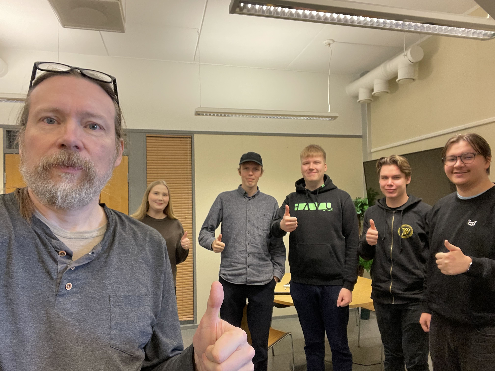
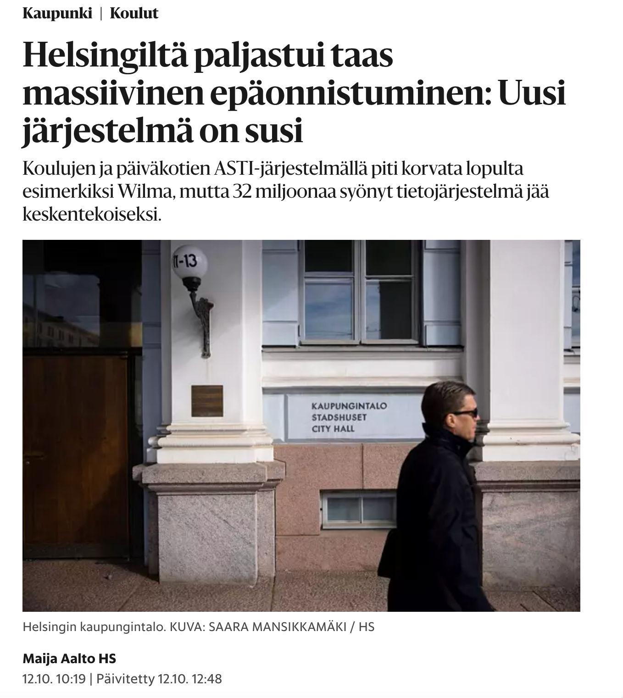
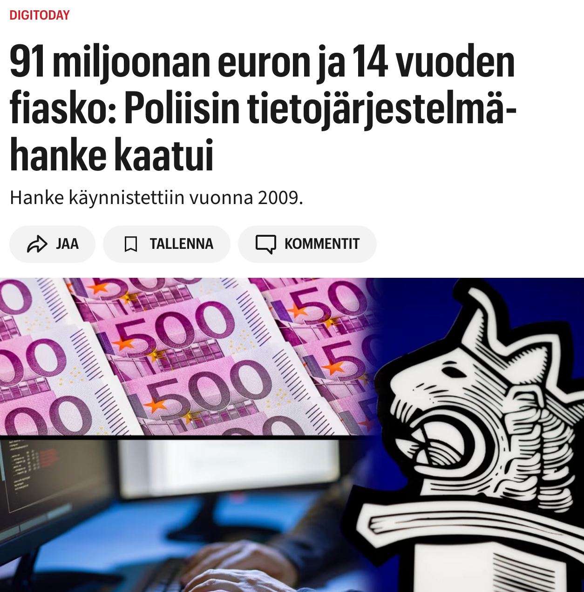
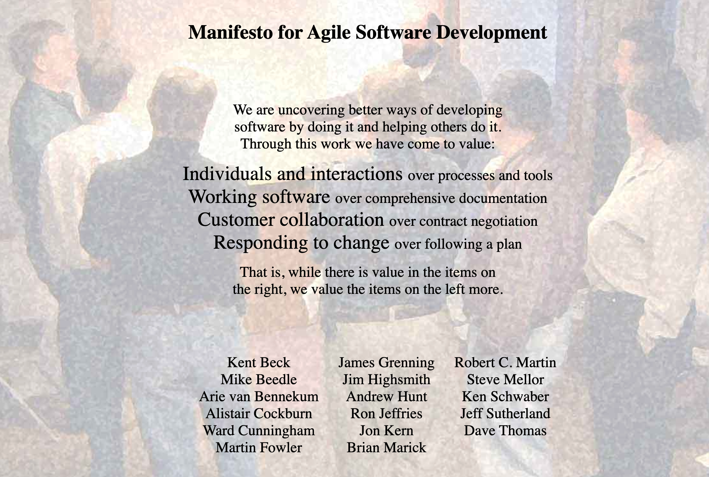

# Ohjelmistotuotanto

&nbsp;&nbsp;&nbsp;&nbsp;&nbsp;&nbsp;&nbsp;&nbsp;&nbsp;&nbsp;&nbsp;&nbsp;&nbsp;&nbsp;&nbsp;&nbsp;&nbsp;&nbsp;&nbsp;&nbsp;&nbsp;&nbsp;&nbsp;&nbsp;&nbsp;&nbsp;&nbsp;&nbsp;&nbsp;&nbsp;&nbsp;&nbsp;&nbsp;&nbsp;&nbsp;Syksy 2026

&nbsp;&nbsp;&nbsp;&nbsp;&nbsp;&nbsp;&nbsp;&nbsp;&nbsp;&nbsp;&nbsp;&nbsp;&nbsp;&nbsp;&nbsp;&nbsp;&nbsp;&nbsp;&nbsp;&nbsp;&nbsp;&nbsp;&nbsp;&nbsp;&nbsp;&nbsp;&nbsp;&nbsp;&nbsp;&nbsp;&nbsp;&nbsp;&nbsp;&nbsp;&nbsp;&nbsp;&nbsp;Luento 1

&nbsp;&nbsp;&nbsp;&nbsp;&nbsp;&nbsp;&nbsp;&nbsp;&nbsp;&nbsp;&nbsp;&nbsp;&nbsp;&nbsp;&nbsp;&nbsp;&nbsp;&nbsp;&nbsp;&nbsp;&nbsp;&nbsp;&nbsp;&nbsp;&nbsp;&nbsp;&nbsp;&nbsp;&nbsp;&nbsp;&nbsp;&nbsp;&nbsp;&nbsp;&nbsp;&nbsp;26.10.2026

# Ohjelmistotuotanto

Luennot:

- Matti Luukkainen 
- Kurssin lopun vierailijat

Ohjaajat: 

- Eemil Aarnio
- Matias Jerkkola
- Aleksanteri Perkkiö
- Bryn Sloan
- Tiina Vilkko

Pajaohjaajat:

- Jasse
- Vera

# Team Ohtu

# Ohjelmistotuotanto

&nbsp;&nbsp;&nbsp;&nbsp;&nbsp;&nbsp;&nbsp;&nbsp;&nbsp;&nbsp;&nbsp;&nbsp;&nbsp;&nbsp;&nbsp;&nbsp;&nbsp;&nbsp;&nbsp;&nbsp;&nbsp;&nbsp;&nbsp;&nbsp;&nbsp;&nbsp;&nbsp;&nbsp;&nbsp;&nbsp;&nbsp;&nbsp;&nbsp;&nbsp;&nbsp;&nbsp;&nbsp;&nbsp;&nbsp;?

# Ohjelmistotuotanto

Johdanto _ohjelmistotuotantoon_ (engl. software engineering), eli systemaattiseen tapaan tehdä hieman laajempia ohjelmistoja useamman hengen tiimissä ulkoiselle asiakkaalle

. . .

Erityinen paino ns. ketterissä (engl. agile) ohjelmistotuotantomenetelmissä

# Kurssin oppimistavoitteet

Valmiudet toimia _juniorikehittäjänä_ pienessä tiimissä, esim. _ohjelmistoprojektissa_ TKT20007

. . .

Suoritettuaan kurssin opiskelija

- tuntee ohjelmistoprosessin vaiheet

. . .

- tietää miten vaatimuksia hallitaan ketterässä kehityksessä

. . .

- ymmärtää suunnittelun, toteutuksen ja testauksen roolin ketterässä kehityksessä

. . .

- tunnistaa tiimityöskentelyn merkityksen ja tuntee keinoja tukea sitä ketterässä tiimissä

. . .

- ymmärtää laadunhallinnan perusteet

. . .

- osaa tehdä kehityksestä hallittua ja toistettavaa: versionhallinta, automatisoitu testaus, jatkuva integraatio

. . .

- osaa hyödyntää tekoälyä hallitusti sovelluskehityksessä

# Esitietovaatimukset

- Tietokannat ja Web-ohjelmointi tai vastaavat tiedot

. . .

- Vanhalta nimeltään _Aineopintojen harjoitustyö: tietokantasovellus_

. . .

- ja näiden esitiedot: Ohpe, Ohja, Tikape

- hyötyä jos Ohte ja Lapio

# Kurssin rakenne

- Luennot
  - ma ja ti 12-14
  - Ohjelmistotuotantoon liittyvää käsitteistöä ja teoriaa
  - Vierailuluennot (viimeisillä viikoilla)

. . .

- Laskarit

  - teoriaa kertaavat _monivalintatehtävät_, deadline su 23.59
  - ohjelmointia, versionhallintaa, automatisoitua testaamista ja tekoälyn hyödyntämistä käsittelevät, deadline _maanantaina klo 23.59_
    - viikon 7 deadline poikkeaa

  . . .

  - oletettu kuormittavuus: viikoilla 1–2 noin 8 tuntia, viikolla 3 noin 6 tuntia, viikoilla 4–6 noin 4 tuntia ja viikolla 7 noin 6 tuntia
  - monivalintoihin vastaaminen nopeaa, jos...

. . .

- Miniprojekti
  - alkaa kurssin 3. viikolla
  - yhdistää teorian ja käytännön

# Miniprojekti

- kurssin viikoilla 3–7
- ryhmätyö: koodataan hiukan, harjoitellaan projektinhallintaa, tiimityöskentelyä sekä eräitä laadunhallintatekniikoita

. . .

- ryhmässä 4–6 opiskelijaa, ryhmillä on myös asiakas, jota tavataan viikoittain
- ensimmäisellä viikolla asiakastapaamiseen tulee varata 90 minuuttia, myöhemmillä viikoilla 30 minuuttia
- kurssin lopussa on miniprojektien yhteinen kahden tunnin mittainen demotilaisuus

. . .

- miniprojekteissa työskentelyyn tulee varata aikaa noin 6 tuntia viikossa

. . .

- tekoälyä hyödynnetään hallitusti myös miniprojektissa: ryhmä sopii yhteiset pelisäännöt ja vastaa koodin laadusta

. . .

_Kurssin läpäisyn edellytyksenä_ on hyväksytysti suoritettu tai hyväksiluettu miniprojekti

# Miniprojektit

- Käynnistyvät 9.11. alkavalla viikolla

- **Ilmoittautumisen deadline torstai 5.11. klo 23.59**

- Aloitustilaisuudet
  - ma 9.11. klo 14–16 C220
  - ti 10.11. klo 14–16 D122
  - ke 11.11. klo 16–18 C220
  - to 12.11. klo 10–12 BK114
  - to 12.11. klo 14–16 B222

. . .

- Seuraavat viikot: sprinttien katselmointi ja suunnittelu samassa aikaikkunassa

- Loppudemot
  - ti 8.12. klo 14–16 B123
  - ke 9.12. klo 10–12 B123

# Miniprojektin hyväksilukeminen

Vähintään kolmen kuukauden työkokemus tiimityönä tehtävästä ohjelmistokehityksestä

Lähetä **sähköpostia** sen jälkeen, kun olet palauttanut viikon 1 tehtävät

# Kurssin arvostelu

Jaossa yhteensä 40 pistettä

- laskarit 10 pistettä
  - monivalintatehtävät 2 pistettä
  - viikoittaiset ohjelmointi/versionhallinta/konfigurointitehtävät 8 pistettä
- miniprojekti 11 pistettä
- koe 18 pistettä
- osallistuminen vierailuluennoille 1 piste (0,33 pistettä per luentokerta, täydet pisteet kolmesta kerrasta)

. . .

Arvosanaan 1 riittää 20 pistettä, arvosanaan 5 tarvitaan 36 pistettä.

Läpipääsy edellyttää lisäksi miniprojektin hyväksyttyä suoritusta (tai hyväksilukua) ja vähintään puolet kokeen pisteistä

# Luennot - laskarit - miniprojekti

**Luennoilla** ohjelmistokehityksen teoriaa ja käsitteistöä

- laskarien _monivalintatehtävät_ liittyvät kunkin viikon luentoihin

. . .

**teknisempien laskarien** aihepiirejä ei paljoa käsitellä luennoilla

. . .

**Miniprojekti** yhdistää luentojen teorian ja laskareissa käsitellyt teknisemmät asiat, ja soveltaa niitä käytännössä

. . .

**Kokeessa** suurin painoarvo teoriassa ja sen soveltamisessa käytäntöön

- laskareiden teknisimpiä asioita ei kokeessa kysytä
- tarkemmin kokeesta kurssin viimeisellä luennolla

# Versionhallinta 1 op

Saat suoritusmerkinnän tekemällä kaikki kurssin versionhallintatehtävät ja suorittamalla hyväksytysti miniprojektin (tai hyväksilukemalla sen)

# Kurssimateriaali

https://studies.cs.helsinki.fi/ohtu/

# Kurssipalaute

. . .

- Kurssipalaute
  - Kurssin lopussa kerättävän palautteen lisäksi ns. jatkuva palaute https://norppa.helsinki.fi

. . .

- Kurssipalaute **vaikuttaa**
- Edellisen kurssin palautteen "moitteita"
  - miniprojektien ryhmäjako: toiveena vaikutusmahdollisuus, aikataulujen ja tavoitteiden huomiointi
    - jako on edelleen satunnainen, mutta aikataulut pyritään huomioimaan paremmin
  - kurssisivun selkeys ja navigoitavuus: parannettu
  - riippuvuus GitHub Educationista: säilyy, sillä AI-agentteja vaativat tehtävät lisääntyvät
    - rinnalle tulossa vaihtoehto
  - monivalintojen satunnaisuus: luovuttu, monivalinnat helpompi tehdä materiaalia seuratessa

# Monivalintojen korvaaminen luentopäiväkirjalla

. . .

- Kurssin viikoilla 1–5 viikon luentoja kertaavat monivalinnat (2/40 kurssin pisteistä)

. . . 

- Monivalinnat herättäneet tunteita, en ole itsekään niiden fani
- Hyödyt ovat kiistattomat, kokeet menevät nykyään paremmin kuin monivalintoja edeltävänä aikana
  - linjassa ns. testausvaikutuksen (testing effect) kanssa: asioiden mieleen palauttaminen tehostaa oppimista enemmän kuin uudelleenlukeminen

. . .

- Tarjolla vaihtoehto: **viikoittainen luentopäiväkirja**
- Noin A4:n kokoinen omin sanoin tehty yhteenveto viikon luentojen asioista
  - voi olla tehty käsin, joko tekstiä, lista ranskalaisia viivoja tai esim. mind map
  - ei kuitenkaan missään tapauksessa plagiaatti tai tekoälyllä generoitu 

. . .

- Deadline kunkin viikon sunnuntai klo 23.59, lähetetään sähköpostitse matti.luukkainen@helsinki.fi 

# Tekoälyn käyttö

- Sallittua

. . .

- Jokaisella vastuu omasta oppimisesta

. . .

- "pakollista": noin 10 tehtävää liittyen tekoälyn käyttöön

. . .

- Kokeessa mahdotonta (koe kynällä ja paperilla)

# Paja ja Discord

- Apua tehtäviin pajassa BK107
  - ma 16-19
  - ti 13-16
  - to 16-19
  - pe 13-16

. . .

- Kurssin Discord: https://study.cs.helsinki.fi/discord/join/ohtu
  - kanavalle liitytään komennolla _/join course TKT20006 - Ohjelmistotuotanto - ohtu_
  - apua tehtäviin ja kurssiin liittyvää keskustelua

# Ohjelmistotuotanto engl. software engineering

. . .

The IEEE Computer Society määritelmän mukaan

- _Systemaattisen, kurinalaisen ja mitattavissa olevan lähestymistavan soveltaminen ohjelmistojen kehittämiseen, käyttöön ja ylläpitoon, eli "insinöörityön" soveltaminen ohjelmistoihin_

. . .

Alun perin IEEE:n terminologiastandardista , käytössä myös _SWEBOK_:issa eli _Guide to the Software Engineering Body of Knowledge_:ssa

- ison komitean yritys määritellä mitä ohjelmistotuotannolla tarkoitetaan ja mitä osa-alueita siihen kuuluu
- uusin versio 4 ilmestyi vuonna 2024

# Ohjelmistotuotannon osa-alueet SWEBOK:in mukaan

- Software requirements eli **vaatimusmäärittely**
- Software design eli **suunnittelu**
- Software construction eli **toteutus/ohjelmointi**
- Software testing eli **testaus**
- Software maintenance eli **ylläpito**

. . .

- Configuration management eli **konfiguraatiot**
- Models and methods eli **mallit ja menetelmät**
- Software quality eli **laadunhallinta**
- Software engineering process eli **ohjelmistotuotantoprosessi**
- Software engineering management eli **projektien johtaminen**

. . .

- Software architecture eli **arkkitehtuuri**
- Software engineering operations eli **operointi tuotannossa**
- Software security eli **tietoturva**
- Software engineering economics eli **talous**
- Professional practice  **ammattietiikka ja ryhmädynamiikka**

# Ohjelmiston elinkaari (software lifecycle)

Tehtiinpä ohjelmisto millä tavalla tahansa, se käy läpi samat _vaiheet_

- Vaatimusten analysointi ja määrittely
- Suunnittelu
- Toteutus
- Testaus
- Ylläpito ja jatkokehitys

. . .

Nämä vaiheet muodostavat ohjelmiston _elinkaaren_

. . .

**Ohjelmistotuotantoprosessi** määrittelee, missä järjestyksessä ja miten vaiheet toteutetaan

- peräkkäin vai limittäin, kerran vai toistuvasti

. . .

Vaiheisiin palataan tarkemmin myöhemmin kurssilla

# Alussa (ja osin edelleen) code'n'fix

Historian alkuaikoina laitteet maksoivat paljon, ohjelmat olivat laitteistoihin nähden "triviaaleja"

- ohjelmointi konekielellä
- sovelluksen käyttäjä ohjelmoi itse ohjelmansa

. . .

Vähitellen ohjelmistot alkavat kasvaa ja kehitettiin korkeamman tason ohjelmointikieliä (Fortran, Cobol, Algol)

- sovellusalue laajenee monille elämänaloille

. . .

Pikkuhiljaa homma alkaa karata käsistä:

- budjetit ylittyivät ja projektit myöhästyivät aikatauluista
- ohjelmistot olivat tehottomia, niiden laatu oli huono ja ne eivät toimineet käyttäjien tarpeiden mukaan
- koodin ylläpito ja laajentaminen oli vaikeaa
- usein ohjelmistoja ei hyvistä aikeista huolimatta saatu ollenkaan toimitettua

# Ohjelmistokriisi

Termi Software crisis lanseerataan lokakuussa 1968 NATO:n konferenssissa

- In essence, it refers to the difficulty of writing correct, understandable, and verifiable computer programs.

. . .

Edsger Dijkstra:

- **as long as there were no machines, programming was no problem at all**

. . .

- when we had a few weak computers, programming became a mild problem

. . .

- **now we have gigantic computers, programming has become an equally gigantic problem**.

# Kriisi ei ole ohi (syksy 2023)

{ width=400 }

# 

{ width=400 }

# Software development as Engineering {.t}

Termi **software engineering** nousee laajaan tietoisuuteen 1968 NATO:n konferenssissa. Fritz Bauerin määritelmä:

- _The establishment and use of sound engineering principles in order to obtain economically software that is reliable and works efficiently on real machines_

# Software development as Engineering {.t}

Termi **software engineering** nousee laajaan tietoisuuteen 1968 NATO:n konferenssissa. Fritz Bauerin määritelmä:

- Vakiintuneiden insinööriperiaatteiden käyttöönotto ja soveltaminen, jotta saadaan taloudellisesti tuotettua ohjelmistoja, jotka ovat luotettavia ja toimivat tehokkaasti todellisilla koneilla

  . . .

Ajatus siitä, että ohjelmistojen tekemisen tulisi olla kuin mikä tahansa muu insinöörityö

- ensin rakennettava artefakti _määritellään_ (requirements)
- ja _suunnitellaan_ (design) aukottomasti
- tämän jälkeen _rakentaminen_ (construction) on melko suoraviivainen vaihe

# Vesiputousmalli

Winston W. Royce: Managing the Development of Large Software Systems, 1970

Sivulla 2 Royce esittelee yksinkertaisen prosessimallin, jossa elinkaaren vaiheet suoritetaan lineaarisesti peräkkäin:

{ width=440 }

# Vesiputousmalli Roycen artikkelista

{ width=440 }

# Vesiputousmallin suosion taustaa

Vesiputousmalli saavutti nopeasti suosiota

Yhdysvaltain puolustusministeriö rupesi vaatimaan kaikilta alihankkijoiltaan vesiputousmallin noudattamista

- Standardit DOD-STD-2167 (1985) ja DOD-STD-2167A (1988)

. . .

Muutkin ohjelmistoja tuottaneet tahot ajattelivat, että koska DoD vaatii vesiputousmallia, tapa kannattaa omaksua itselleen

# Vesiputousmallin oletuksia

Vesiputousmalli perustuu vahvasti siihen, että _eri vaiheet ovat erillisten tuotantotiimien tekemiä_

- Tämän takia kunkin vaiheen tulokset _dokumentoidaan tarkoin_

. . .

_Vaiheet tehdään peräkkäin_

- esim. tekninen suunnittelu aloitetaan kun vaatimusmäärittely on valmis

. . .

Vesiputousmallin mukainen ohjelmistoprosessi on yleensä etukäteen _tarkkaan suunniteltu, resursoitu ja aikataulutettu_

. . .

**Vesiputousmallin mukainen ohjelmistotuotanto ei ole osoittautunut erityisen onnistuneeksi**

# Vesiputousmallin ongelmia

Asiakkaan _vaatimukset muuttuvat_ usein matkan varrella:

- Asiakas ei tiedä tai osaa sanoa mitä haluaa/tarvitsee
- Asiakkaan tarve muuttuu projektin kuluessa
- Asiakas alkaa haluta muutoksia kun näkee lopputuotteen

. . .

Vaatimusmäärittelyn, suunnittelun ja toteutuksen erottaminen ei järkevää

- Ohjelmaa on mahdotonta suunnitella siten, että toteutus on suoraviivaista
- Toteutusteknologiat vaikuttavat suuresti määriteltyjen ominaisuuksien hintaan
- Osa suunnittelusta tapahtuu pakosti vasta ohjelmoitaessa

. . .

_Lopuksi tapahtuva laadunhallinta_ paljastaa ongelmat liian myöhään

- Korjaukset mahdollisesti kalliita: voi paljastua ongelmia jotka pakottavat muuttamaan ohjelmiston vaatimuksia

# Vesiputous oli väärinymmärrys

Paradoksaalista kyllä vesiputousmallin isänä pidetty Royce **ei suosittele** artikkelissaan suoraviivaisen lineaarisen mallin käyttöä

. . .

Royce esittelee lineaarisen vesiputousmallin **sivulla 2**, mutta toteaa että se **ei sovellu** monimutkaisiin ohjelmistoprojekteihin

. . .

Roycen mukaan 

- ensin tulee tehdä prototyyppi
- ja siitä saatujen kokemusten valossa suunnitellaan ja toteutetaan lopullinen ohjelmisto

# Roycen kahden iteraation malli

{ width=400 }

# Iteratiivinen ohjelmistokehitys

Vesiputousmallin ongelmiin reagoinut _iteratiivinen_ tapa tehdä ohjelmistoja alkoi yleistyä 80- ja 90-luvuilla

- mm. spiraalimalli, prototyyppimalli, Rational Unified Process

. . .

Iteratiivisessa ohjelmistokehityksessä

- ohjelmistotuotanto jaetaan jaksoihin, eli _iteraatioihin_
- jokaisen iteraation aikana määritellään, suunnitellaan, toteutetaan ja testataan ohjelmistoa
- eli ohjelmisto kehittyy vähitellen (inkrementaalisesti)

# Iteratiivinen ohjelmistokehitys

{ width=400 }

. . .

- asiakasta tavataan jokaisen iteraation välissä
- asiakas näkee sen hetkisen version ohjelmasta ja pystyy vaikuttamaan seuraavien iteraatioiden kulkuun

# Iteratiivinen ohjelmistokehitys ei ole uusi keksintö

Yhdysvaltojen puolustusministeriön vuonna 2000 julkaisema hankintaohje alkaa suositella iteratiivista ohjelmistoprosessia:

- There are two approaches, evolutionary (_iterative_) and single step (_waterfall_), to full capability. An _evolutionary approach is preferred_...

. . .

Iteratiivinen ohjelmistokehitys on paljon vanhempi idea kuin vesiputousmalli

- esim. NASA:n ensimmäisen amerikkalaisen avaruuteen vieneen Project Mercuryn ohjelmisto kehitettiin 50- ja 60-lukujen taitteessa iteratiivisesti
- avaruussukkuloiden ohjelmisto tehtiin vesiputousmallin valtakaudella, mutta iteratiivisesti
  - 8 viikon iteraatioissa, 31 kuukaudessa

. . .

Roycen artikkelikin (vuonna 1970) ehdotti _kahden iteraation_ menetelmää ohjelmistojen tekemiseen

#  Ketterien menetelmien synty...

Perinteisissä prosessimalleissa korostettiin

- huolellista projektisuunnittelua
- tarkkaa dokumentaatiota
- yksityiskohtaisia analyysi- ja suunnittelumenetelmiä
- täsmällistä, tarkasti ohjattua ohjelmistoprosessia

. . .

_Tukivat erityisesti laajojen, pitkäikäisten ohjelmistojen kehitystyötä_

- pienten ja keskisuurten ohjelmistojen tekoon turhan jäykkiä

. . .

Pyrittiin työtä tekevän yksilön merkityksen minimoimiseen

- yksilö on "tehdastyöläinen", joka voidaan helposti korvata toisella ja tällä ei ole ohjelmiston kehittämiseen vaikutusta

# Ketterien menetelmien synty

Ristiriita/turhauma synnytti joukon **ketteriä prosessimalleja** (agile)

- korostivat itse ohjelmistoa sekä ohjelmiston asiakkaan ja toteuttajien merkitystä yksityiskohtaisen suunnittelun ja dokumentaation sijaan

. . .

- Useita samanhenkisiä menetelmiä 90-luvun loppupuolelta lähtien

# Ketterä manifesti 2001

. . .

{ width=400 }

# Ketterä manifesti 2001

Etsimme parempia tapoja tehdä ohjelmistokehitystä, kun teemme sitä itse ja autamme muita siinä.

. . .

Kokemuksemme perusteella arvostamme:

- **Yksilöitä ja kanssakäymistä** enemmän kuin menetelmiä ja työkaluja
- **Toimivaa ohjelmistoa** enemmän kuin kattavaa dokumentaatiota
- **Asiakasyhteistyötä** enemmän kuin sopimusneuvotteluja
- **Vastaamista muutokseen** enemmän kuin pitäytymistä suunnitelmassa

. . .

Jälkimmäisilläkin asioilla on arvoa, mutta arvostamme ensiksi mainittuja enemmän

. . .

Manifestin laativat ja allekirjoittivat 17 ketterien menetelmien varhaista pioneeria, mm. Kent Beck, Robert Martin, Ken Schwaber ja Martin Fowler

# Ketterät periaatteet, osa 1

. . .

Tärkeimpänä tavoitteenamme on täyttää asiakkaan toiveet **toimittamalla arvokasta ohjelmistoa jo varhaisessa vaiheessa ja jatkuvasti**

. . .

**Toimitamme toimivaa ohjelmistoa säännöllisesti**, parin viikon tai kuukauden välein, mieluummin lyhyemmällä aikavälillä

. . .

Liiketoiminnan edustajien ja kehittäjien tulee **työskennellä yhdessä päivittäin** koko projektin ajan

. . .

Tehokkain ja toimivin tapa välittää tietoa kehitystiimille ja tiimin sisällä on **kasvokkain** käytävä keskustelu

. . .

**Otamme muuttuvat vaatimukset vastaan** myös kehityksen loppuvaiheessa. Ketterät menetelmät valjastavat muutoksen asiakkaan kilpailueduksi

# Ketterät periaatteet, osa 2

Rakennamme projektit motivoituneiden yksilöiden ympärille. Annamme heille ympäristön ja tuen, jota he tarvitsevat, ja **luotamme siihen, että he saavat työn tehtyä**

. . .

Parhaat arkkitehtuurit, vaatimukset ja suunnitelmat syntyvät **itseorganisoituvissa tiimeissä**

. . .

Tiimi **tarkastelee säännöllisin väliajoin, kuinka toimia tehokkaammin**, ja mukauttaa toimintaansa sen mukaisesti

. . .

**Yksinkertaisuus** – tekemättä jätettävän työn maksimointi – on olennaista

. . .

Jatkuva huomio **tekniseen laatuun ja hyvään suunnitteluun** edistää ketteryyttä

. . .

Ketterät menetelmät edistävät **kestävää kehitystä**. Rahoittajien, kehittäjien ja käyttäjien tulisi pystyä ylläpitämään tasainen työtahti loputtomiin

# Ketterät menetelmät

Sateenvarjotermi useille ketterille prosessimalleille

- Näistä tunnetuimpia Scrum ja eXtreme programming eli XP
- Molempiin, erityisesti Scrumiin tutustutaan kurssin aikana

. . .

Ketterä ohjelmistotuotanto on ottanut vaikutteita myös Toyota production systemin taustalla olevasta _lean-ajattelusta_

Leanista peräisin olevia menetelmiä

- Kanban
- Scrumban (Scrumin ja Kanbanin yhdistelmä)

. . .

- sekä laajan mittakaavan leaniin ja ketterään kehitykseen tarkoitettuja menetelmiä kuten SAFe ja LeSS

Myös nämä kuuluvat kurssin aihepiiriin

# Viikon 1 laskarit

. . .

Ohjelmistokehityksen käytännön työkaluja

- Versionhallinta: Git
- Automatisoitu testaus: Unittest
- Projektin riippuvuuksienhallinta ja "buildaus": uv
- CI- ja build-palvelinohjelmisto: GitHub Actions

Tavoitteena mahdollistaa hallittu ja toistettavissa oleva ohjelmistokehitys

. . .

_Deadline maanantaina klo 23.59_

# Generatiivinen tekoäly

- Loppuuko ohjelmistokehitys? 

. . .

- Tuskin, mutta se muuttuu

. . .

- Opettele perusteet syvällisesti
  - ihmistä tarvitaan näyttämään suunta: mitä asiakas oikeasti tarvitsee
  - agentti pystyy jo laajoihin kokonaisuuksiin, mutta vastuu kokonaisuudesta jää ihmiselle: arkkitehtuuri, rakenne ja ylläpidettävyys

. . .

- Agentit: esim. Claude Code, Copilotin Agent-tila, Cursor

. . .

- Tekoäly toimii _vahvistimena_ (DORA 2025): parantaa hyvin toimivia tiimejä, pahentaa heikosti toimivien ongelmia

. . .

- Suosittelen hyödyntämään kunhan vaan tietää mitä tekee
  - Vibe coding vs. agentic engineering
  - Tarkemmin: materiaali [Tekoäly ohjelmistotuotannossa](https://ohjelmistotuotanto-hy.github.io/genai/)
