# Ohjelmistotuotanto

&nbsp;&nbsp;&nbsp;&nbsp;&nbsp;&nbsp;&nbsp;&nbsp;&nbsp;&nbsp;&nbsp;&nbsp;&nbsp;&nbsp;&nbsp;&nbsp;&nbsp;&nbsp;&nbsp;&nbsp;&nbsp;&nbsp;&nbsp;&nbsp;&nbsp;&nbsp;&nbsp;&nbsp;&nbsp;&nbsp;&nbsp;&nbsp;&nbsp;&nbsp;&nbsp;Syksy 2026

&nbsp;&nbsp;&nbsp;&nbsp;&nbsp;&nbsp;&nbsp;&nbsp;&nbsp;&nbsp;&nbsp;&nbsp;&nbsp;&nbsp;&nbsp;&nbsp;&nbsp;&nbsp;&nbsp;&nbsp;&nbsp;&nbsp;&nbsp;&nbsp;&nbsp;&nbsp;&nbsp;&nbsp;&nbsp;&nbsp;&nbsp;&nbsp;&nbsp;&nbsp;&nbsp;&nbsp;&nbsp;Luento 10

&nbsp;&nbsp;&nbsp;&nbsp;&nbsp;&nbsp;&nbsp;&nbsp;&nbsp;&nbsp;&nbsp;&nbsp;&nbsp;&nbsp;&nbsp;&nbsp;&nbsp;&nbsp;&nbsp;&nbsp;&nbsp;&nbsp;&nbsp;&nbsp;&nbsp;&nbsp;&nbsp;&nbsp;&nbsp;&nbsp;&nbsp;&nbsp;&nbsp;&nbsp;&nbsp;&nbsp;30.11.2026

# Muistakaa...

. . .

- Kurssipalaute
  - Kurssilla lopussa kerättävän palautteen lisäksi ns. jatkuva palaute https://norppa.helsinki.fi

. . .

- Paja BK107
  - ma 16-19
  - ti 13-16
  - to 16-19
  - pe 13-16

- Kurssin Discord: https://study.cs.helsinki.fi/discord/join/ohtu
  - kanavalle liitytään komennolla _/join course TKT20006 - Ohjelmistotuotanto - ohtu_

. . .

- CurreChat
  - https://curre.helsinki.fi/chat
  - Keskusteluja ei käytetä koulutusdatana
  - Kurssimateriaalichat

# Kurssin viimeiset viikot

- Miniprojektit jatkuvat
  - tällä viikolla viimeinen asiakastapaaminen, ensi viikolla loppudemot

. . .

- Loppudemot (jokainen ryhmä osallistuu toiseen demoista)
  - ti 8.12. klo 14–16 B123
  - ke 9.12. klo 10–12 B123

. . .

- Vierailuluennot (läsnäolosta 0.33 kurssipistettä per kerta)
  - ti 1.12. Ville Nordberg, Trail openers ja Irene Nikkarinen, Kesko
  - ma 7.12. Olli Warro, Bought ja Matti Paksula, Donut Lab
  - ti 8.12. Kasper Hirvikoski sekä Aleksandr Tereshchenko ja Risto Mikkola, Unity

. . .

- Kurssikoe tiistaina 15.12. klo 13-16 A111 ja B123 (kynällä ja paperilla)
  - ILMOITTAUDU viimeistään la 5.12. klo 23.59!

# Laajan mittakaavan ketterä

. . .

- Ketterä tarkoitettu alunperin pienten tiimien hallintaan
  - Scrum-tiimi: korkeintaan 10 henkeä (Scrum Guide 2020)
  - Entä jos on kyseessä iso ohjelmisto?

. . .

- Perusperiaate pitää **tiimit pieninä**, ja kasvattaa tuotantokapasiteettia käyttämällä **useampia tiimejä**
  - Tämä edellyttää tiimien välistä töiden koordinointia 

. . .

- Jo kauan käytetty tapa: _Scrum of Scrums_ 
  - koordinoiva tiimi, johon kuuluu jäseniä jokaisesta Scrum-tiimistä
  - esim. scrum master tai lead developer osallistuu

. . .

- Scrum of Scrums -tiimi voi tavata päivittäin/viikoittain

# Scrum of Scrums 
 
- Scrum of Scrums -periaate on jo hyvin vanha
  - Jeff Sutherland  1996 

. . .

- Firmassa satoja sovelluskehittäjiä, kymmeniä Scrum-tiimejä ja useita eri tuotteita
  - Jokaisen tuotteen tiimejä koordinoi kerran viikossa kokoontuva Scrum of Scrums 

. . .

- Koko tuotejoukkoa hallinnoi kuukausittain kokoontuva "management Scrum"
  - koostui yrityksen johdosta, tuotepäälliköistä ja johtavista ohjelmistoarkkitehdeistä

. . .

- Kuvaus ei ole kovin seikkaperäinen
  - miten esim. backlogien suhteen tulisi toimia?

# Laajan mittakaavan ketterä

- 2010-luvulta alkaen ketterän skaalaamiseen esitelty useita menetelmiä, esim.
  - Scaled Agile Framework eli SAFe
  - Large Scale Scrum eli LeSS
  - Disciplined Agile eli DA
  - Scrum@Scale

. . .

- Laajentavat ketteryyttä ottamalla mukaan lean-ajattelua

. . .

- Toisin kuin ketterä, lean on lähtökohtaisesti tarkoitettu toimimaan suuressa skaalassa
  - sisältää enemmän koko organisaation toimintaa ohjaavia periaatteita kuin perinteinen ketterä

# Laajan mittakaavan ketterä

- 2010-luvulta alkaen ketterän skaalaamiseen esitelty useita menetelmiä, esim.
  - **Scaled Agile Framework eli SAFe**
  - **Large Scale Scrum eli LeSS**
  - Disciplined Agile eli DA
  - Scrum@Scale

- Laajentavat ketteryyttä ottamalla mukaan lean-ajattelua

- Toisin kuin ketterä, lean on lähtökohtaisesti tarkoitettu toimimaan suuressa skaalassa
  - sisältää enemmän koko organisaation toimintaa ohjaavia periaatteita kuin perinteinen ketterä

# Skaalauskehykset tutkimuksen valossa

- Systemaattinen kirjallisuuskatsaus (Edison ym. 2022, IEEE TSE)
  - tutkimus keskittynyt kaupallisten kehysten käytänteisiin, taustaperiaatteet jääneet vähälle
  - vertailussa myös itse räätälöidyt mallit, esim. Nokia ja Ericsson

# SAFe eli Scaled Agile Framework

. . .

- Pääasiallinen kehittäjä on Dean Leffingwell, joka toimi Nokia Mobile Phonesissa (NMP) konsulttina 2000-luvulla
  - SAFe on syntynyt pitkälti Nokialla tehdyn työn pohjalta
  - NMP:lla olikin käytössä eräänlainen esiversio SAFe:sta

. . .

- SAFe:n virallinen ensimmäinen versio julkaistiin 2011

. . .

- Yhdistää _kaikki_ viime vuosien ketterän ja leanin parhaat käytänteet sekä joukon tuotteiden hallinnointiperiaatteita

. . .

- SAFe tarjoaa suuren määrän käytänteitä, henkilö- ja tiimirooleja sekä käsitteitä
  - _menetelmäkehys_, yritykset räätälöivät itselleen sopivanlaisen prosessin käyttäen SAFe:n tarjoamia työkaluja

. . .

- Tarjoaa 4 erikokoista valmiiksi räätälöityä konfiguraatiota
  - _Essential SAFe:_ pienemmille yrityksille ja SAFen soveltamisen alkuvaiheeseen
  - _Full SAFe:_ massiivisten, useita tuotteita hallitsevien yritysten käyttöön

#

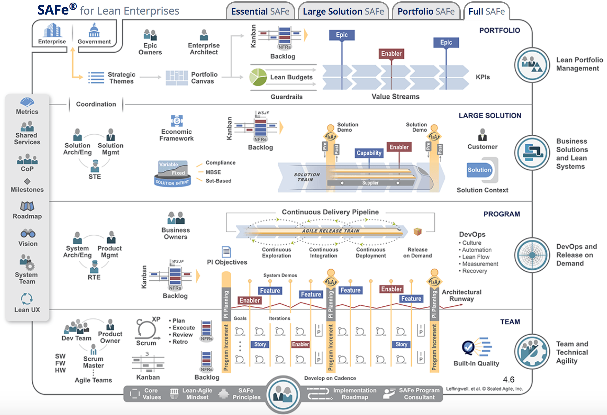{ width=450 }

#

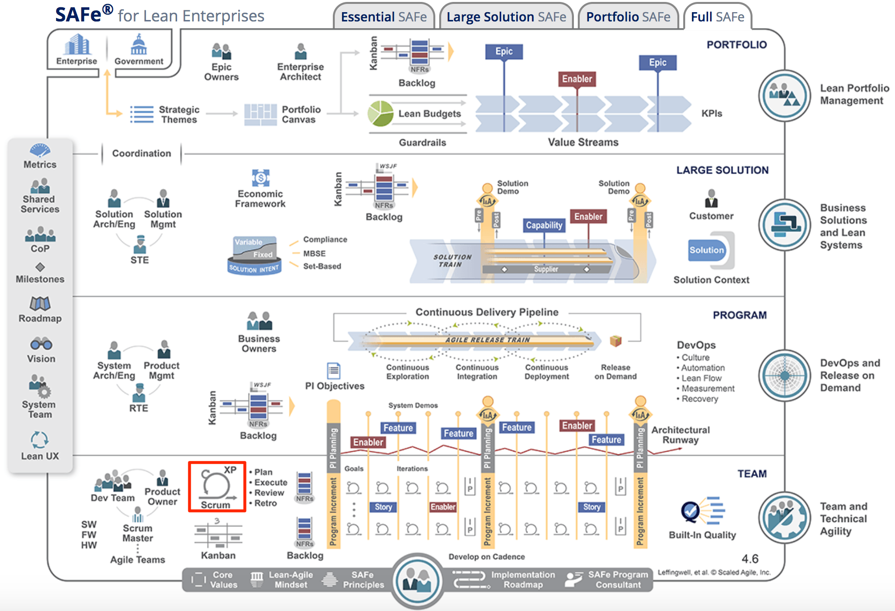{ width=450 }

# Agile release train ja planning interval

- Sovelluskehityksen ytimessä modifioitu Scrum

. . .

- Samaa tuotetta tekevät tiimit muodostavat _toimitusjunan_ (agile release train, ART)
  - tuottavat yhdessä isompia kokonaisuuksia useammasta sprintistä koostuvan _planning interval_ (PI) -jakson aikana (aiemmin _program increment_)

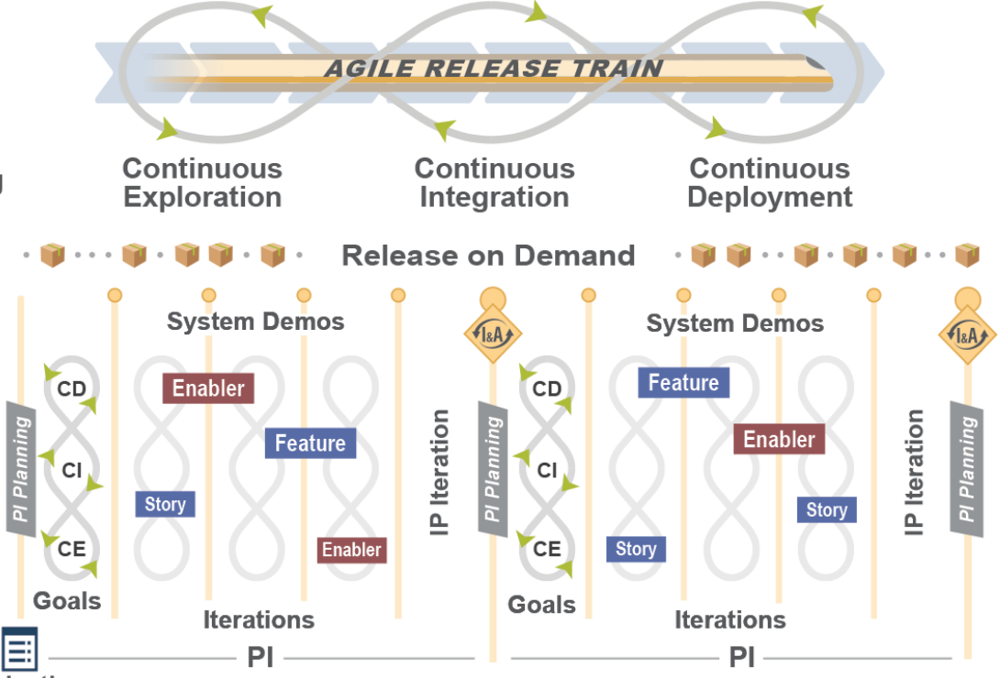{ width=250 }

# SAFe

- Planning intervaleja ja release traineja taas ohjaillaan yhä korkeammalta organisaatiosta erilaisten johtajien toimesta
  - SAFe tarjoaa tähän paljon tukea käsitteistön ja roolien kautta

# SAFe: paljon rooleja

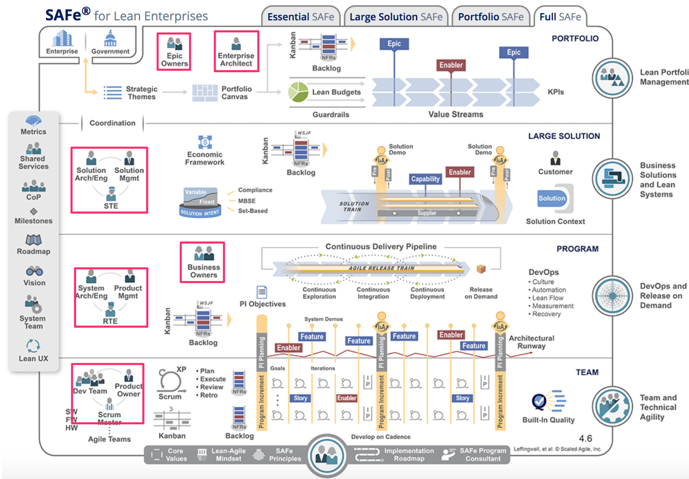{ width=450 }

# SAFe: paljon artefakteja

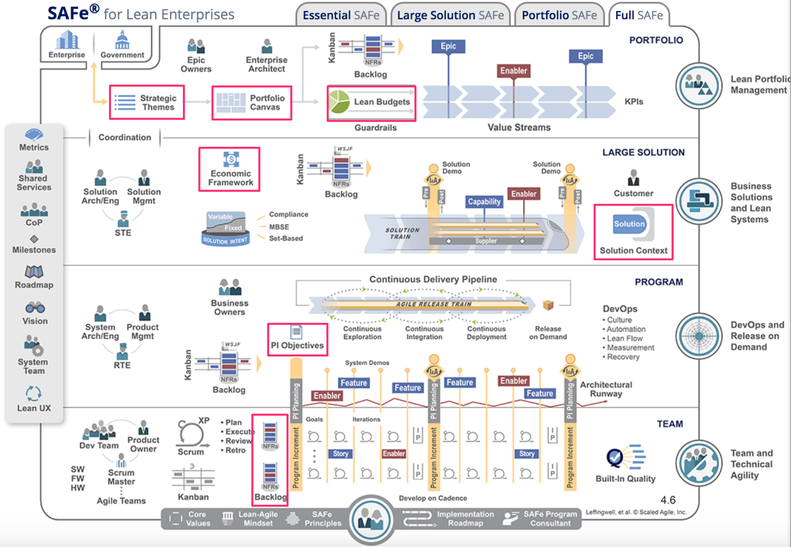{ width=450 }

# SAFe

- Planning intervaleja ja release traineja taas ohjaillaan yhä korkeammalta organisaatiosta erilaisten johtajien toimesta
  - SAFe tarjoaa tähän paljon tukea käsitteistön ja roolien kautta

- SAFe on dokumentoitu laajasti ja tarjoaa tarkat ohjeet SAFen käyttöönottoon ja noudattamiseen

. . .

- SAFe firmojen johdon suosiossa
  - tarjoaakin firman managementille sopivasti tekemistä roolien ja käytänteiden muodossa

# SAFen suosio ja kritiikki

. . .

- SAFe sisältää käytännössä kaikki mahdolliset ketterän ja lean-ohjelmistokehityksen parhaat käytänteet
  - Kaikki vieläpä selkeästi ja yksityiskohtaisesti dokumentoituna

. . .

- SAFe on yleisimmin mainittu skaalauskehys, mutta sen osuus on laskenut
  - yhä useampi ei käytä valmista skaalauskehystä lainkaan

. . .

- SAFe on saanut osakseen myös paljon kritiikkiä
  - Osa kritiikistä kohdistuu SAFen määrittelemän prosessin raskauteen
  - Osa taas SAFe:n top down -management luonteeseen

. . .

- Ken Schwaber on kyseenalaistanut onko SAFe ylipäätään ketterä menetelmä 
  - _Individuals and interactions over processes and tools_
  - SAFe taas prosessina vaikuttaa kovin raskaalta

# LeSS eli Large Scale Scrum

. . .

- LeSS:in taustalla on Craig Larman ja Bas Vodde 
  - konsultteina 2000-luvun alussa Nokia Siemens Networksilla

. . .

- Erittäin yksinkertainen, vahvasti Scrumiin pohjautuva
  - Uusia rooleja, artefakteja ja palavereja ei ole 

. . .

- Kaksi eri versiota
  - _LeSS_ tilanteisiin, missä tuotetta tekee 2-8 scrum-tiimiä
  - _LeSS Huge_ tilanteisiin, missä tiimejä tarvitaan suurempi määrä

# LeSSin perusperiaatteet

- Sekä LeSS että LeSS Huge perustuvat seuraavaan

. . .

- Kehitetään yhtä tuotetta, jolla on yksi product owner ja yksi product backlog

. . .

- Kaikilla tiimeillä on samaan aikaan etenevät sprintit

. . .

- Tiimit tekevät sprintin aikana yhdessä tuotteesta uuden version
  - _one shippable product increment_

. . .

- Featuretiimit 

# LeSSin perusperiaatteet

- Jos yrityksellä on useita tuotteita, niitä kutakin varten on oma LeSS-toteutuksensa
  - LeSS ei ota kantaa siihen miten firma hallinnoi tuoteperheitään

. . .

- LeSS korostaa että kyse *ei ole* Scrumin päälle rakennettu erillinen kerros

. . .

- vaan ideana on soveltaa Scrumin elementtejä laajemmassa skaalassa
  - LeSS is "barely sufficient methodology"

# Vähemmällä enemmän

- Periaatteet ovat lähes samat kuin SAFe:ssa, yksi periaatteista tekee kuitenkin selvää eroa menetelmien välille

. . .

- Emme halua:
  - **Lisää rooleja**, sillä se vähentää tiimien vastuuta
  - **Lisää artefakteja**, sillä se etäännyttää tiimit asiakkaista
  - **Lisää prosesseja**, sillä se vähentää oppimista ja tiimien omistajuutta

. . .

- Sen sijaan haluamme:
  - **Vastuuta ottavia tiimejä** vähentämällä rooleja
  - **Asiakaslähtöisempiä tiimejä** ja hyödyllisempiä tuotteita vähentämällä artefakteja
  - Enemmän tiimien **omistajuutta prosessista** ja mielekkäämpää työtä vähentämällä määriteltyjä prosesseja

. . .

- **Haluamme vähemmällä enemmän** (more with less)

# LeSS

- Katsotaan hieman tarkemmin LeSS:in pienempää konfiguraatiota

. . .

- Roolit
  - yksi product owner
  - 2-8 tiimiä
  - yksi scrum master 1-3 tiimiä kohti

. . .

- Tiimit:
  - cross functional
  - feature teams
  - työskentelevät saman koodin parissa

#

- Artefaktit
  - yksi product backlog
  - yhteinen kehitettävä tuote
  - tiimikohtaiset sprinttibacklogit

. . .

- Kaikille yhteinen sprintti

{ width=430 }

# LeSS: kaksiosainen sprintin suunnittelu

. . .

- Ensimmäisessä osassa product owner ja tiimien edustajat valitsevat backlogilta tiimeille seuraavan sprintin storyt

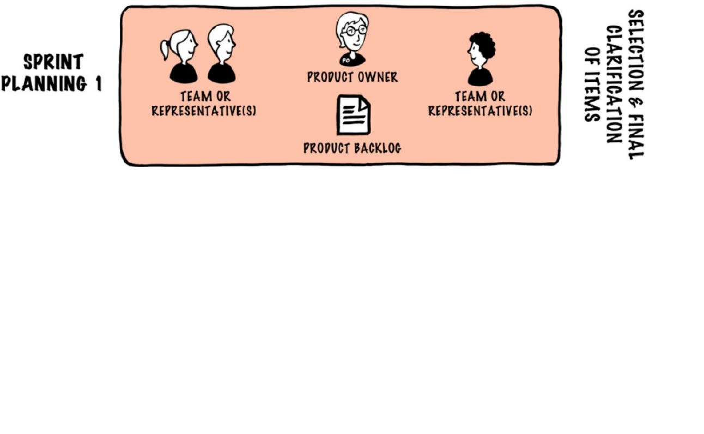{ width=360 }

# LeSS: kaksiosainen sprintin suunnittelu 

- Ensimmäisessä osassa product owner ja tiimien edustajat valitsevat backlogilta tiimeille seuraavan sprintin storyt

{ width=360 }

- Toisessa osassa tiimit muodostavat omat sprint backlogit

#

- Kaikkien tiimien yhteinen aikaansaannos (one shippable product increment) katselmoidaan yhdessä

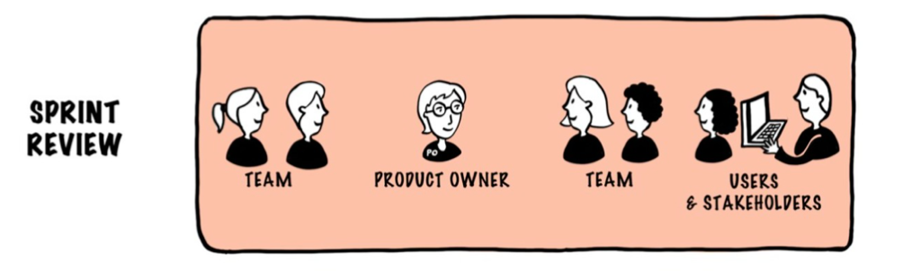{ width=330 }

. . .

- Retrospektiivi on kaksitasoinen
  - tiimikohtainen 
  - overall-retrospektiivi: edustus kaikista tiimeistä ja mahdollisesti yrityksen johdosta

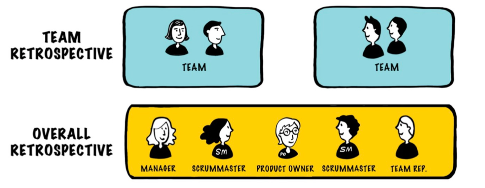{ width=330 }

# LeSS: Muu tiimien välinen koordinointi

- Yhteisen sprintin suunnittelun, reviewin ja overall-retrospektiivin lisäksi ei muita yhteisiä tapaamisia

. . .

- LeSS antaa joukon aiheeseen liittyviä ohjeita ja suosituksia 

. . .

- Tiimit päättävät keskenään miten tiimien välinen koordinointi tapahtuu 
  - Emphasize Just Talk and informal networks 
  - communicate in code
  - cross-team meetings
  - component mentors
  - open spaces
  - scouts 

. . .

- Scrum of Scrums -palaverit mainitaan, mutta suositellaan informaalimpia kommunikaation muotoja

# LeSS huge

- Yksi tuote, backlog ja vastuunalainen product owner
- Backlog jaetaan _vaatimusalueisiin_ (requirement area)
  - jokaiselle alueelle siitä vastaava _area product owner_
  - muodostavat product owner -tiimin
  - backlogiin aluekohtaiset näkymät

{ width=440 }

# LeSS vs SAFe

- SAFen ja LeSSin juuret Suomessa ja Nokialla

. . .

- Nokian organisaatiorakenteen takia Nokia Mobile Phonesin (NMP) ja Nokia Siemens Networksin (NSN) ohjelmistokehitystapa oli täysin erilainen

. . .

- SAFe (NMP) ja LeSS (NSN) ovat samoista taustaperiaatteistaan ja yhteisestä syntykonsernista huolimatta hyvin erilaisia menetelmiä

. . .

- SAFe suosittu yritysjohdon keskuudessa, mutta saanut paljon kritiikkiä
  - Ohjelmistokehittäjiltä en ole kuullut SAFesta juurikaan kiitosta

. . .

- SAFe:n kotia Nokia Mobile Phonesia ei enää ole
- Nokia (Siemens) Networks on nykyinen Nokia, jossa LeSSiä on sovellettu pitkään

# TAUKO 10 min

# Spotifyn malli

. . .

- 2012 julkaistu artikkeli _Scaling agile @ Spotify_ (Kniberg & Ivarsson) saavutti paljon huomiota

- Miten Spotify skaalasi toimintansa muutamassa vuodessa yhdestä useampaan kymmeneen tiimiin

. . . 

{ width=350 }

# Malli vai tavoite?

- Joakim Sundén (agile coach Spotifyllä 2011–2017):
  - _"Even at the time we wrote it, we weren't doing it. It was part ambition, part approximation."_

. . .

- Ei valmis viitekehys, vaan kuvaus yhden yrityksen tavoitteista tiettynä hetkenä

# Squad eli tiimi

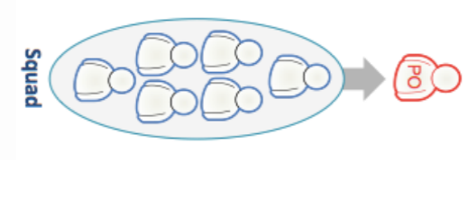{ width=220 }

- Itseorganisoituva, cross-functional, featuretiimi, noin 5–10 henkeä
  - 2012 kuvauksessa työskenteli yhdessä tilassa

. . .

- Saa itse päättää prosessinsa, ei välttämättä Scrum

. . .

- Tiimeillä vahva liiketoiminnallinen missio
  - suuri autonomia myös liiketoiminnallisiin päätöksiin
  - mahdollisimman suora asiakaskontakti
  - firman vision puitteissa

. . .

- Ministartup, agile coachit apuna scrum mastereiden sijaan

# Squad eli tiimi

- Tiimi vastaa asiakkaalle näkyvästä osasta (esim. iPhone-sovellus, soittolistat, laskutus)
  - tai muita tiimejä palvelevasta sisäisestä palvelusta

# Tribe eli heimo

{ width=220 }

- Joukko tiimejä jotka työskentelevät jonkin loogisen kokonaisuuden parissa

. . .

- 2012: tiimit fyysisesti lähekkäin, samassa rakennuksessa tai kerroksessa
  - vuodesta 2021 _Work From Anywhere_: toimisto, etätyö tai yhdistelmä

# Tribe eli heimo

- Alle 100 henkeä (maks. kymmenkunta tiimiä)
  - Dunbarin luku ≈ 150, Spotify halusi pysyä selvästi alle

. . .

- Yhteisiä kokouksia: suunnittelua, demoja...

# Chapter eli jaosto

- Riskinä että autonomiset tiimit joutuvat kohtaamaan toistuvasti samoja ongelmia

. . . 

{ width=300 }

- Heimon eri tiimien samaa asiaa tekevien ihmisten joukko
  - esim. testaajat, designerit, frontend-kehittäjät

- levittää tietoa tiimistä toiseen

# Chapter eli jaosto

- PO: _what to build next_, jaosto: _how to build it well_
- Jaostoa johtaa _chapter lead_: jäsenten esihenkilö, mutta itsekin jonkin tiimin jäsen
  - kritiikki: chapter leadilla ei vastuuta tiimin työn etenemisestä

# Guild eli kilta

{ width=350 }

- Heimorajat ylittävä, samasta asiasta kiinnostuneiden yhteisö

# Spotifyn "malli"

- Kuvaa Spotifyn tavoitteita ja osin todellisuutta noin 2012–14

. . . 

- Dokumentoi ainoastaan pintapuolisesti tiettyjä asioita siitä miten firma oli organisoitunut
  - ei tarkoitettu ohjeeksi muille ...

. . . 

- Monet asiat ovat Spotifyllä sittemmin muuttuneet
  - "Spotify ei käytä Spotifyn mallia"

. . .

- Levisi yllättäen maailmalle
  - myös Suomessa ruvettiin pöhisemään heimoista

. . . 

- Saanut paljon kritiikkiä
  - "keksinyt" tunnettuja asioita uudelleen uusilla termeillä
  - Spotifyn sisältä (antaa utopistisen kuvan firman toiminnasta)
  - myös mallin soveltamista ilman sen hengen ymmärtämistä arvosteltu

# Team Topologies (Skelton & Pais 2019)

- Ei prosessi, vaan tapa suunnitella tiimit ja niiden rajapinnat
  - keskeistä tiimin _kognitiivinen kuorma_, taustalla Conwayn laki

. . .

- Neljä tiimityyppiä: virtaan keskittyvä (stream-aligned), alusta (platform), mahdollistava (enabling), monimutkaisen osajärjestelmän tiimi
- Kolme vuorovaikutustapaa: yhteistyö, X-as-a-Service, fasilitointi

. . .

- _Platform engineering_: sisäinen kehitysalusta keventää tiimien kuormaa

# Miten laajalti ketterää/leania käytetään

. . .

- Paljon kyselytutkimuksia, luvut vaihtelevat 46–86 % välillä
  - Project Management Institute (2018): 46 %
  - Stack Overflow (yli 100 000 vastaajaa, 2018): 86 %
  - Helsingin yliopisto ja Nitor (2018): vain 5,9 % ei käytä ketteriä menetelmiä lainkaan

. . .

- Turun yliopisto ym. _Adoption and Suitability of Software Development Methods and Practices_ 2016:
  - Scrum 71 %, Kanban 50 %, Lean 40 %, vesiputous 35 %

# Hybridimenetelmät: HELENA-tutkimus

- Laaja kansainvälinen kysely: alle 15 % toimii puhtaasti ketterästi tai puhtaasti perinteisesti

. . .

- Valtaosa käyttää _hybridimenetelmiä_, eli itse koottuja yhdistelmiä

. . .

- Ketteryyttä ei voi määritellä menetelmän nimellä
  - olennaista on, mitä käytänteitä tiimit todella soveltavat

# State of Agile -raportti: vuodesta 2006

- Scrum selvästi yleisin

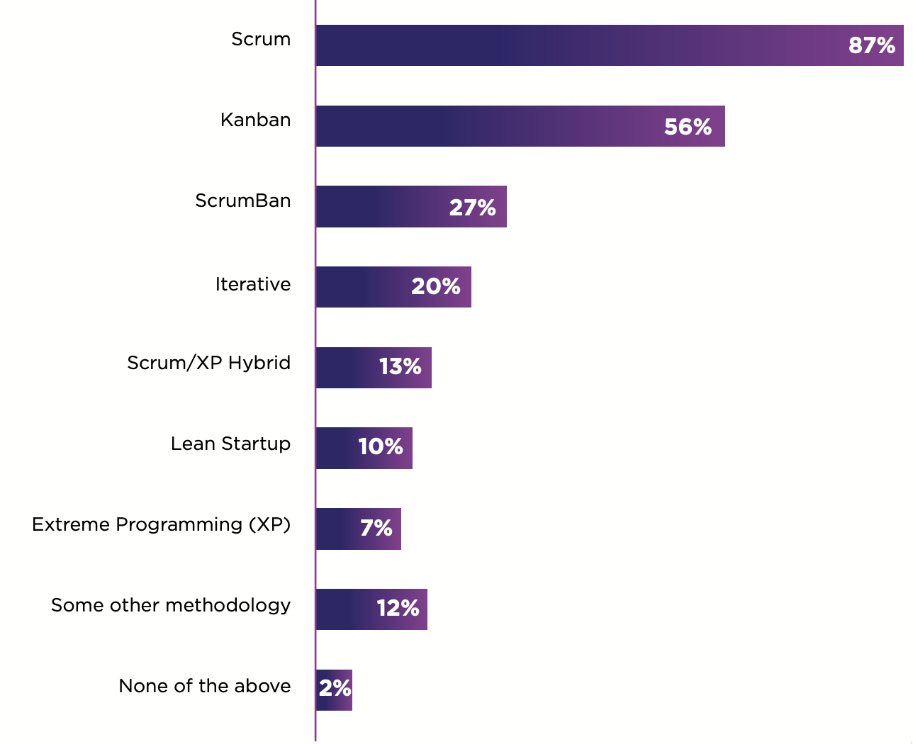{ width=230 }

- Kaupallisen työkaluvalmistajan (Digital.ai) tuottama
- Tuorein 18. raportti (2025) ei enää kysy menetelmistä

#

- Ketteryydellä saavutettuja hyötyjä

{ width=350 }

# DORA 2024: suoritustasot

\tiny

| Taso | Tuotantoonviennit | Läpimenoaika | Epäonnistuneet | Palautuminen |
|---|---|---|---|---|
| Elite 19 % | useita kertoja päivässä | alle päivä | 5 % | alle tunti |
| High 22 % | päivittäin–viikoittain | päivä–viikko | 20 % | alle päivä |
| Medium 35 % | viikoittain–kuukausittain | viikko–kuukausi | 10 % | alle päivä |
| Low 25 % | kuukausittain–2 krt/v | 1–6 kk | 40 % | viikko–kuukausi |

\normalsize

. . .

- Valtaosa kaukana jatkuvasta toimittamisesta
- Medium: harvemmat viennit, mutta harvemmin epäonnistuvat kuin High

# Toimiiko ketterä ohjelmistokehitys

- Standish Groupin _Chaos Report_, vuodesta 1994
  - Ohjelmistoprojektien onnistuminen

. . .

- 2020:

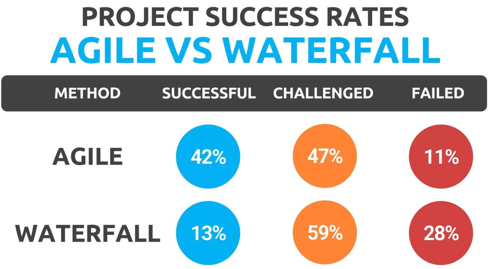{ width=250 }

- successful: aikataulussa, budjetissa, sovittu toiminnallisuus

#

- Projektin koolla on todella suuri merkitys onnistumisen kannalta

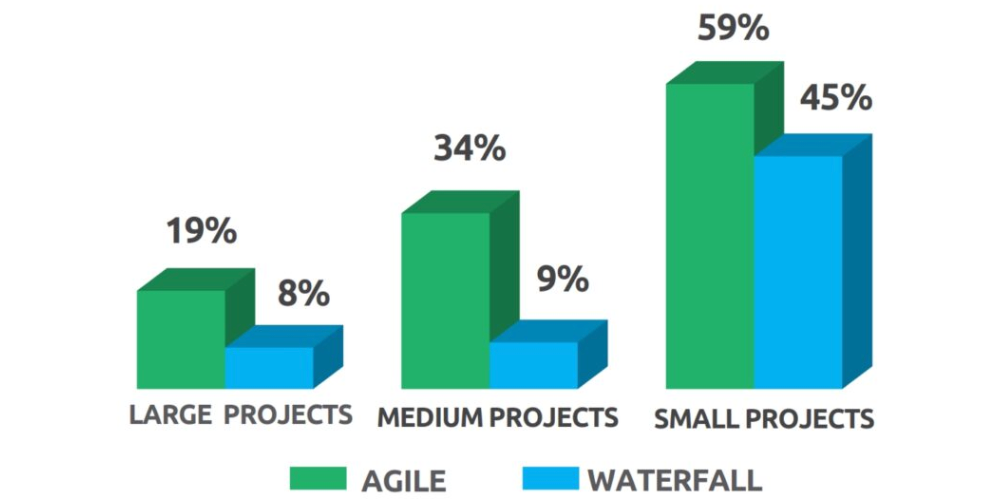{ width=300 }

# Chaos-raportin kritiikki

- Kaupallinen, data ei julkista

. . .

- Eveleens & Verhoef (2010): onnistumisen määritelmä yksipuolinen
  - mittaa alkuperäisten arvioiden osuvuutta, ei tuotettua arvoa
  - ketterässä laajuuden muuttuminen on tarkoituksellista

. . .

- Selvää silti: suuret hankkeet riskialttiita, joten ne kannattaa pilkkoa

# Ketteryyden kritiikki

- Dave Thomas (manifestin kirjoittaja) 2014: _Agile is Dead (Long Live Agility)_
  - agile = markkinointitermi, puhutaan mieluummin ketteryydestä (agility)

. . .

- Kritiikki kohdistuu teollisuuteen: pikasertifikaatit, raskaat kehykset, Dark Scrum, waterscrumfall
- 2020-luvulla ketteriä rooleja karsittu, esim. Capital One 2023: yli 1 100 roolia

. . .

- Kritiikki ei yleensä kohdistu manifestin arvoihin vaan soveltamiseen

# Etä- ja hybridityö

- Manifesti: tehokkain viestintä kasvokkain, mutta pandemian jälkeen etä- ja hybridityö yleistä

. . .

- Microsoft (n. 61 000 hlöä): etätyö siilouttaa, ryhmän ulkopuolinen yhteistyö väheni noin neljänneksellä
- Trip.com, satunnaistettu koe (n. 1 600 hlöä): 2 etäpäivää viikossa vähensi irtisanoutumisia noin kolmanneksella, suoriutuminen ennallaan

. . .

- Riski laajan skaalan ketterälle: tiimien välinen epämuodollinen koordinaatio kärsii

# Tieteellinen evidenssi

- DevOps-käytänteiden hyödyistä on jonkin verran tieteellistä evidenssiä
  - Accelerate: _The Science of Lean Software and DevOps: Building and Scaling High Performing Technology Organizations_ 2018

. . .

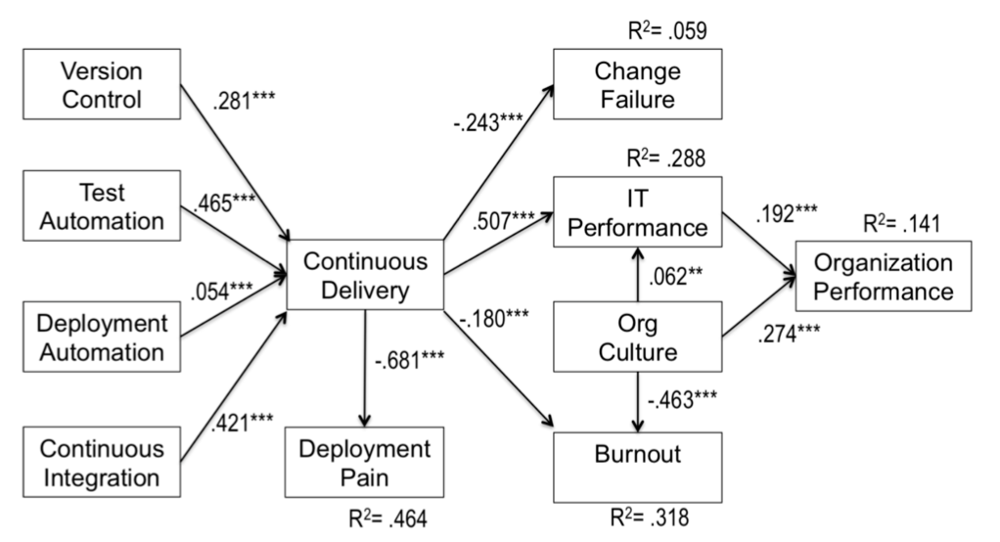{ width=380 }

# Tieteellinen evidenssi

- DevOps-käytänteiden hyödyistä on jonkin verran tieteellistä evidenssiä
  - Accelerate: _The Science of Lean Software and DevOps: Building and Scaling High Performing Technology Organizations_ 2018

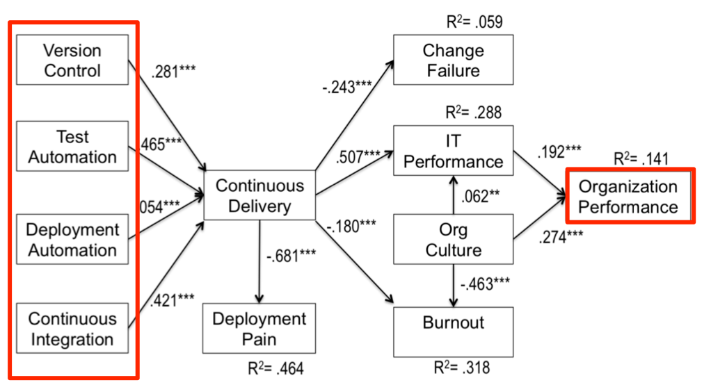{ width=380 }

# Tieteellinen evidenssi

- DevOps-käytänteiden hyödyistä on jonkin verran tieteellistä evidenssiä
  - Accelerate: _The Science of Lean Software and DevOps: Building and Scaling High Performing Technology Organizations_ 2018

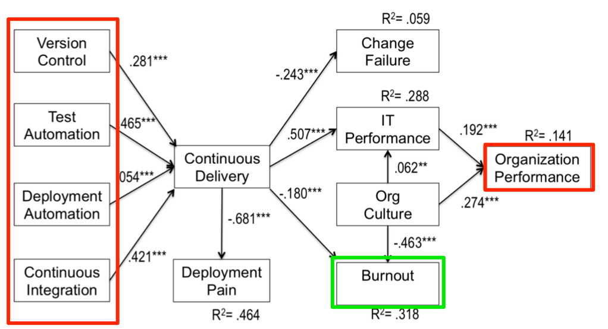{ width=380 }

# Mitä kuvasta näkee

- Luku = yhteyden voimakkuus, negatiivinen = käänteinen yhteys, \*\*\* = p < 0,001

. . .

- Testiautomaatio (0,465) ja CI (0,421) vahvimmin yhteydessä jatkuvaan toimitusvalmiuteen

. . .

- Jatkuva toimitusvalmius → IT-suorituskyky (0,507) → organisaation menestys (0,192)
  - vaikutus yrityksen menestykseen välillinen

. . .

- Vähentää tuotantoonviennin tuskaa (−0,681), epäonnistuneita muutoksia (−0,243) ja loppuunpalamista (−0,180)

. . .

- Kulttuuri: organisaation menestys (0,274), loppuunpalaminen (−0,463)

. . .

- Malli selittää vain n. 14 % organisaation menestyksen vaihtelusta (R² = 0,141)

# Accelerate: käytänteiden vaikutukset

{ width=330 }

# Mitä nuoli tarkoittaa?

- Nuoli = tekijä _ennustaa_ nuolen kärjessä olevaa tekijää
  - tilastollisesti merkitsevä yhteys kyselyaineistossa, ei kokeellisesti todistettu syy-seuraussuhde

. . .

- Vasemmalla käytänteet: lean-tuotekehitys, lean-johtaminen, tekniset käytänteet
  - tekniset käytänteet → jatkuva toimitusvalmius → vähemmän loppuunpalamista, tuotantoonviennin tuskaa ja korjaustyötä, parempi kulttuuri ja työtyytyväisyys

. . .

- Oikealla lopputulokset: toimituskyky → organisaation menestys ja ei-kaupalliset tavoitteet

. . .

- Toimituskyky ennustaa myös lean-tuotekehitystä: vaikutus molempiin suuntiin

# Organisaatiokulttuuri: Westrumin malli

- Accelerate-tutkimuksessa kulttuuria mitattiin sosiologi Ron Westrumin mallilla: miten tietoon ja epäonnistumisiin suhtaudutaan

. . .

- _Valtaan perustuva_ (pathological): pelko, tietoa panttaillaan, huonojen uutisten tuojia rangaistaan, etsitään syyllistä

. . .

- _Sääntöihin perustuva_ (bureaucratic): osastot suojelevat reviiriään, huonoista uutisista ei välitetä, epäonnistumiset käsitellään sääntöjen mukaan

. . .

- _Tavoitteisiin perustuva_ (generative): yhteinen tavoite, tieto kulkee avoimesti, epäonnistuminen johtaa syiden selvittämiseen

. . .

- Tavoitteisiin perustuva kulttuuri ennusti parempaa toimituskykyä ja työtyytyväisyyttä
  - toisaalta lean-käytänteet ja jatkuva toimittaminen parantavat kulttuuria

# The Science of Lean Software and DevOps

- Tutkimus tehty 2013-2017, perustuu yli 20 000 kyselytutkimuksen vastaukseen
  - Julkaistu kirjan lisäksi vertaisarvioituina tieteellisinä julkaisuina

. . .

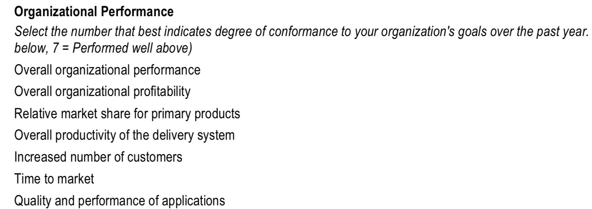{ width=500 }

# DORA-mittarit

- Tutkimusta jatkettu vuosittain DORA-raportteina (Google)

. . .

- Nopeus (throughput)
  - tuotantoonvientien tiheys (deployment frequency)
  - muutoksen läpimenoaika commitista tuotantoon (change lead time)
  - palautumisaika epäonnistuneesta tuotantoonviennistä (failed deployment recovery time)

. . .

- Vakaus (instability)
  - välitöntä korjausta vaativien tuotantoonvientien osuus (change fail rate)
  - suunnittelemattomien korjaavien tuotantoonvientien osuus (deployment rework rate, lisätty 2024)

. . .

- Nopeus ja vakaus eivät ole toistensa vastakohtia: parhaat organisaatiot ovat hyviä molemmissa

# DORA-raportti 2025

- _State of AI-assisted Software Development_

. . .

- Aiempi jako neljään suoritustasoon (elite, high, medium, low) korvattiin seitsemällä tiimityypillä
  - toimituskyvyn lisäksi huomioidaan mm. työn kitka ja kuormittuneisuus

. . .

- Tekoäly toimii _vahvistimena_: korostaa organisaation olemassa olevia vahvuuksia ja heikkouksia

# Kehittäjien tuottavuus: SPACE

- DORA-mittarit kuvaavat ohjelmistotoimituksen suorituskykyä, eivät suoraan kehittäjien tuottavuutta
  - yksittäiset mittarit (commitit, koodirivit) johtavat harhaan

. . .

- SPACE-viitekehys (Forsgren ym. 2021), viisi ulottuvuutta:
  - **S**atisfaction and well-being: tyytyväisyys ja hyvinvointi
  - **P**erformance: työn tulokset
  - **A**ctivity: aktiivisuus
  - **C**ommunication and collaboration: kommunikaatio ja yhteistyö
  - **E**fficiency and flow: tehokkuus ja työn sujuvuus

. . .

- Tuottavuutta arvioitava useamman ulottuvuuden kautta, myös kehittäjien omia arvioita hyödyntäen

# Kehittäjäkokemus: DevEx (2023)

- SPACE-tutkijoiden tiivistys tuottavuuteen vaikuttavista tekijöistä

. . .

- _Palautesilmukat_: kuinka nopeasti palaute tulee testeiltä, CI:ltä ja katselmoinnista
- _Kognitiivinen kuorma_: ylimääräinen ajattelu huonon dokumentaation tai monimutkaisten työkalujen takia
- _Flow-tila_: keskittyminen ilman keskeytyksiä

. . .

- Esim. nopea CI ja testiautomaatio parantavat suoraan palautesilmukoita

# Toimiiko ketterä

- Evidenssiä on, mutta... 

. . .

- Kaikki edelliset olivat kyselytutkimuksia
  - käsitteitä ei ole kunnolla määritelty (Scrum vs Scrumbut)
  - osallistuneet eivät ehkä edusta tasaisesti koko populaatiota
  - kyselyjen tekijät eivät ole puolueettomia menetelmien suhteen

. . .

- Akateemisenkin tutkimuksen laatu ja tulosten yleistettävyys vaihtelee

. . .

- Ohjelmistokehityksessä liian paljon muuttujia, jotta jonkin yksittäisen tekijän vaikutusta voitaisiin mitata empiirisesti

. . .

- Menetelmiä soveltavat ihmiset, ja mittaustulos yhdellä tiimillä ei välttämättä yleisty muihin olosuhteisiin

# Entäs AI

# Coding on Copilot 2023 Data Shows Downward Pressure on Code Quality

- GitClear analysoi 153 miljoonaa koodiriviä vuosilta 2020–2023
- Havaitsi koodin laadun heikentyneen AI-avusteisen ohjelmoinnin yleistyttyä

. . .

- Code churn (nopeasti korjatut tai poistetut rivit) kasvanut (ennuste 2024: 2x vs. 2021)
- Lisätyn ja copy/pastetun koodin osuus kasvaa, kun taas koodin refaktorointi ja uudelleenkäyttö vähenevät

. . .

- copy/paste-koodi **lisää teknistä velkaa ja vaikeuttaa ylläpitoa tulevaisuudessa**
- Koodin ikä lyhenee: yhä suurempi osa koodista korvataan nopeasti, mikä viittaa siihen, että **uutta koodia lisätään paljon, mutta sitä ei hyödynnetä uudelleen**

. . .

Johtopäätös: AI-avusteinen koodaus nopeuttaa kehitystä, mutta aiheuttaa haasteita koodin laadulle ja ylläpidettävyydelle

# DORA 2025: State of AI-assisted Software Development

- Tutkimukseen osallistui lähes 5 000 ohjelmistoammattilaista

. . .

- Suurin osa kyselyyn vastanneista (90%) käyttää tekoälyä työssään

. . .

- Yli 80 % uskoo sen parantaneen tuottavuuttaan

. . .

- 59 % kertoo AI:n parantaneen koodin laatua

. . .

- Noin 30% ilmoittaa ettei luota tekoälyn tuottamaan koodiin

. . .

- AI:n käytön on havaittu lisäävän riskiä sovelluksen tuotantoonviennin (deployment) epävakaudelle

. . .

- Vahvaa DevOps-kulttuuria noudattavat saavat suuremmat hyödyt AI:sta 

# Tekoäly ja tiimin kulttuuri

- Tekoäly toimii vahvistimena: se ei korjaa huonoa prosessia, eikä huonoa toimintakulttuuria
  - jos virheistä ei uskalleta puhua, myös agentin virheet jäävät piiloon
  - kireässä ilmapiirissä on helpompi kysyä kielimallilta kuin kollegalta, jolloin tieto ei kulje tiimissä

. . .

- Pariohjelmointi on edelleen hyödyllistä
  - ei välttämättä saman funktion kirjoittamista, vaan keskustelua arkkitehtuurista ja ohjelmiston suunnasta
  - rakentaa yhteistä ymmärrystä ja luottamusta, jota agentin kanssa ei synny

# Mihin

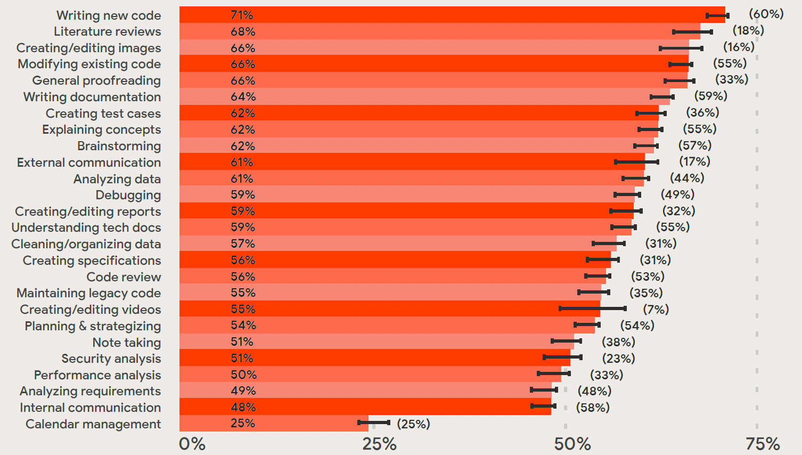{ width=420 }

# Miten 

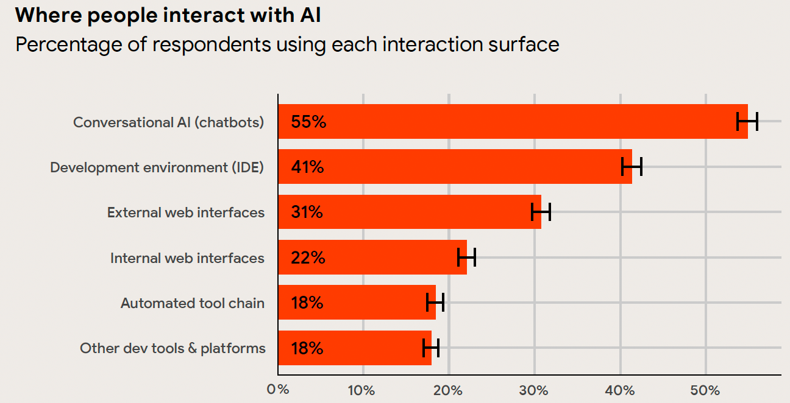{ width=400 }

# Miten usein

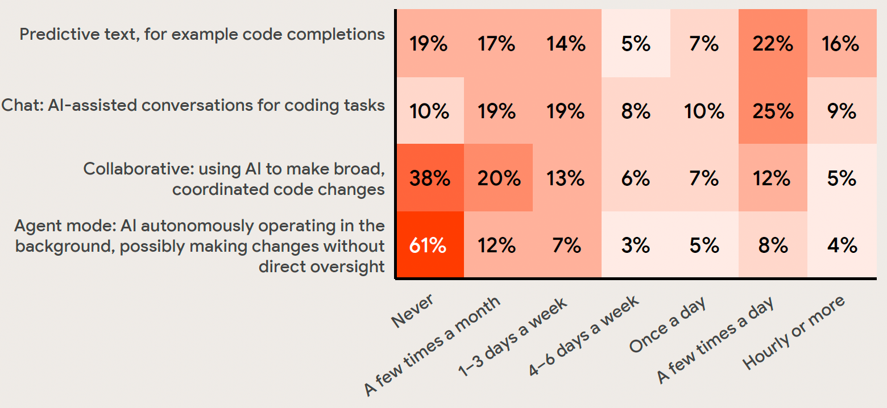{ width=400 }

# Koe

- Koe tiistaina 15.12. klo 13-16 A111 ja B123 (kynällä ja paperilla)
  - ilmoittautuminen viimeistään la 5.12. klo 23.59

. . .

- **PAKKO ILMOITTAUTUA** 5.12. mennessä

. . .

- Kaikki materiaali käytössä
  - copy paste tietysti kiellettyä
  - johtaa välittömään hylkäämiseen
  - entä ChatGPT?

. . .

- Koealueena kurssimateriaalin osat 1-5 sekä laskarit, paitsi
  - Git
  - Poetry 
  - GitHub Actions
  - unittest
  - Mock 
  - Robot/Selenium
  - Vierailuluennot

. . .

- Edellisten vuosien kokeita on nähtävillä vanhoilla kurssisivuilla
  - suureksi osaksi esseitä