# Ohjelmistotuotanto

&nbsp;&nbsp;&nbsp;&nbsp;&nbsp;&nbsp;&nbsp;&nbsp;&nbsp;&nbsp;&nbsp;&nbsp;&nbsp;&nbsp;&nbsp;&nbsp;&nbsp;&nbsp;&nbsp;&nbsp;&nbsp;&nbsp;&nbsp;&nbsp;&nbsp;&nbsp;&nbsp;&nbsp;&nbsp;&nbsp;&nbsp;&nbsp;&nbsp;&nbsp;&nbsp;Syksy 2026

&nbsp;&nbsp;&nbsp;&nbsp;&nbsp;&nbsp;&nbsp;&nbsp;&nbsp;&nbsp;&nbsp;&nbsp;&nbsp;&nbsp;&nbsp;&nbsp;&nbsp;&nbsp;&nbsp;&nbsp;&nbsp;&nbsp;&nbsp;&nbsp;&nbsp;&nbsp;&nbsp;&nbsp;&nbsp;&nbsp;&nbsp;&nbsp;&nbsp;&nbsp;&nbsp;&nbsp;&nbsp;Luento 2

&nbsp;&nbsp;&nbsp;&nbsp;&nbsp;&nbsp;&nbsp;&nbsp;&nbsp;&nbsp;&nbsp;&nbsp;&nbsp;&nbsp;&nbsp;&nbsp;&nbsp;&nbsp;&nbsp;&nbsp;&nbsp;&nbsp;&nbsp;&nbsp;&nbsp;&nbsp;&nbsp;&nbsp;&nbsp;&nbsp;&nbsp;&nbsp;&nbsp;&nbsp;&nbsp;&nbsp;27.10.2026

# Kurssipalaute

- Kurssipalaute
  - Kurssilla lopussa kerättävän palautteen lisäksi ns. jatkuva palaute https://norppa.helsinki.fi

# Paja ja Discord

- Apua tehtäviin pajassa BK107
  - ma 16-19
  - ti 13-16
  - to 16-19
  - pe 13-16

- Kurssin Discord: https://study.cs.helsinki.fi/discord/join/ohtu
  - kanavalle liitytään komennolla _/join course TKT20006 - Ohjelmistotuotanto - ohtu_

# Miniprojektit

- Käynnistyvät 9.11. alkavalla viikolla

- **Ilmoittautumisen deadline la 7.11. klo 23.59**

- Aloitustilaisuudet
  - ma 9.11. klo 14–16
  - ti 10.11. klo 14–16
  - ke 11.11. klo 16–18
  - to 12.11. klo 10–12
  - to 12.11. klo 14–16

- Seuraavat viikot: sprinttien katselmus ja suunnittelu samassa aikaikkunassa

- Loppudemot
  - ti 8.12. klo 14–16
  - ke 9.12. klo 10–12

# Vesiputousmalli

{ width=440 }

# Vesiputousmallin suurimmat ongelmat

. . .

- Vaatimukset mahdotonta määritellä tyhjentävästi heti alussa
  - asiakas ei ymmärrä vielä alussa mitä haluaa
  - bisnesympäristö muuttuu projektin kuluessa

. . .

- Suunnittelu sillä tasolla, että ohjelmointi on suoraviivainen "rakennusvaihe" on mahdotonta
  - ohjelmointi on osa suunnitteluprosessia, ohjelmakoodi on tuotteen lopullinen suunnitelma

. . .

- Suunnittelu taas on teknisesti haastavaa, riskejä sisältävää toimintaa

. . .

- Lopussa tehtävä testaus paljastaa ongelmat liian myöhään
  - ongelmien korjaaminen voi edellyttää kalliita muutoksia

# Ohjelmiston tuottaminen ei ole kontrolloitu prosessi

- 80- ja 90-lukujen iteratiiviset prosessimallit korjaavat monia edellisen kalvon epäkohdista
- Olivat edelleen tarkkoihin etukäteissuunnitelmiin perustuvia
  - Tarkka projektisuunnitelma ja sen noudattaminen
  - Selkeä roolijako: projektipäälliköt, analyytikot, arkkitehdit, ohjelmoijat, testaajat

. . .

- eli ne olettivat että ohjelmistotuotanto on jossain määrin _kontrolloitavissa oleva prosessi_

# Ketterien menetelmien perusolettamuksia

. . .

- Useimmat ohjelmistoprojektit ovat laadultaan uniikkeja
  - **Vaatimukset erilaiset** kuin millään jo tehdyllä ohjelmistolla
  - **Uusi tekijätiimi**, varustettu omanlaisilla kompetensseilla ja persoonallisuuksilla
  - **Toteutusteknologiat kehittyvät** tehdään todennäköisesti tavalla, joka ei ole kaikille tuttu

. . .

- Järkevää lähteä oletuksesta että kyseessä ei ole _kontrolloitu prosessi_, joka voidaan tarkkaan etukäteen aikatauluttaa ja suunnitella

. . .

- Parempi ajatella _tuotekehitysprojektina_, jonka kontrollointiin sopii paremmin _empiirinen prosessi_ jonka periaatteina
  - _transparency_ läpinäkyvyys
  - _inspection_ tarkkailu
  - _adaptation_ mukauttaminen

# Ketterien menetelmien perusolettamuksia

- Tekijät yksilöitä: toimivat paremmin kun heihin luotetaan ja annetaan tiimille vapaus organisoida itse toimintansa

. . .

- Oletuksena että perinteinen command-and-control ja jako eri vastuualueisiin ei tuota optimaalista tulosta

. . .

- "The whole team"-periaate: tiimi kollektiivina vastuussa aikaansaannoksesta

. . .

Eilisellä luennolla käsitelty _ketterä manifesti_ heijastelee näitä olettamuksia

. . .

Ovatko nämä valideja olettamuksia?

# Scrum

- Tutustumme kurssilla Scrumiin, joka on jo vuosia ollut selvästi suosituin ketterä menetelmä/prosessimalli

. . .

- Scrum Guiden (2020) mukaan Scrum on
  - kevyt (lightweight) menetelmäkehys
  - joka auttaa ihmisiä, tiimejä ja organisaatioita tuottamaan arvoa
  - mukautuvien ratkaisujen avulla monimutkaisiin ongelmiin

. . .

- Tarkoituksella ei-kattava (purposefully incomplete): määrittelee vain välttämättömät osat, muut menetelmät ja tekniikat valitaan tapauskohtaisesti

. . .

- Guiden aiempien versioiden kiteytys pätee edelleen:
  - kevyt (lightweight)
  - helppo ymmärtää
  - mutta **äärimmäisen vaikea hallita** (extremely difficult to master)

# Scrum kuvana

{ width=440 }

# Scrum: accountabilities, artifacts and events

Terminologiaa

- Scrum-tiimissä (≤ 10 henkeä) kolme **vastuuta** (accountability):
  - Kehittäjät (developers)
  - Scrum master
  - Product owner

. . .

- **Artefaktit** ja niiden **sitoumukset** (commitment)
  - Product backlog (kehitysjono): _product goal_
  - Sprint backlog (sprintin tehtävälista): _sprint goal_
  - Increment (valmis lisäys ohjelmistoon): _definition of done_

. . .

- Scrumissa tekeminen rytmittyy **sprintteihin** eli korkeintaan kuukauden mittaisiin iteraatioihin

. . .

- Sprintteihin kuuluu muutamia **standardipalavereja** (events):
  - Sprintin suunnittelupalaveri
  - Daily scrum -palaverit
  - Sprintin katselmointi
  - Retrospektiivi
  - myös sprintti itse on tapahtuma, joka sisältää muut, eli tapahtumia on viisi

# Product backlog

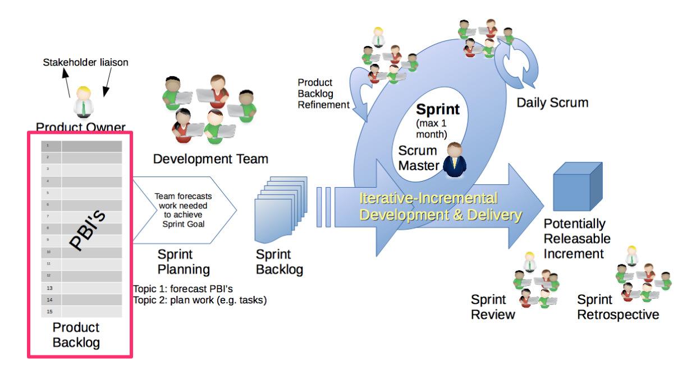{ width=440 }

# Product backlog

- Priorisoitu lista asiakkaan tuotteelle asettamista _vaatimuksista_
  - asiakkaan tasolla olevia _arvoa tuottavia_ toiminnallisuuksia, kirjattuna asiakkaan ymmärtämällä kielellä
  - tähtää _tuotteen tavoitteeseen_ (product goal), pidemmän aikavälin päämäärään

. . .

- Listan kärkipään vaatimukset valitaan toteutettavaksi seuraaviin sprintteihin
  - kirjattu tarkemmin kuin backlogin häntäpään vaatimukset

. . .

- Backlogia tarkennetaan jatkuvasti (_backlog refinement_)
- Vaatimukset ovat usein _estimoituja_ eli toteutuksen vaatima työmäärä on arvioitu
  - Työmääräarviot tekevät kehittäjät
  - Scrum Guide ei määrää tekniikkaa: esim. story pointit, tai arvioinnista luopuminen (#NoEstimates)

. . .

- Scrum ei määrittele missä muodossa backlog ja siinä olevat vaatimukset esitetään
  - nykyään käytetään usein _user story_ -formaattia

# Product owner

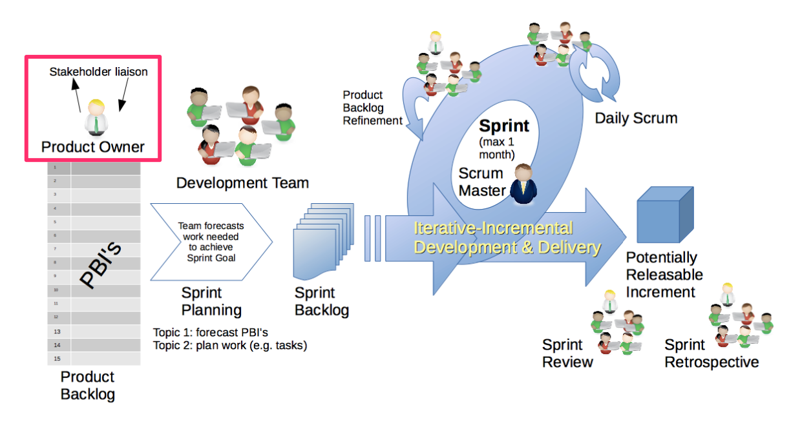{ width=440 }

# Product owner

- Backlogista vastaa _product owner_ eli tuotteen omistaja
  - määrittelee ja kommunikoi tuotteen tavoitteen
  - päättää mitä backlogille otetaan
  - priorisoi backlogin

. . .

- Product owner on yksittäinen henkilö, ei komitea
  - Priorisointiin voi toki olla vaikuttamassa useampikin henkilö
  - Product owner tekee lopulliset päätökset prioriteettien suhteen

. . .

- Product owner on vastuussa backlogista
  - Varmistaa että kehittäjät ymmärtävät toteutettavaksi valitut vaatimukset
  - Priorisoi vaatimukset maksimoiden asiakkaan tuotteesta saaman hyödyn/arvon

# Tuoteajattelu

- Tavoitteena _vaikutus_ (outcome), ei pelkkä _tuotos_ (output)
  - valmistuneiden ominaisuuksien määrä ei kerro, onko ohjelmistosta hyötyä
  - myös product goal kuvaa tavoiteltua tilaa, ei ominaisuuslistaa

. . .

- Feature-tiimi vs. tuotetiimi (Marty Cagan)
  - feature-tiimi toteuttaa sille annettuja ominaisuuksia
  - tuotetiimi saa ratkaistavaksi ongelman ja vastaa siitä, että ratkaisu toimii

. . .

- Määräaikaisista projekteista pysyviin tuotetiimeihin

# Scrum master

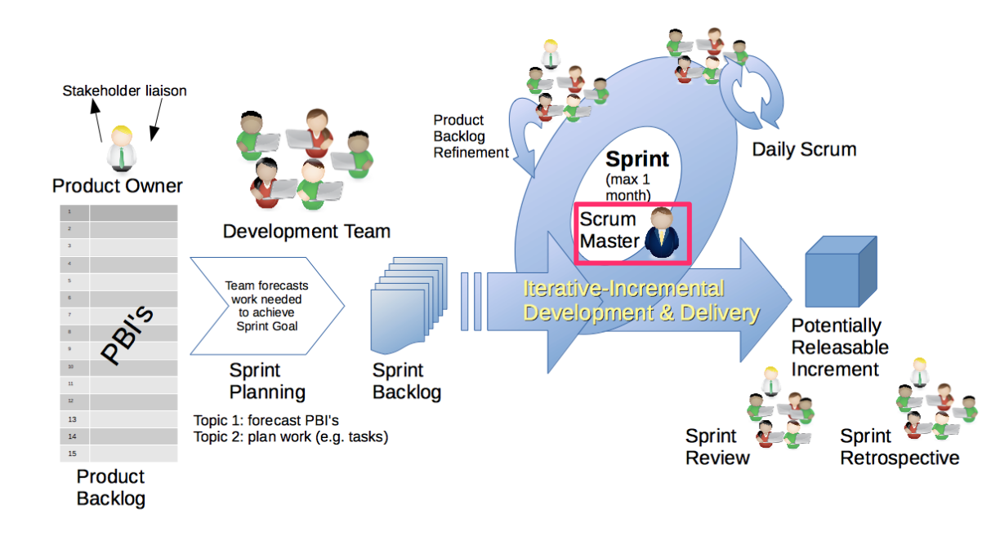{ width=440 }

# Scrum master

- Tiimeillä on _scrum master_, eli henkilö joka huolehtii siitä että ohjelmistokehitys etenee sujuvasti
  - vastaa Scrumin käyttöönotosta ja tiimin tehokkuudesta

. . .

- Ei perinteinen projektipäällikkö vaan _true leader who serves_ (aiemmin _servant-leader_)
  - järjestää Scrumiin liittyvät palaverit
  - huolehtii että Scrumia noudatetaan järkevällä tavalla
  - opastaa hyvien käytänteiden noudattamisessa
  - rohkaisee ja auttaa tiimiä itseohjautuvuudessa

. . .

- Pyrkii poistamaan kehitystyön **esteitä**
  - voi olla tiimistä riippumaton asia, jonka poistamiseksi scrum master joutuu neuvottelemaan yrityksen hallinnon kanssa
  - voi liittyä ryhmän työtapoihin, tällöin scrum master opastaa ryhmää toimimaan siten, että este poistuu

. . .

- Scrum master tekee kaikkensa, jotta tiimillä olisi optimaaliset olosuhteet kehittää tuotetta

# Kehittäjät

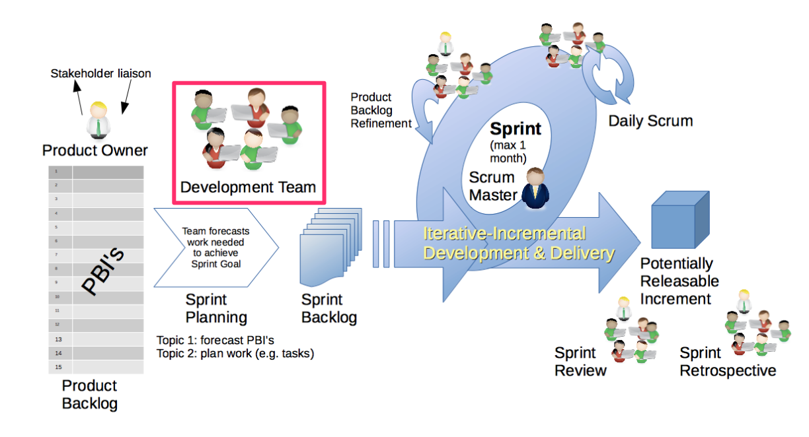{ width=440 }

# Kehittäjät

- Kehittäjät tekevät jokaisessa sprintissä käyttökelpoisen lisäyksen ohjelmistoon
  - aiemmin puhuttiin 3-9 hengen kehitystiimistä, vuodesta 2020 enää yksi Scrum-tiimi (yleensä ≤ 10 henkeä) ilman alitiimejä tai hierarkioita
  - vaikka kaikilla nimike developer, voivat jotkut tiimin jäsenistä olla erikoistuneet omaan osa-alueeseensa

. . .

- koko tiimi kantaa aina yhteisen vastuun kehitystyöstä

. . .

- Pitkään ideaalina oli, että tiimi työskentelee täysipäiväisesti samassa tilassa
  - Scrum Guide ei ota kantaa työskentelypaikkaan
  - nykyään yleistä hybridi- ja etätyö, mikä korostaa kommunikaatiokäytäntöjen merkitystä

# Kehittäjät

- Tiimi on _cross-functional_, eli sen tulisi sisältää kaikki tarvittava osaaminen järjestelmän suunnitteluun, toteuttamiseen ja testaamiseen

. . .

- Tiimiä ei johdeta ulkopuolelta
  - kehittäjät päättävät miten paljon vaatimuksia backlogilta valitaan sprinttiin
  - tiimi päättää itse kuka tekee mitä, milloin ja miten sprintin tavoite saavutetaan

. . .

- Tiimi on siis _itseohjautuva_ (self-managing), aiemmin puhuttiin itseorganisoituvasta (self-organizing)

# Sprintti

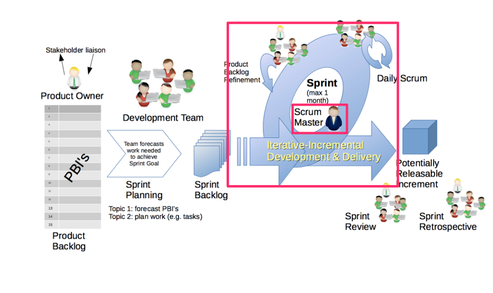{ width=440 }

# Sprintti

- Scrumissa kehitystyö siis jakautuu korkeintaan kuukauden mittaisiin iteraatioihin eli sprintteihin
- Sprintti on _time-boxed_, sitä ei missään olosuhteissa pidennetä
  - vain product owner voi perua sprintin

. . .

- Jokaisen sprintin alussa tiimi valitsee projektin backlogista sprintin aikana toteutettavat vaatimukset
  - Backlog on priorisoitu ja vaatimukset valitaan aina priorisoidun listan kärjestä
  - Product ownerin asettama prioriteettijärjestys määrää missä _järjestyksessä_ asioita toteutetaan

. . .

- Kehittäjät valitsevat sprinttiin ainoastaan sen verran toteutettavaa, minkä arvioivat saavansa valmiiksi

# Sprintti

- Sprintin aikana scrum-tiimi toteuttaa _itseohjautuvasti_ sprinttiin valitut ohjelmiston ominaisuudet
- Sprintin aikana ei tehdä muutoksia, jotka vaarantavat sprintin tavoitteen, eikä laadusta tingitä
  - sisältöä voidaan tarkentaa ja neuvotella uudelleen product ownerin kanssa

. . .

- Sprintin aikana syntyy ainakin yksi _increment_, eli valmis, käyttökelpoinen lisäys tuotteeseen
  - incrementtejä voi syntyä useita ja niitä voi julkaista jo kesken sprintin

# TAUKO

# Definition of done

- Jokaisessa sprintissä lopputuloksena **toimiva, valmiiksi tehty osa ohjelmistoa**

. . .

- Scrumissa määritellään _definition of done_: mitä tarkoittaa, että jokin vaatimus on toteutettu valmiiksi
  - organisaation yhteinen, tai jos sellaista ei ole, Scrum-tiimin laatima

. . .

- Määritellään yleensä tarkoittamaan sitä, että vaatimus on
  - _analysoitu, suunniteltu, ohjelmoitu, testattu, testaus automatisoitu, dokumentoitu, integroitu muuhun ohjelmistoon ja viety tuotantoympäristöön_

. . .

- DoD:tä täyttämätöntä vaatimusta ei voi julkaista eikä edes esitellä katselmoinnissa
  - se palaa product backlogiin myöhemmin toteutettavaksi

. . .

- Jos sprintin aikana osoittautuu että tiimi ei ehdi toteuttamaan kaikkia vaatimuksia, _laadusta ei tingitä_
  - osa vaatimuksista jätetään seuraavaan sprinttiin

# Sprintin suunnittelu

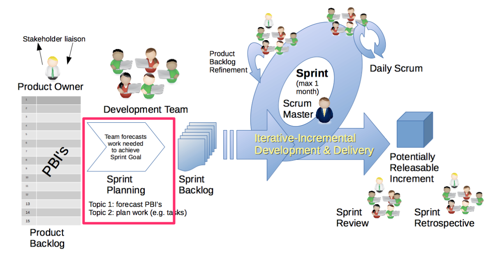{ width=440 }

# Sprintin suunnittelu

- Ennen jokaista sprinttiä järjestetään sprintin _suunnittelukokous_
- Kokouksella kolme tavoitetta, Scrumin sanoin _aihetta_: **miksi**, **mitä** ja **miten**
- Kesto korkeintaan 8 h kuukauden sprintille, lyhyemmille yleensä vähemmän

. . .

- Ensimmäinen aihe on selvittää **miksi** sprintti on arvokas
  - koko tiimi muotoilee _sprintin tavoitteen_ (sprint goal)

. . .

- Toinen aihe on selvittää **mitä** sprintin aikana tehdään
  - Product owner esittelee product backlogin kärjessä olevat vaatimukset
  - Tiimin tulee olla selvillä siitä, mitä vaatimuksilla tarkoitetaan
  - Tiimi arvioi kuinka monta backlogin vaatimuksista se kykenee sprintin aikana toteuttamaan

# Sprintin suunnittelu

- Suunnittelukokouksen kolmantena aiheena on selvittää **miten** sprintin tavoite saavutetaan

. . .

- Tämä yleensä edellyttää että tiimi suunnittelee toteutettavaksi valitut vaatimukset tarvittavalla tasolla
  - Aikaansaannoksena on usein lista teknisistä _tehtävistä_ (task), jotka sprintin aikana on toteutettava

. . .

- Suunnittelun aikana identifioidut tehtävät kirjataan _sprintin backlogiin_ eli sprintin tehtävälistaan

. . .

Palaamme sprintin suunnitteluun tarkemmin ja konkreettisten esimerkkien kanssa ensi viikolla

# Sprintin suunnittelu: *product backlogilta sprint backlogille*

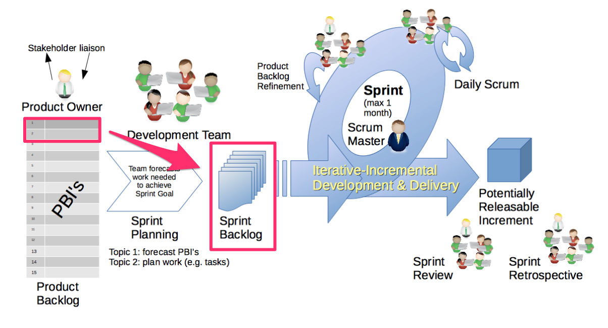{ width=440 }

# Daily scrum – päiväpalaveri

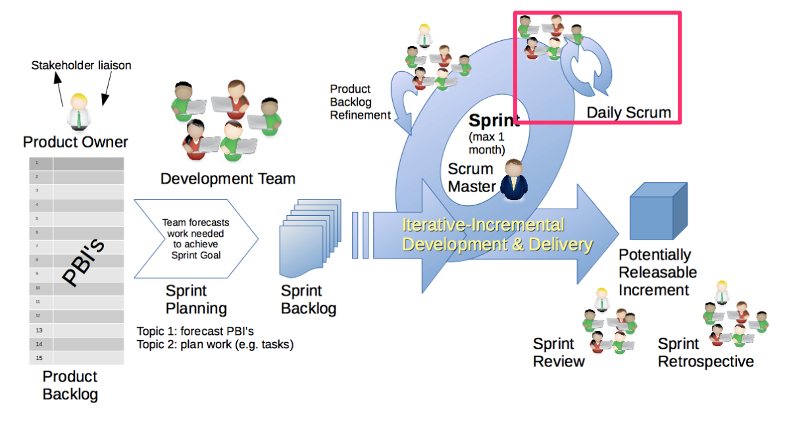{ width=440 }

# Daily scrum – päiväpalaveri

- Sprintin jokaisena työpäivänä pidetään _daily scrum_ eli korkeintaan 15 minuutin mittainen palaveri
  - Aina samaan aikaan ja samassa paikassa, palaveri on kehittäjiä varten
  - usein aamulla, mutta Scrum Guide ei tätä edellytä

. . .

- Scrum Guide 2020: tarkoituksena on tarkastella edistymistä kohti sprintin tavoitetta
  - ja mukauttaa sprintin backlogia tarvittaessa, eli muokata tulevaa suunniteltua työtä

. . .

- Kehittäjät voivat valita palaverin rakenteen ja tekniikat vapaasti
  - kunhan palaveri keskittyy edistymiseen kohti sprintin tavoitetta
  - ja tuottaa konkreettisen suunnitelman seuraavan työpäivän työlle

. . .

- Ei pelkkä statuspalaveri vaan osa inspect-and-adapt-sykliä

# Daily scrum – kolmen kysymyksen malli

- Pitkään Scrumin suosittelema malli on edelleen yleinen: jokainen vastaa vuorollaan kolmeen kysymykseen
  - Mitä sain aikaan edellisen tapaamisen jälkeen?
  - Mitä aion saada aikaan ennen seuraavaa tapaamista?
  - Mitä esteitä etenemiselläni on?

. . .

- Riskinä, että palaveri muuttuu yksittäisten kehittäjien raportoinniksi
  - kysymyksiä kannattaa tarkastella sprintin tavoitteen näkökulmasta

. . .

- Palaverin on tarkoitus olla lyhyt, ongelmista ja muista asioista keskustellaan erikseen daily scrumin jälkeen

# Sprintin katselmointi

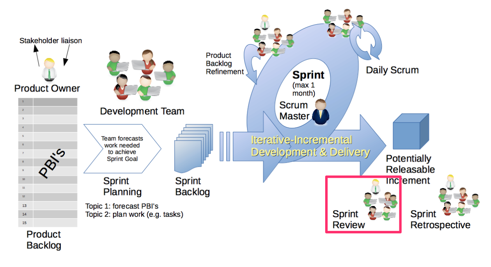{ width=440 }

# Sprintin katselmointi

- Sprintin päätteeksi järjestetään _sprint review_ eli katselmointi
- Scrum-tiimi ja sidosryhmät, kesto korkeintaan 4 h kuukauden sprintille

. . .

- Tiimi esittelee sprintin aikaansaannoksia
  - tarkastellaan/demotaan toteutettua toimivaa ohjelmistoa
  - työskentelysessio, ei pelkkä esitys

. . .

- Ainoastaan definition of donen mukaisesti toteutetut vaatimukset demotaan

. . .

- Product owner varmistaa, mitkä vaatimuksista toteutettiin hyväksyttävällä tavalla (yleinen käytäntö, ei mainita Scrum Guidessa)
- Ne vaatimukset joita ei hyväksytä toteutetuksi siirretään takaisin product backlogiin

# Sprintin katselmointi

- Katselmoinnin aikana sidosryhmät antavat palautetta tuotteesta ja voivat esim. ehdottaa uusia vaatimuksia lisättäväksi product backlogiin
- Arvioidaan edistymistä kohti tuotteen tavoitetta

. . .

- Katselmointi aiheuttaa usein myös tarpeen product backlogin uudelleenpriorisoimiseen

# Retrospektiivi

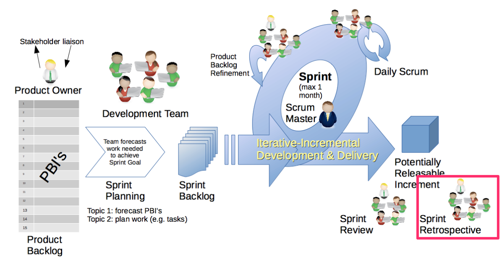{ width=440 }

# Retrospektiivi

- _Retrospektiivi_ on sprintin katselmoinnin ja seuraavan sprintin alun välissä pidettävä palaveri, jonka aikana Scrum-tiimi tarkastelee omaa työskentelyprosessiaan
  - kesto korkeintaan 3 h kuukauden sprintille

. . .

- Identifioidaan mikä meni hyvin ja missä asioissa on parantamisen varaa

. . .

- Mietitään ratkaisuja ongelmakohtiin, joita pyritään korjaamaan seuraavan sprintin aikana

# Retrospektiivi

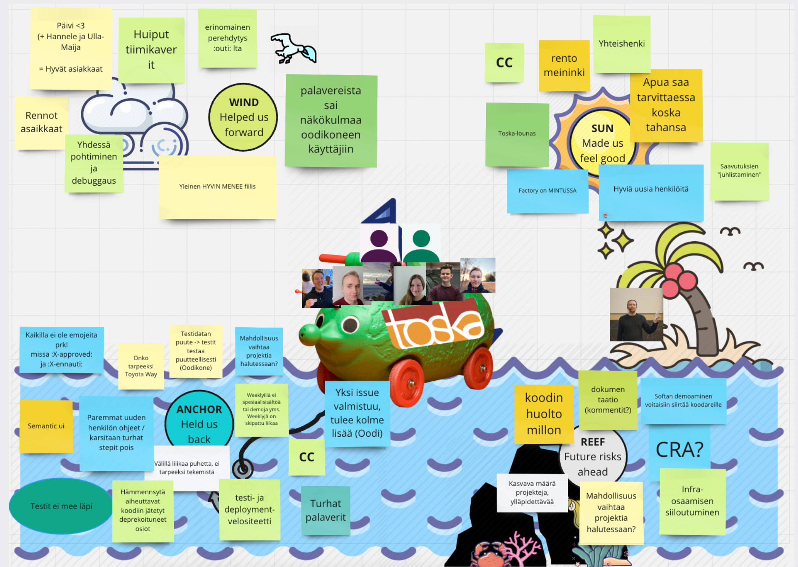{ width=440 }

# Transparency - inspect - adapt

- Scrumin taustaperiaatteet ovat
  - _läpinäkyvyys_ (transparency)
  - _tarkkailu_ (inspection)
  - _mukauttaminen_ (adaptation)

. . .

- Asioiden läpinäkyvyys mahdollistaa niiden jatkuvan tarkkailun
- ja sen seurauksena toimintatapoja ja kehitettävää tuotetta on mahdollista mukauttaa

. . .

- Läpinäkyvyys: backlogit, daily scrum, definition of done, sprintin katselmointi, increment...

. . .

- Lyhyt kehityssykli mahdollistaa sekä tuotteen että toimintatapojen nopean inkrementaalisen parantamisen
  - backlogia uudelleenpriorisoidaan ja muokataan palautteen sekä opitun perusteella
  - retrospektiivi kannustaa tiimiä jatkuvasti parantamaan työprosessiaan

# Scrumin arvot

- Scrum sisältää joukon _arvoja_ joiden noudattamista se pitää oleellisena: _commitment, focus, openness, respect, courage_

. . .

- tiimin tulee olla _sitoutunut_ (commitment) yhteisen tavoitteen saavuttamiseksi

. . .

- ja _fokusoitua_ (focus) oikeiden asioiden tekemiseen

. . .

- tulee olla _rohkeutta_ (courage) tehdä päätöksiä ja kohdata myös vaikeimpia asioita
  - tulee olla avoimia sekä onnistumisten että ongelmien suhteen

. . .

- oleellista on _kunnioittaa_ (respect) koko ajan kaikkia tiimin jäseniä sekä ohjelmiston sidosryhmiä

# Scrumin tehokas soveltaminen

- Jotta Scrum toimisi _tehokkaasti_, tarvitaan sen soveltamiseen sopiva asenne ja orientaatio, eli on noudatettava Scrumin arvoja

. . .

- Scrumin tekemisen ei ole tarkoitus olla ainoastaan pelisääntöjen orjallista noudattamista

. . .

- Scrumin inspect-and-adapt (tarkkaile ja mukauta) -luonne ohjaa siihen, **tiimien on koko ajan mukautettava toimintaansa**

. . .

- *Tiimien optimaalisen toiminnan kannalta on joskus parempi toimia jopa joidenkin Scrumin ohjeiden vastaisesti*

# Scrumin ongelmat

- Scrum on osoittautunut monin paikoin paremmaksi tavaksi ohjelmistojen tuottamiseen kuin vesiputousmalli

. . .

- Yleinen ratkaisu ohjelmistotuotannon ongelmiin se ei ole
  - Scrumin käytön yleistyessä myös epäonnistuneiden Scrum-projektien määrä kasvaa

. . .

- Yksi ongelmista on ns. **scrumbut**
  - We use Scrum, **but** having a Daily Scrum every day is too much overhead, so we only have one per week.
  - We use Scrum, **but** retrospectives are a waste of time, so we don't do them.
  - We use Scrum, **but** we can't build a piece of functionality in two weeks, so our Sprints are 3 months long

. . .

- Transparency-inspect-adapt voi vaarantua

# Scrumin ongelmia Robert Martinin listaamina

. . .

- **Tekniset käytänteet puuttuvat**: ei teknisiä suosituksia, esim. automaattisesta testauksesta

. . .

- **Scrum masterin rooli**: sertifioitu scrum master voi muuttua mikromanageroivaksi projektipäälliköksi

. . .

- **Itseohjautuvuuden ja skaalautumisen rajat**: itseohjautuvuutta korostetaan liikaa, usean tiimin työskentelyyn ei ohjeita

. . .

- **Product backlogin hallinta**: liian vähän ohjeita backlogin organisointiin

. . .

- Kritiikki vuodelta 2010, mutta pitkälti validi edelleen
  - myöhemmin mm. Ron Jeffries: _Dark Scrum_ (2016), Scrum johdon kontrollivälineenä
  - 2020-luvulla monet yritykset ovat vähentäneet erillisiä scrum master -rooleja

# Waterscrumfall

- Yleisesti raportoitu ongelma ketterään ohjelmistokehitykseen siirryttäessä on se, että muu organisaatio jää ennalleen

. . .

- Waterscrumfall
  - ohjelmistokehitys tapahtuu Scrumia mukaillen
  - budjetointi, vaatimusten hallinta sekä tuotantoonvienti etenevät edelleen vanhoja kontrolloituja prosesseja noudattaen

. . .

- Päätetään alustava Scrumiin tutustumisemme Scrum Guiden aiempien versioiden kiteytykseen:

**Scrum is easy to understand but extremely difficult to master**
