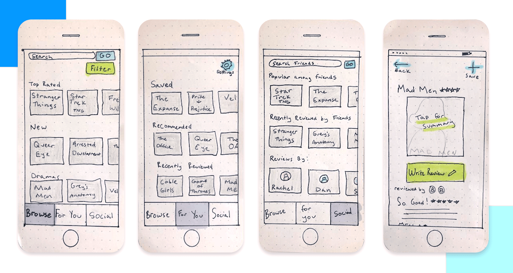
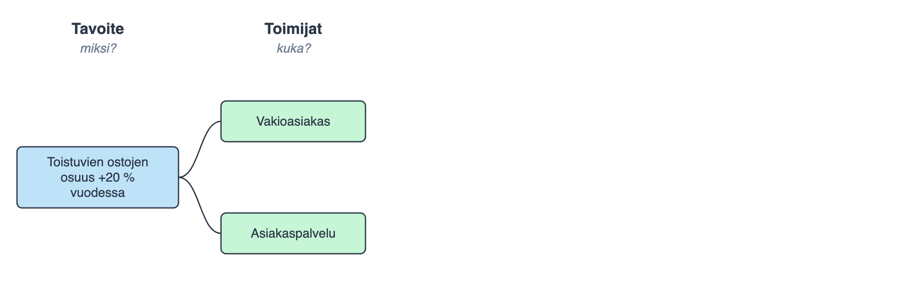
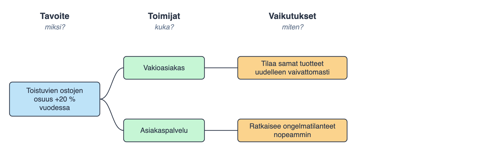
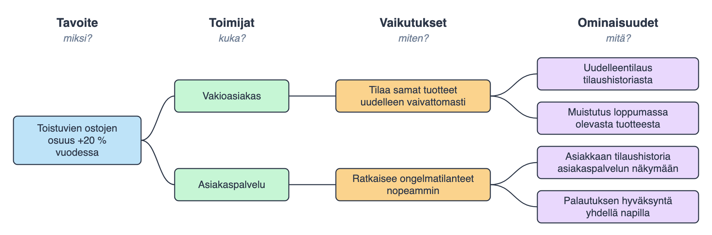
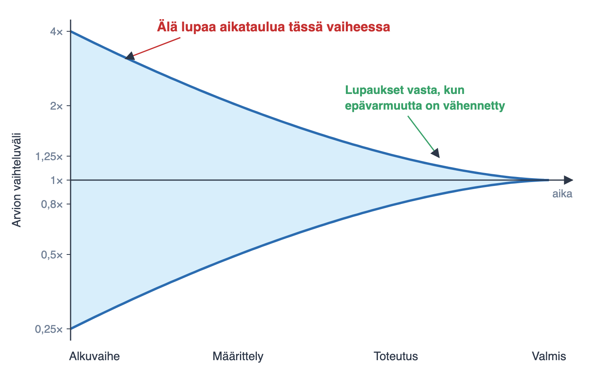
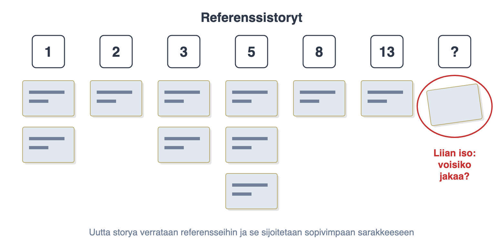
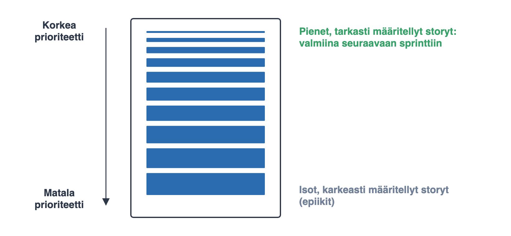

# Ohjelmistotuotanto

&nbsp;&nbsp;&nbsp;&nbsp;&nbsp;&nbsp;&nbsp;&nbsp;&nbsp;&nbsp;&nbsp;&nbsp;&nbsp;&nbsp;&nbsp;&nbsp;&nbsp;&nbsp;&nbsp;&nbsp;&nbsp;&nbsp;&nbsp;&nbsp;&nbsp;&nbsp;&nbsp;&nbsp;&nbsp;&nbsp;&nbsp;&nbsp;&nbsp;&nbsp;&nbsp;Syksy 2026

&nbsp;&nbsp;&nbsp;&nbsp;&nbsp;&nbsp;&nbsp;&nbsp;&nbsp;&nbsp;&nbsp;&nbsp;&nbsp;&nbsp;&nbsp;&nbsp;&nbsp;&nbsp;&nbsp;&nbsp;&nbsp;&nbsp;&nbsp;&nbsp;&nbsp;&nbsp;&nbsp;&nbsp;&nbsp;&nbsp;&nbsp;&nbsp;&nbsp;&nbsp;&nbsp;&nbsp;&nbsp;Luento 3

&nbsp;&nbsp;&nbsp;&nbsp;&nbsp;&nbsp;&nbsp;&nbsp;&nbsp;&nbsp;&nbsp;&nbsp;&nbsp;&nbsp;&nbsp;&nbsp;&nbsp;&nbsp;&nbsp;&nbsp;&nbsp;&nbsp;&nbsp;&nbsp;&nbsp;&nbsp;&nbsp;&nbsp;&nbsp;&nbsp;&nbsp;&nbsp;&nbsp;&nbsp;&nbsp;&nbsp;2.11.2026

# Kurssipalaute

- Kurssipalaute
  - Kurssilla lopussa kerättävän palautteen lisäksi ns. jatkuva palaute https://norppa.helsinki.fi

. . . 

# Paja ja Discord

- Apua tehtäviin pajassa BK107
  - ma 16-19
  - ti 13-16
  - to 16-19
  - pe 13-16

- Kurssin Discord: https://study.cs.helsinki.fi/discord/join/ohtu
  - kanavalle liitytään komennolla _/join course TKT20006 - Ohjelmistotuotanto - ohtu_

# Miniprojektit

- Käynnistyvät 9.11. alkavalla viikolla

- **Ilmoittautumisen deadline torstai 5.11. klo 23.59**

- Aloitustilaisuudet
  - ma 9.11. klo 14–16 C220
  - ti 10.11. klo 14–16 D122
  - ke 11.11. klo 16–18 C220
  - to 12.11. klo 10–12 BK114
  - to 12.11. klo 14–16 B222

- Seuraavat viikot: sprinttien katselmus ja suunnittelu samassa aikaikkunassa

- Loppudemot
  - ti 8.12. klo 14–16 B123
  - ke 9.12. klo 10–12 B123

# Ohjelmiston elinkaari (software lifecycle)

. . .

- **Vaatimusten analysointi ja määrittely**
- Suunnittelu
- Toteutus
- Testaus
- Ohjelmiston ylläpito ja evoluutio

# Vaatimusmäärittely (engl. requirements engineering)

- Keskeisin ongelma ohjelmistotuotantoprosessissa on määritellä
  asiakkaan vaatimukset rakennettavalle ohjelmistolle

. . .

- Jakaantuvat kahteen luokkaan
  - Toiminnalliset vaatimukset
    - ohjelman toiminnot
  - Ei-toiminnalliset vaatimukset
    - koko ohjelmistoa koskevat "laatuvaatimukset" ja
    - toimintaympäristön asettamat rajoitteet

. . .

- Vaatimusmäärittelyn tulee ainakin alkaa ennen ohjelmiston suunnittelua ja toteuttamista
  - vesiputouksessa vaatimukset määritellään heti alussa
  - iteratiivisessa ja ketterässä kehityksessä projektin kuluessa

# Vaatimusmäärittelyn vaiheet

- Vaatimusmäärittelyn luonne vaihtelee paljon riippuen
  - kehitettävästä ohjelmistosta
  - kehittäjäorganisaatiosta
  - ohjelmistokehitysprosessista

. . .

- Asiakkaan tai asiakkaan edustajan on oltava prosessissa aktiivisesti mukana

. . .

- Jaotellaan yleensä muutamaan työvaiheeseen
  - kartoitus (engl. elicitation)
  - analyysi
  - validointi
  - dokumentointi
  - hallinnointi

. . .

- Työvaiheet limittyvät ja vaatimusmäärittely etenee spiraalimaisesti tarkentuen

# Vaatimusten kartoituksen menetelmiä

- Selvitetään järjestelmän sidosryhmät (stakeholders) eli tahot, jotka tekemisissä järjestelmän kanssa

. . .

- Käytetään kaikki mahdolliset keinot:
  - Haastatellaan sidosryhmien edustajia
  - Pidetään brainstormaussessioita asiakkaan ja kehittäjien kesken

. . .

- Kehittäjät voivat strukturoida vaatimusten kartoitusta
  - Mietitään _kuviteltuja käyttäjiä_ ja keksitään käyttäjille tyypillisiä _käyttöskenaarioita_
  - Tehdään paperiprototyyppejä ja käyttöliittymäluonnoksia

# Vaatimusten kartoituksen menetelmiä

{ width=200 }

. . . 

- Skenaarioita ja prototyyppejä läpikäymällä näkemys tarkentuu
  - tekoälyllä "vibetetty" klikattava prototyyppi syntyy tunneissa, mutta on kertakäyttöinen

. . .

- Menetelmiä
  - _Jobs to be done_: mitä "työtä" käyttäjä yrittää saada tehdyksi ja miksi?
  - _Impact mapping_: liiketoiminnan tavoite → toimijat → tavoitellut muutokset käyttäytymisessä → ominaisuudet

  . . .

- Molemmat varmistavat, että vaatimukset palvelevat todellista tarvetta eivätkä ole pelkkiä ominaisuustoiveita

# Impact mapping

- Vaatimukset kerätään helposti ominaisuustoiveina
  - mihin tavoitteeseen ominaisuus oikeastaan liittyy?

. . .

- Impact mapping (Gojko Adzic) kääntää järjestyksen: lähdetään tavoitteesta, ominaisuudet mietitään vasta lopuksi

. . .

- Ominaisuudet ovat vain oletuksia siitä, mikä vie kohti tavoitetta
  - toteutetaan ensin ne, joilla uskotaan olevan suurin vaikutus, ja mitataan tulokset
  - ominaisuus, jolta ei löydy polkua tavoitteeseen, on ehdokas karsittavaksi

# Impact mapping: kartan rakenne

{ width=410 }

- _miksi_: mitattava liiketoiminnan tavoite

# Impact mapping: kartan rakenne

{ width=410 }

- _miksi_: mitattava liiketoiminnan tavoite
- _kuka_: toimijat, joiden käyttäytyminen vaikuttaa tavoitteeseen

# Impact mapping: kartan rakenne

{ width=410 }

- _miksi_: mitattava liiketoiminnan tavoite
- _kuka_: toimijat, joiden käyttäytyminen vaikuttaa tavoitteeseen
- _miten_: tavoiteltu muutos toimijoiden käyttäytymisessä (impact)

# Impact mapping: kartan rakenne

{ width=410 }

- _miksi_: mitattava liiketoiminnan tavoite
- _kuka_: toimijat, joiden käyttäytyminen vaikuttaa tavoitteeseen
- _miten_: tavoiteltu muutos toimijoiden käyttäytymisessä (impact)
- _mitä_: ominaisuudet, jotka voisivat saada muutoksen aikaan

#

- Kartoitettuja vaatimuksia täytyy **analysoida**, eli ovatko ne
  - riittävän kattavat
  - keskenään ristiriidattomia
  - testattavissa
  - toteutettavissa ja taloudellisesti järkeviä

. . .

- Vaatimukset on myös pakko **dokumentoida** muodossa tai toisessa
  - Ohjelmistokehittäjiä varten: mitä tehdään
  - Testaajia varten: toimiiko järjestelmä kuten vaatimukset määrittelevät

. . .

- Joskus vaatimusdokumentti toimii oleellisena osana asiakkaan ja kehittäjien välisessä sopimuksessa

. . .

- Ja **validoida**:
  - Onko asiakas sitä mieltä että kirjatut vaatimukset kuvaavat sellaisen järjestelmän, jota asiakas tarvitsee

# Toiminnalliset vaatimukset

- Vaatimukset jakaantuvat toiminnallisiin ja ei-toiminnallisiin vaatimuksiin

. . .

- _Toiminnalliset vaatimukset_ (functional requirements) kuvaavat mitä toimintoja järjestelmällä on
- Esim:
  - Asiakas voi lisätä tuotteen ostoskoriin
  - Onnistuneen luottokorttimaksun yhteydessä asiakkaalle vahvistetaan ostotapahtuman onnistuminen sähköpostitse

. . .

- Toiminnallisten vaatimusten dokumentointi voi tapahtua esim.
  - feature-listoina
  - UML-käyttötapauksina (joita käsiteltiin kurssilla Ohjelmistotekniikka ennen vuotta 2018)
  - Ketterissä menetelmissä usein **user storyinä**

# Ei-toiminnalliset vaatimukset

- Ei-toiminnalliset vaatimukset jakautuvat kahteen luokkaan

. . .

- _Laatuvaatimukset_ (quality attributes), ovat koko järjestelmän toiminnallisuutta rajoittavia/ohjaavia tekijöitä, esim.
  - Käytettävyys
  - Saavutettavuus
  - Tietoturva
  - Suorituskyky
  - Skaalautuvuus
  - Testattavuus
  - Laajennettavuus

. . .

- _Toimintaympäristön rajoitteita_ (constraints) ovat esim:
  - Toteutusteknologia (tulee toteuttaa NodeJS:llä ja Reactilla)
  - Integroituminen muihin järjestelmiin (kirjautuminen HY-tunnuksilla, data SISU:sta)
  - Mukautuminen lakeihin ja standardeihin: GDPR, esteettömyysdirektiivi, tekoälysäädös

. . .

- Vaikuttavat ohjelmiston arkkitehtuurin suunnitteluun

# Vaatimusmäärittely vesiputouksen aikakaudella

. . .

- Vesiputousmallissa vaatimusmäärittely erillinen ohjelmistoprosessin vaihe
  - tehdään kokonaan ennen suunnittelun aloittamista

. . .

- Pidettiin itsestäänselvänä, että jos määrittelyssä tehdään virhe, joka huomataan vasta testauksessa, muutoksen tekeminen on moninkertaisesti kalliimpaa

. . .

- Tästä loogisena johtopäätöksenä oli tehdä vaatimusmäärittelystä erittäin järeä ja huolella tehty työvaihe

# Vaatimusmäärittely vesiputouksen aikakaudella: vaikeaa

- Ideaali jonka mukaan vaatimusmäärittely voidaan irrottaa erilliseksi vaiheeksi on osoittautunut utopiaksi

. . .

- Vaatimusten muuttuminen on väistämätöntä
  - asiakas ei osaa ilmaista tarpeita, toimintaympäristö muuttuu, vaatimusdokumenttia tulkitaan väärin...

. . .

- Vaatimusmäärittelyä ei ole mahdollista/järkevää irrottaa suunnittelusta ja toteutuksesta
  - Suunnittelu auttaa ymmärtämään ongelma-aluetta syvällisemmin ja generoi muutoksia vaatimuksiin
  - Ohjelmat rakentuvat yhä enemmän valmiiden komponenttien (open source, SaaS) varaan

. . .

- **Jos toteutus otetaan huomioon, on helpompi arvioida vaatimusten toteuttamisen hintaa**

# Vaatimusmäärittely iteratiivisessa ja ketterässä ohjelmistokehityksessä

. . .

- Iteratiivisen ja ketterän ohjelmistotuotannon tapa on integroida kaikki ohjelmistotuotannon vaiheet yhteen

. . .

- Projektin alussa määritellään vaatimuksia tarkemmalla tasolla ainakin yhden iteraation tarpeiden verran

. . .

- Ohjelmistokehittäjät arvioivat vaatimusten toteuttamisen hintaa
- Asiakas priorisoi: iteraatioon valitaan toteutettavaksi ne vaatimukset, jotka maksimoivat liiketoiminnallisen arvon

# Vaatimusmäärittely iteratiivisessa ja ketterässä ohjelmistokehityksessä

- Jokaisen iteraation aikana tehdään määrittelyä, suunnittelua, ohjelmointia ja testausta

. . .

- Jokainen iteraatio tuottaa valmiin osan järjestelmää

. . .

- Edellisen iteraation tuotos toimii syötteenä seuraavan iteraation vaatimusten määrittelyyn

. . .

- **Ohjelmisto on mahdollista saada tuotantoon jo ennen kaikkien vaatimusten valmistumista**

. . .

- Kattavana teemana tuottaa asiakkaalle maksimaalisesti arvoa

# Kokeileva vaatimusmäärittely: Lean startup

- Eric Ries (2011): _Lean startup_

  - kuvaa systemaattisen tavan kartoittaa vaatimuksia erityisen epävarmoissa konteksteissa

. . .

- Malli perustuu kolmiosaisen build-measure-learn-syklin toistamiseen

{ width=200 }

# Lean startup

- Esim. internetpalveluja tai mobiilisovelluksia rakennettaessa käyttäjien tarpeista ei minkäänlaista varmuutta

. . .

- Otetaan lähtökohdaksi jokin idea siitä, mitä käyttäjät haluavat

. . .

- Rakennetaan nopeasti **minimum viable product (MVP)**, joka toteuttaa ominaisuuden

. . .

- MVP laitetaan tuotantoon ja **mitataan miten asiakkaat käyttäytyvät** uuden toiminnallisuuden suhteen

. . .

- Tekoälyagentit nopeuttavat MVP:iden tekemistä

# Lean startup

- Jos MVP on jonkin toiminnallisuuden uusi versio, käytetään **A/B-testausta**
  - uusi ominaisuus julkaistaan osalle käyttäjistä, loput jatkavat vanhan ominaisuuden käyttöä
  - edellyttää riittävää käyttäjämäärää, etukäteen sovittua mittaria ja tilastollista arviointia

. . .

- Mitattua käyttäytymistä:
  - olivatko toteutetut toiminnallisuudet käyttäjien mieleen

. . .

- Jos idea on hyvä, toteutetaan sen toiminnallisuus robustilla tavalla
  - jos ei, palataan järjestelmän edelliseen versioon

. . .

- **Menetelmällä on siis tarkoitus oppia systemaattisesti ja mahdollisimman nopeasti mitä asiakkaat haluavat**

. . .

- Nimestään huolimatta käytössä erityisesti suurissa yhtiöissä, kuten Meta, Google, Netflix ja Amazon

# TAUKO 10 minuuttia

# Vaatimusmäärittely ja projektisuunnittelu ketterässä prosessimallissa

# User story

. . .

- Ketterän vaatimusmäärittelyn tärkein työväline on user story

- Mike Cohn:
  - _A user story describes **functionality that will be valuable** to either user or purchaser of software._

. . .

- User stories are composed of three aspects:
  1. **A written description** of the story, used for planning and reminder
  2. **Conversations** about the story to serve to flesh the details of the story
  3. **Tests** that convey and document details and that will be used to determine that the story is complete

# User story

- User storyt kuvaavat loppukäyttäjän kannalta arvokkaita toiminnallisuuksia

. . .

- User story on karkean tason tekstuaalinen kuvaus

. . .

- ja lupaus/muistutus siitä, että toiminnallisuuden vaatimukset on selvitettävä asiakkaan kanssa

. . .

- Seuraavat voisivat olla verkkokaupan user storyjen tekstuaalisia kuvauksia:
  - Asiakas voi lisätä tuotteen ostoskoriin
  - Asiakas voi poistaa ostoskorissa olevan tuotteen
  - Asiakas voi maksaa luottokortilla ostoskorissa olevat tuotteet

# User story

- Kun user story päätetään toteuttaa, on sen tarkat vaatimukset pakko selvittää

. . .

- Story on lupaus kommunikoinnista asiakkaan kanssa _conversations about the story to serve to flesh the details of the story_

. . .

- Määritelmän kolmas alikohta sanoo että storyyn kuuluu _Tests that convey and document details and that will be used to determine that the story is complete_

# Hyväksymiskriteerit

- Storyyn kuuluvia testejä kutsutaan **hyväksymistesteiksi** tai **hyväksymiskriteereiksi**

. . .

- Yleensä joukko konkreettisia testiskenaarioita joiden toimittava, jotta storyn voidaan todeta olevan valmis

. . .

- Luonne vaihtelee projekteittain
  - Tekstinä dokumentoituja skenaarioita
  - Parhaassa tapauksessa automaattisesti suoritettavia testejä

. . .

- Selkeät hyväksymiskriteerit toimivat myös koodausagentin spesifikaationa
  - GitHubin issueksi kirjatun storyn voi jopa antaa suoraan pilviagentin toteutettavaksi
  - storyn kuvauksen ja kriteerien laatu ratkaisee lopputuloksen

# Esimerkki user storystä

. . .

{ width=450 }

# Hyvän storyn kriteerejä

. . .

- User storyn tulee kuvata sovelluksen käyttäjälle arvokkaita toimintoja
  - Käytettävä asiakkaan kieltä, ei teknistä jargonia

. . .

- User story tulisi kuvata "end to end"-toiminnallisuutta
  - kattaen käyttöliittymän, bisneslogiikan, ja tietokannan
  - esimerkki huonosta storystä _lisää jokaisesta asiakkaasta rivi tietokantatauluun customers_

. . .

- Edellisen sivun story suositussa muodossa
  - As a _type of user_, I want _functionality_ so that _business value_
  - As a _student_ I want _to purchase a parking pass_ so that _I can drive to school_

# Hyvän storyn kriteerit

- Bill Wake _INVEST in good User Stories_, kuusi toivottavaa ominaisuutta
  - Independent
  - Negotiable
  - Valuable to user or customer
  - Estimable
  - Small
  - Testable

. . .

- **Independent**: storyjen pitäisi olla toteutusjärjestykseltään mahdollisimman riippumattomia
  - antaa asiakkaalle enemmän vapauksia

. . .

- **Negotiable**: storyn luonne "muistilappuna" ja keskusteluna
- **Valuable**

# Hyvän storyn kriteerit

- **Estimable**: storyn toteuttamisen vaatima työmäärä pitää olla arvioitavissa kohtuullisella tasolla

. . .

- **Small** storyt on oltava riittävän pieniä, yhden sprintin aikana toteutettavissa olevia

. . .

- **Testable**: storyille pitää pystyä laatimaan kriteerit, joiden avulla voi todeta onko story toteutettu hyväksyttävästi

. . .

- Ei-toiminnalliset vaatimukset (esim. suorituskyky, käytettävyys) aiheuttavat usein haasteita testattavuudelle
  - Esim. story _verkkokaupan tulee toimia tarpeeksi nopeasti kovassakin kuormituksessa_
  - voidaan muotoilla testattavaksi seuraavasti: _käyttäjän vasteaika saa olla korkeintaan 0.5 sekuntia 99% tapauksissa jos yhtäaikaisia käyttäjiä sivulla on maksimissaan 1000_

# Ketterää vaatimusten hallintaa...

# Alustava backlog

- Projektin alussa etsitään ja määritellään user storyja ja muodostetaan niistä alustava product backlog

. . .

- Käytettävissä ovat kaikki yleiset vaatimusten kartoitustekniikat:
  - haastattelut, brainstormaus, paperiprototyypit, käyttöliittymäluonnokset, impact mapping...

. . .

- Alustavan storyjen keräämisvaiheen ei ole tarkoituksenmukaista kestää kovin kauaa, maksimissaan muutaman päivän

. . .

- User story on muistilappu ja lupaus tarkennuksesta:
  - Turhiin detaljeihin ei puututa
  - Ei edes tavoitella täydellistä ja kattavaa listaa vaatimuksista, asioita tarkennetaan myöhemmin

. . .

- Kun alustavat storyt identifioitu, ne priorisoidaan ja työmäärä arvioidaan karkealla tasolla

# Backlogin priorisointi

. . .

- Prioriteetti määrää järjestyksen, missä ohjelmistokehittäjät toteuttavat ohjelmiston ominaisuuksia
- **Priorisoinnin hoitaa product owner**

. . .

- Motivaationa on pyrkiä maksimoimaan asiakkaan kehitettävästä ohjelmistosta saama hyöty/arvo

. . .

- Tärkeimmät asiat halutaan toteuttaa nopeasti
  - saadaan tuotteen alustava versio nopeasti julkaistua

. . .

- Arvon lisäksi priorisoinnissa kannattaa huomioida
  - Storyn toteuttamiseen kuluva työmäärä
  - Storyn kuvaamaan ominaisuuteen sisältyvä tekninen riski

# Estimointi

. . .

- User storyjen estimointiin eli niiden viemän työmäärän arvioimiseen on kaksi motivaatiota
  - Auttaa asiakasta priorisoinnissa
  - Mahdollistaa koko projektin viemän ajan arvioinnin

. . .

- Työmäärän arvioimiseen on kehitetty vuosien varrella useita erilaisia menetelmiä
  - Kaikille yhteistä on se, että ne eivät toimi kunnolla
  - **tarkkoja työmääräarvioita on mahdoton antaa**

. . .

- Mitä kauempana tuotteen/ominaisuuden valmistuminen on, sitä epätarkempia työmääräarviot ovat

# Cone of uncertainty

{ width=300 }

. . .

- Ketterän kehityksen _lähtökohta_ on että estimointi on epävarmaa ja tarkentuu vasta projektin kuluessa
  - ei tehdä sitovia estimointiin perustuvia lupauksia

# Suhteelliseen kokoon perustuva estimointi

- Ominaisuuksien toteuttamiseen menevän tarkan ajan arvioiminen on vaikeaa

. . .

- Ohjelmistokehittäjät pystyvät jossain määrin arvioimaan _eri ominaisuuksien vaatimaa työmäärää suhteessa toisiinsa_
  - tutkimusnäyttö suhteellisen estimoinnin paremmuudesta on kuitenkin vähäistä (Jørgensen 2014)

. . .

- Esim.
  - _Tuotteen lisääminen ostoskoriin_ vie yhtä kauan kuin _Tuotteen poistaminen ostoskorista_
  - _Ostoskorissa olevien tuotteiden maksaminen luottokortilla_ taas vie noin kolme kertaa kauemmin kuin edelliset

. . .

- Ketterissä menetelmissä käytetäänkin yleisesti _suhteelliseen kokoon perustuvaa estimointia_
  - Yksikkönä arvioinnissa on yleensä **story point**
  - Ei yleensä vastaa mitään todellista tuntimäärää

# Kehittäjät estimoivat

- Estimoinnin tekevät **aina** kehittäjät
  - Product owner tarkentaa estimoitaviin storyihin liittyviä vaatimuksia

. . .

- Estimointia auttaa user storyn pilkkominen teknisiin työvaiheisiin

. . .

- _Tuotteen lisääminen ostoskoriin_, voisi sisältää toteutuksen kannalta seuraavat tekniset tehtävät:

  - tarvitaan sessio, joka muistaa asiakkaan
  - oliot/tietorakenteet ostoskorin ja ostoksen esittämiseen
  - html-näkymää päivitettävä tarvittavilla painikkeilla
  - Kontrolleri painikkeiden käsittelyyn
  - yksikkötestit kontrollerille ja tietorakenteille
  - hyväksymistestien automatisointi

- Jos kyseessä on samantapainen toiminnallisuus kuin joku aiemmin toteutettu, ei pilkkomista välttämättä tarvita

# Estimointi definition of donen tarkkuudella

- Estimoinnissa tulee arvioida storyn viemä aika _definition of donen_ tarkkuudella
- Tämä sisältää yleensä kaiken storyn toteuttamiseen liittyvän
  - määrittely, suunnittelu, toteutus, automatisoitujen testien tekeminen, testaus, integrointi ja dokumentointi

. . .

- Estimointi on joka tapauksessa suhteellisen epätarkkaa, joten estimoinnin on tarkoitus tapahtua nopeasti
  - Storyn estimointiin kannattaa käyttää aikaa max 15 minuuttia

. . .

- Jos se ei riitä, storya ei tunneta niin hyvin että se kannattaisi estimoida
  - story kannattaa todennäköisesti pilkkoa

# Estimoinnin menetelmiä

- Kiinnitetään muutama erikokoinen story _referenssiksi_ ja verrataan muiden storyjen työmäärää näihin

{ width=300 }

. . .

- Käytetään yläpäästä harvenevaa skaalaa, esim. Fibonacci 1, 2, 3, 5, 8, 13, 21 tai 1, 2, 3, 5, 8, 13, 20, 40, 100
- Koska isojen storyjen estimointiin liittyy suuri epävarmuus, ei teeskennellä että skaala olisi yläpäästä tarkka

# Planning poker: osallistetaan koko tiimi

{ width=200 }

. . .

- Ymmärrys storyjen sisällöstä leviää koko tiimiin (transparency)

. . .

- Arviot näytetään yhtä aikaa: kokemattomimmallakin on sama ääni kuin kokeneimmalla

. . .

- Jos joku jättää eriävän arvionsa sanomatta, arvio ei vastaa todellisuutta
  - ongelmat paljastuvat vasta sprintin aikana

# Hyvä product backlog on DEEP

- Mike Cohn ja Roman Pichler lanseerasivat lyhenteen DEEP kuvaamaan hyvän backlogin ominaisuuksia
  - Detailed appropriately
  - Estimated
  - Emergent
  - Prioritized

#

- Estimated, Prioritized

. . .

- _Detailed appropriately_ eli sopivan yksityiskohtainen
  - ylempänä tarkkoja
  - alempana suurpiirteisempiä

{ width=350 }

#

- _Emergent_ kuvaa backlogin muuttuvaa luonnetta:
  - uusia storyja tulee
  - vanhoja poistetaan, uudelleenpriorisoidaan ja uudelleenestimoidaan, muokataan ja pilkotaan

. . .

- Muuttuvan luonteen takia backlogia tulee hoitaa projektin edetessä (engl. backlog refinement, aiemmin grooming)
  - Pääasiallinen vastuu on product ownerilla
  - Backlogin hoitamiseen osallistuvat myös kehittäjät
  - Tapahtuu jatkuvasti läpi sprintin

# "Ready" story ja epiikki

- Hyvä story on siis INVEST (independent, negotiable, valuable, estimable, small, testable)
- DEEP taas sanoo, että backlogin pitää olla _sopivan_ yksityiskohtainen

. . .

- INVEST päteekin vain backlogin korkeamman prioriteetin storyihin
  - Joskus sanotaan että story on **ready**, kun se on valmiina toteutettavaksi (hyvin tunnettu ja INVEST)

. . .

- Alemman prioriteetin storyt voivat olla **epiikkejä** (epic)
  - scope ei tiedossa, ei mielekästä estimoida

. . .

- _Definition of ready_ ei kuulu Scrum Guideen
  - tiukkana porttina se johtaa helposti takaisin vesiputousmaiseen ajatteluun
