# Ohjelmistotuotanto

&nbsp;&nbsp;&nbsp;&nbsp;&nbsp;&nbsp;&nbsp;&nbsp;&nbsp;&nbsp;&nbsp;&nbsp;&nbsp;&nbsp;&nbsp;&nbsp;&nbsp;&nbsp;&nbsp;&nbsp;&nbsp;&nbsp;&nbsp;&nbsp;&nbsp;&nbsp;&nbsp;&nbsp;&nbsp;&nbsp;&nbsp;&nbsp;&nbsp;&nbsp;&nbsp;Syksy 2026

&nbsp;&nbsp;&nbsp;&nbsp;&nbsp;&nbsp;&nbsp;&nbsp;&nbsp;&nbsp;&nbsp;&nbsp;&nbsp;&nbsp;&nbsp;&nbsp;&nbsp;&nbsp;&nbsp;&nbsp;&nbsp;&nbsp;&nbsp;&nbsp;&nbsp;&nbsp;&nbsp;&nbsp;&nbsp;&nbsp;&nbsp;&nbsp;&nbsp;&nbsp;&nbsp;&nbsp;&nbsp;Luento 4

&nbsp;&nbsp;&nbsp;&nbsp;&nbsp;&nbsp;&nbsp;&nbsp;&nbsp;&nbsp;&nbsp;&nbsp;&nbsp;&nbsp;&nbsp;&nbsp;&nbsp;&nbsp;&nbsp;&nbsp;&nbsp;&nbsp;&nbsp;&nbsp;&nbsp;&nbsp;&nbsp;&nbsp;&nbsp;&nbsp;&nbsp;&nbsp;&nbsp;&nbsp;&nbsp;&nbsp;3.11.2026

# Kurssipalaute

- Kurssipalaute
  - Kurssilla lopussa kerättävän palautteen lisäksi ns. jatkuva palaute https://norppa.helsinki.fi

# Paja ja Discord

- Apua tehtäviin pajassa BK107
  - ma 16-19
  - ti 13-16
  - to 16-19
  - pe 13-16

- Kurssin Discord: https://study.cs.helsinki.fi/discord/join/ohtu
  - kanavalle liitytään komennolla _/join course TKT20006 - Ohjelmistotuotanto - ohtu_

# Miniprojektit

- Käynnistyvät 9.11. alkavalla viikolla

- **Ilmoittautumisen deadline torstai 5.11. klo 23.59**

- Aloitustilaisuudet
  - ma 9.11. klo 14–16 C220
  - ti 10.11. klo 14–16 D122
  - ke 11.11. klo 16–18 C220
  - to 12.11. klo 10–12 BK114
  - to 12.11. klo 14–16 B222

- Seuraavat viikot: sprinttien katselmus ja suunnittelu samassa aikaikkunassa

- Loppudemot
  - ti 8.12. klo 14–16 B123
  - ke 9.12. klo 10–12 B123

# Nopea kertaus eiliseltä

- User story

  - description
  - conversations
  - acceptance criteria

  . . .

- Hyvä user story: INVEST

  . . .

- Estimointi
  - Miksi? Kuka? Miten?

. . .

- Product Backlog
  - Kuka vastuussa?
  - Miten saadaan projektin alussa muodostettua?

# Hyvä product backlog on DEEP

- Mike Cohn ja Roman Pichler lanseerasivat lyhenteen DEEP kuvaamaan hyvän backlogin ominaisuuksia
  - Detailed appropriately
  - Estimated
  - Emergent
  - Prioritized

#

- Estimated, Prioritized

. . .

- _Detailed appropriately_ eli sopivan yksityiskohtainen
  - ylempänä tarkkoja
  - alempana suurpiirteisempiä

{ width=350 }

#

- _Emergent_ kuvaa backlogin muuttuvaa luonnetta:
  - uusia storyja tulee
  - vanhoja poistetaan, uudelleenpriorisoidaan ja uudelleenestimoidaan, muokataan ja pilkotaan

. . .

- Muuttuvan luonteen takia backlogia tulee hoitaa projektin edetessä (engl. backlog refinement, aiemmin grooming)
  - Pääasiallinen vastuu on product ownerilla
  - Backlogin hoitamiseen osallistuvat myös kehittäjät
  - Tapahtuu jatkuvasti läpi sprintin

# "Ready" story ja epiikki

- Hyvä story on siis INVEST (independent, negotiable, valuable, estimable, small, testable)
- DEEP taas sanoo, että backlogin pitää olla _sopivan_ yksityiskohtainen

. . .

- INVEST päteekin vain backlogin korkeamman prioriteetin storyihin
  - Joskus sanotaan että story on **ready**, kun se on valmiina toteutettavaksi (hyvin tunnettu ja INVEST)

. . .

- Alemman prioriteetin storyt voivat olla **epiikkejä** (epic)
  - scope ei tiedossa, ei mielekästä estimoida

. . .

- _Definition of ready_ ei kuulu Scrum Guideen
  - tiukkana porttina se johtaa helposti takaisin vesiputousmaiseen ajatteluun

# Velositeetti

- Estimoinnin yksi tarkoitus on mahdollistaa koko projektin viemän aikamäärän summittainen arviointi

. . .

- Estimoinnin yksikkönä on abstrakti käsite _story point_, miten sen avulla voidaan arvioida projektin kestoa?

. . .

- Tiimin _velositeetti_ (engl. velocity) tarjoaa osittaisen ratkaisun tähän

- Velositeetilla tarkoitetaan _tiimin keskimäärin yhdessä sprintissä toteuttamien story pointtien määrää_

. . .

- Jos velositeetti selvillä ja toteutettavaksi tarkoitetut storyt estimoitu, projektin keston arvio on helppo laskea

_(estimaattien summa) / velositeetti \* sprintin pituus_

#

- Projektin alkaessa velositeetti ei ole selvillä
  - ellei kyseessä ole jo yhdessä työskennellyt tiimi

. . .

- Velositeetti vaihtelee alussa melko paljon
  - Estimointi aluksi vaikeampaa varsinkin jos sovellusalue ja käytetyt teknologiat eivät ole täysin tuttuja

{ width=300 }

. . .

- Velositeetti ja siihen perustuva projektin keston arvio tarkentuu pikkuhiljaa

#

- Ketterissä menetelmissä on oleellista kuvata mahdollisimman realistisesti projektin etenemistä

. . .

- Velositeettiin lasketaan mukaan ainoastaan definition of donen mukaisesti toteutetut storyt
  - "lähes valmiiksi" tehtyä työtä ei katsota ollenkaan tehdyksi

{ width=350 }

# Velositeetti ei ole suorituskyvyn mittari

- Eri tiimien velositeetit eivät ole vertailukelpoisia
  - jokainen tiimi määrittelee story pointin omalla tavallaan

. . .

- Velositeettiä ei pidä käyttää tiimin suorituskyvyn mittarina tai tavoitteena
  - estimaatit alkavat paisua, velositeetti kasvaa mutta tuotettu arvo ei

. . .

- _Goodhartin laki_: kun mittarista tulee tavoite, se lakkaa olemasta hyvä mittari

. . .

- Jos velositeettia käytetään tiimiä vastaan, tiimi alkaa suojautua
  - arvioista ja ongelmista ei enää kerrota rehellisesti

# Burndown

- Projektin etenemistä kuvataan joskus release burndown -kaavion avulla

. . .

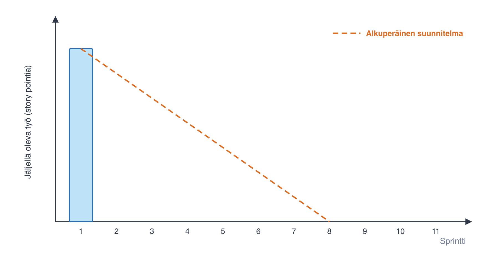{ width=350 }

# Burndown

- Projektin etenemistä kuvataan joskus release burndown -kaavion avulla

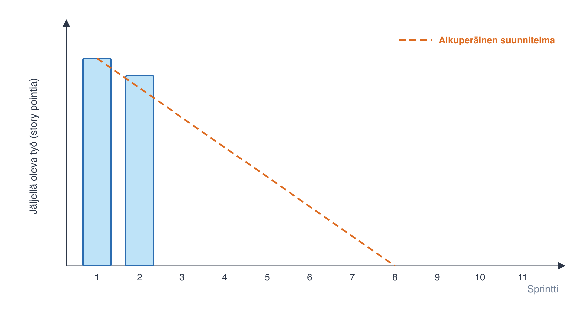{ width=350 }

# Burndown

- Projektin etenemistä kuvataan joskus release burndown -kaavion avulla

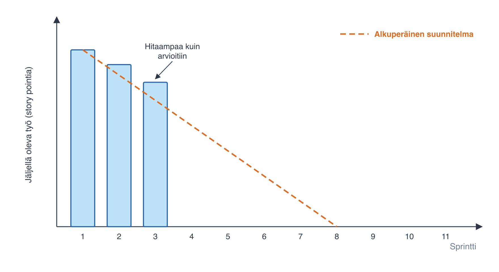{ width=350 }

# Burndown

- Projektin etenemistä kuvataan joskus release burndown -kaavion avulla

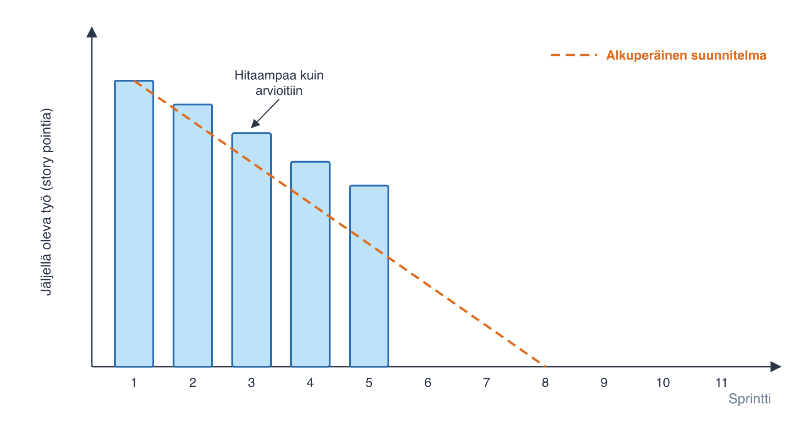{ width=350 }

# Burndown

- Projektin etenemistä kuvataan joskus release burndown -kaavion avulla

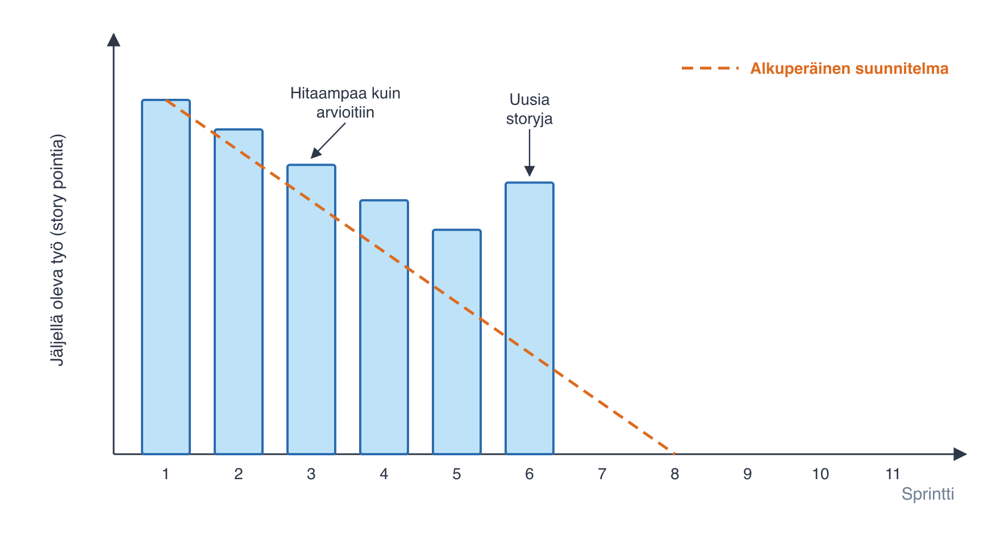{ width=350 }

# Burndown

- Projektin etenemistä kuvataan joskus release burndown -kaavion avulla

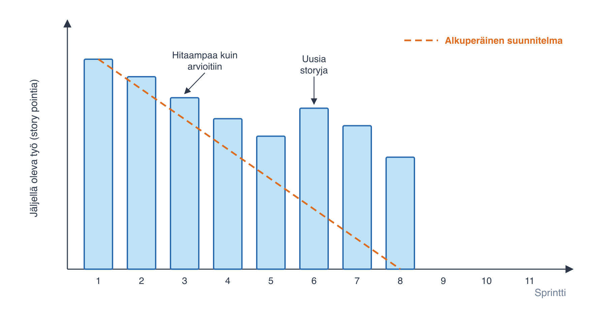{ width=350 }

# Burndown

- Projektin etenemistä kuvataan joskus release burndown -kaavion avulla

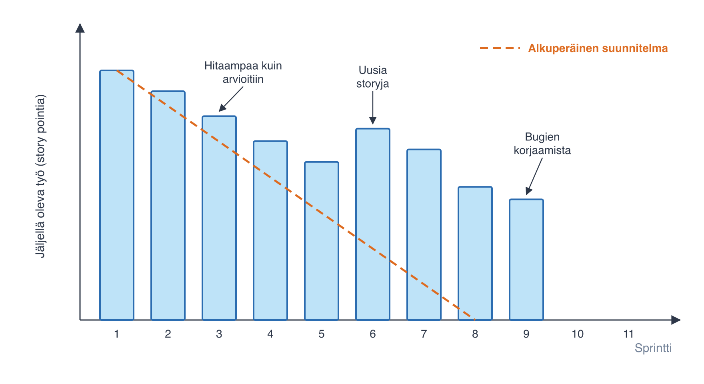{ width=350 }

# Burndown

- Projektin etenemistä kuvataan joskus release burndown -kaavion avulla

{ width=350 }

# Burnup

- Vaatimukset voivat muuttua kesken projektin, jolloin jäljellä olevan työn määrä ei aina vähene

. . .

- Burnup-kaavio tuo työmäärän kasvun selkeämmin esiin

{ width=350 }

# Kannattaako estimointi? #NoEstimates

- Storyjen viemän työmäärän arvioimiseen kaksi motivaatiota
  - auttaa asiakasta priorisoinnissa
  - mahdollistaa koko projektin tai kokonaisuuden viemän ajan ja kustannuksen arvioinnin

. . .

- Story point -pohjainen suhteellinen estimointi on saavuttanut vankan aseman
  - Scrum Guide mainitsee kokoarvion (size) backlogin kohteiden tietona
  - Samoin kuten monet parhaat käytänteet kuten DEEP

. . .

- _#NoEstimates_-liike ruvennut kyseenalaistamaan story point -perustaista estimointitapaa
  - pitää siitä saavutettuja hyötyjä liian vähäisinä verrattuna käytettyyn aikaan ja vaivaan
  - ei kiistä arvioiden hyötyä, vaan kysyy missä tilanteissa estimointi on järkevää

#

- Yksinkertainen vaihtoehto: **arvioidaan velositeetti laskemalla kussakin sprintissä valmistuneiden storyjen lukumäärä**

. . .

- Toimii jos storyt riittävän tasakokoisia?

. . .

- Tekoäly vaikeuttaa estimointia: suhteelliset koot ja velositeetti muuttuvat
  - kehittäjät yliarvioivat helposti tekoälyn tuoman hyödyn, tutkimustieto ristiriitaista

# Tauko 10 min

# Sprintti

# Sprintin suunnittelu

- Kertauksena alkuviikolta: Scrum määrittelee pidettäväksi ennen jokaista sprinttiä _suunnittelupalaverin_

. . .

- Palaverissa sovitaan
  - sprintin tavoite (_miksi_)
  - sprinttiin valittavat storyt (_mitä_)
  - niiden toteutustapa (_miten_)

. . .

- Lähtökohtana DEEP product backlog

. . .

- Product owner esittelee backlogin kärjessä olevat vaatimukset
  - Tiimin on tarkoitus olla riittävällä tasolla selvillä mitä vaatimuksilla tarkoitetaan

. . .

- Tiimi valitsee niin monta storyä kuin se arvioi kykenevänsä sprintin aikana toteuttamaan definition of donen laadulla

# Sprintin tavoite

- Suunnittelun yhteydessä määritellään _sprintin tavoite_ (sprint goal), eli sprintin yksi yhteinen päämäärä
  - Käytännössä usein lyhyt, yhden tai kahden lauseen kuvaus siitä, mitä tiimi on aikeissa sprintin aikana saada aikaan

. . .

- K. Schwaber, ensimmäisen sprintin tavoite:
  - _demonstrate a key piece of user functionality on the selected technology_

. . .

- Verkkokaupan sprinttien tavoitteita voisivat olla:
  - Ostoskorin perustoiminnallisuus: tuotteiden lisäys ja poisto
  - Ostosten maksaminen ja toimitustavan valinta

. . .

- Lyhyt kuvaus parempi niille sidosryhmäläisille, joita ei kiinnosta seurata tapahtumia yksittäisten storyjen tarkkuudella

# Sprinttiin valittavat storyt

- Sprintin tavoitteen asettamisen lisäksi tulee valita backlogista sprintin aikana toteutettavat storyt
  - Kehittäjät päättävät, kuinka monta storya sprinttiin otetaan

. . .

- Jos velositeetti on selvillä, on valinta periaatteessa helppo

{ width=230 }

- Jos velositeettiä ei tiedossa, käytetään harkintaa

#

- Product ownerilla on kolme keinoa vaikuttaa sprinttiin mahtuviin storyihin

{ width=230 }

- Entä jos myös D halutaan sprinttiin?

#

- Keino 1: uudelleenpriorisoidaan

{ width=250 }

. . .

- Entä jos myös C halutaan mukaan?

#

- Keino 2: karsitaan A:n kuvaamaa toiminnallisuutta

{ width=280 }

. . .

- Entä jos A ei saa pienentyä

#

- Keino 3: jaetaan A kahteen osaan

{ width=280 }

- Tärkeämpi osa toiminnallisuutta eli A1 mahtuu mukaan sprinttiin, vähemmän tärkeät osat eli A2 jää myöhempiin sprintteihin

. . .

- Lopullisen päätöksen sprinttiin mahtuvasta työmäärästä tekevät kuitenkin aina kehittäjät

# Storyjen jakaminen

- Haastava aihe aloittelijalle ja joskus myös kokeneille ohjelmistokehittäjille

- Pääperiaate: jakamisessa syntyvien storyjen edelleen noudatettava INVEST-kriteerejä

. . .

- Richard Lawrencen ohjeita

# Tapa 1: liiketoimintasääntöjen variaatiot (business rule variations)

_Käyttäjänä voin hakea lentoja joustavilla päivämäärillä_

. . .

kannattaa jakaa siten että jokainen näistä ehdoista eritellään omaksi storykseen

- _... "päivien x ja y välillä"_
- _... "jonakin joulukuun viikonloppuna"_
- _... "± n päivää päivistä x ja y"_

# Tapa 2: yksinkertainen/monimutkainen (simple/complex)

_Käyttäjänä voin hakea lentoja kahden kohteen välillä_

. . .

voidaan jakaa seuraavasti

- _... vain suorat lennot_
- _... välilaskujen enimmäismäärä määriteltynä_
- _... myös lähialueen lentokentät huomioiden_

# Tapa 3: suuri työmäärä (major effort)

_Käyttäjänä voin maksaa lennon VISA-, MasterCard-, Diners Club- tai American Express -kortilla_

. . .

voitaisiin jakaa kahtia, missä ensimmäisessä storyssa vasta hoidettaisiin yksi luottokorttityyppi, ja seuraava story yleistäisi toiminnan kaikkiin kortteihin:

- _... voin maksaa VISA-kortilla_
- _... voin maksaa kaikilla neljällä korttityypillä (kun yksi korttityyppi on jo toteutettu)_

# Tapa 4: tiedon syöttötavat (data entry methods)

_Käyttäjänä voin hakea lentoja kahden kohteen välillä_

. . .

jakaantuukin helposti kahteen esim. seuraavasti

- _... syöttämällä päivämäärät yksinkertaisesti tekstinä_
- _... hienon kalenterikäyttöliittymän avulla_

# Tapa 5: suorituskyvyn lykkääminen (defer performance)

_Käyttäjänä voin hakea lentoja kahden kohteen välillä_

. . .

jakaantuu kahtia seuraavasti:

- _... hitaasti: kunhan toimii, näytetään "haetaan"-animaatio_
- _... alle viidessä sekunnissa_

# Tapa 6: operaatiot (operations)

_Käyttäjänä voin hallinnoida käyttäjätiliäni_

. . .

jakaantuu moneen osaan

- _... voin luoda käyttäjätilin_
- _... voin muokata käyttäjätilini asetuksia_
- _... voin poistaa käyttäjätilini_

# Tapa 7: spiken erottaminen (break out a spike)

Jos tiimi ei ole toteuttanut koskaan luottokorttimaksuun liittyvää toiminnallisuutta, user storysta

_Käyttäjänä voin maksaa luottokortilla_

. . .

kannattaa eriyttää aikarajattu eksperimentti eli _spike_, joka suoritetaan aiemmassa sprintissä.

Tämän jälkeen toivon mukaan varsinaisen toiminnallisuuden toteuttava story osataan estimoida paremmin:

- _Selvitä luottokorttimaksujen käsittely_
- _Toteuta luottokorttimaksujen käsittely_

. . .

- Spike vs. MVP: kumpikin on epävarmuutta vähentävä kokeilu
  - spike vastaa tiimin omiin, esim. teknisiin kysymyksiin
  - MVP testaa, onko ideasta arvoa käyttäjille 

# Miten sprintin tavoitteeseen päästään?

- Sprintin suunnittelun yhteydessä sprinttiin valituille user storyille tehdään karkean tason suunnittelu

. . .

- Mietitään mitä _teknisen tason tehtäviä_ (task) on toteutettava, jotta user story saadaan valmiiksi

. . .

- Suunnitellaan komponentteja ja rajapintoja karkealla tasolla

. . .

- Huomioidaan uusien storyjen aiheuttamat muutokset olemassa olevaan osaan sovelluksesta

# Storyn jako taskeihin, esimerkki

- Esimerkiksi _tuotteen lisääminen ostoskoriin_, voitaisiin jakaa seuraaviin teknisiin taskeihin:
  - sessio, joka muistaa asiakkaan
  - oliot ja tietorakenteet ostoskorin ja ostoksen esittämiseen
  - laajennus tietokantaskeemaan
  - html-näkymää päivitettävä tarvittavilla painikkeilla
  - kontrolleri painikkeiden käsittelyyn
  - yksikkötestit kontrollerille ja ostoskorin logiikalle
  - hyväksymistestien automatisointi

. . .

- Kaikkia storyyn liittyviä taskeja ei sprintin suunnittelun aikana löydetä
  - Uusia taskeja generoidaan tarvittaessa sprintin edetessä

# Sprint backlog

- _Sprint backlog_ koostuu sprinttiin valituista storyista ja niihin liittyvistä tehtävistä eli taskeista

. . .

- Sprint backlog usein organisoitu taskboardiksi

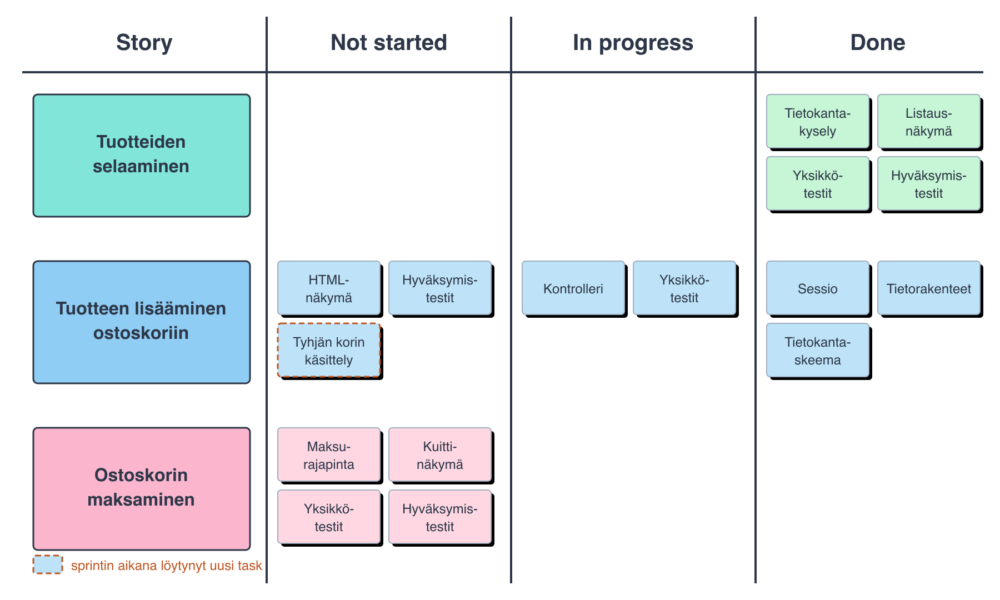{ width=250 }

- Taskit niiden valmistumisastetta kuvaavassa sarakkeessa

. . .

- Sprint backlog on kehittäjien työväline: Scrum ei määrää sen muotoa, tiimi muokkaa taskboardin omiin tarpeisiinsa

# Sprintin etenemisen seuranta

- Seurataan _valmiiksi saatuja storyja_, joko lukumäärä tai story pointit

. . .

- Toinen vaihtoehto on seurata valmistuneiden taskien lukumäärää, tätä  käytetään miniprojektissa
  - taskit kannattaa viedä loppuun story kerrallaan

. . .

- Työkalut (esim. GitHub Projects, Jira) piirtävät sprintin burndown- tai burnup-kaavion automaattisesti

. . .

- _A Scrum book 2019_: tiimi voi saada valmiiksi lähes kaikki taskit saamatta valmiiksi yhtäkään storya
  - taskeihin perustuva käyrä näyttää hyvältä, mutta asiakkaan saama arvo on nolla

# Joskus sprinteissä ...

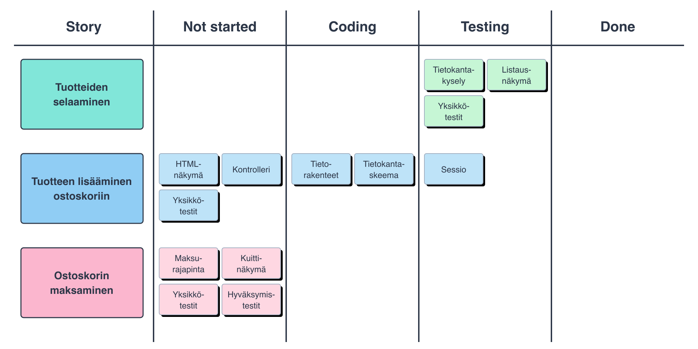{ width=350 }

# Joskus sprinteissä ...

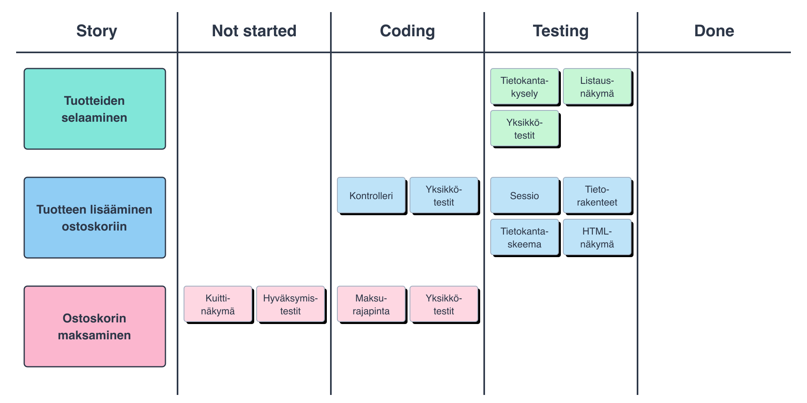{ width=350 }

# Joskus sprinteissä käy näin

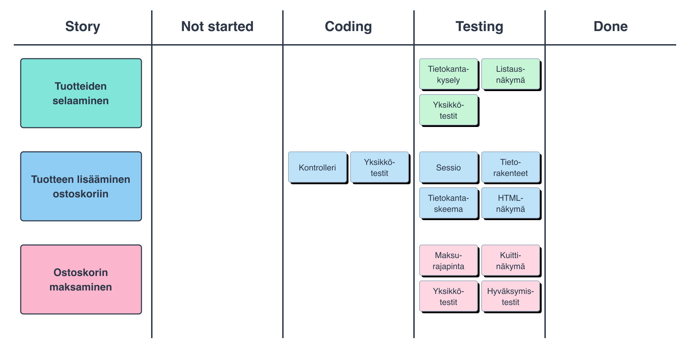{ width=350 }

# Puolivalmis työ kasautuu ja asiat eivät valmistu

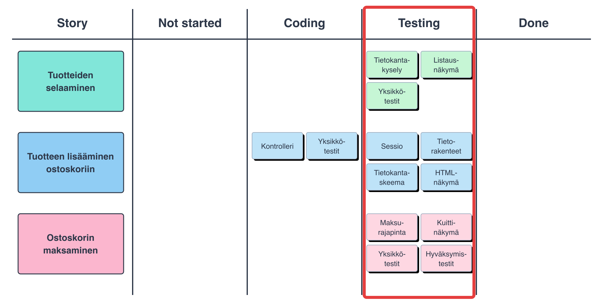{ width=350 }

- Yhtä aikaa työn alla olevien taskien suuri määrä voi koitua ongelmaksi
  - Riski sille, että sprintin päätyttyä paljon osittain valmiita storyja kasvaa

# WIP-rajoitteet

- Ratkaisu: _work in progress eli WIP_ -rajoitteet

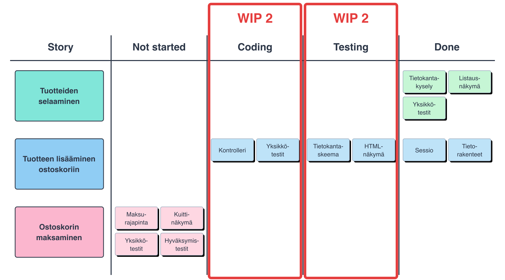{ width=300 }

# Kanban ja Lean

- WIP-rajoitusten idea on peräisin _Kanban_-menetelmästä, joka on eräs keskeisimmistä _Lean_-ajattelun työkaluista
  - Lean-ajattelu on peräisin jo kymmeniä vuosia vanhasta Toyota Production Systemistä

. . .

- Lean-ajattelun taustalla on idea _hukan_ eli asiakkaalle arvoa tuottamattomien asioiden eliminoinnista

. . .

- Toiminnallisuudet tuovat arvoa vasta käytössä, sitä ennen ne sitovat turhaan kustannuksia ja tuovat riskejä

. . .

- Hukkaa muun muassa: **osittain tehty työ, välivarastointi ja turha odottaminen**

# WIP-rajoitteiden soveltaminen

- WIP-rajoitteita voidaan soveltaa Scrumin yhteydessä monella tavalla

. . .

- Aika tavallista on rajoittaa tietyssä työvaiheessa, esim. toteutusvaiheessa olevien taskien määrää

. . .

- tai yksittäisen sovelluskehittäjän kerrallaan työn alla olevien töiden määrää

. . .

- Järkevintä lienee rajoittaa sprintin aikana yhtä aikaa työn alla olevien storyjen määrää mahdollisimman pieneksi

. . .

- WIP-rajoitteita säädetään usein retrospektiivien yhteydessä jos kehitystyössä havaitaan ongelmia

# Scrumban

- Scrum + Kanbanin käytäntöjä
  - WIP-rajoitteet: kerralla työn alla vain rajattu määrä asioita
  - työn virtauksen seuraaminen: kauanko storyn valmistuminen kestää ja missä työ jumittaa

. . .

- Suunnittelu tarpeen mukaan, ei välttämättä kiinteitä sprinttejä
  - estimointia kevennetään, ennusteet toteutuneesta läpimenonopeudesta

. . .

- Sopii esim. ylläpito- ja tukityöhön, jossa työtä tulee jatkuvasti ja ennakoimatta
  - riskinä, että sprintin tuoma säännöllinen pysähtyminen ja tarkastelu katoaa

. . .

- Hybridimallit ovat valtavirtaa: harva noudattaa yhtä menetelmää sellaisenaan
