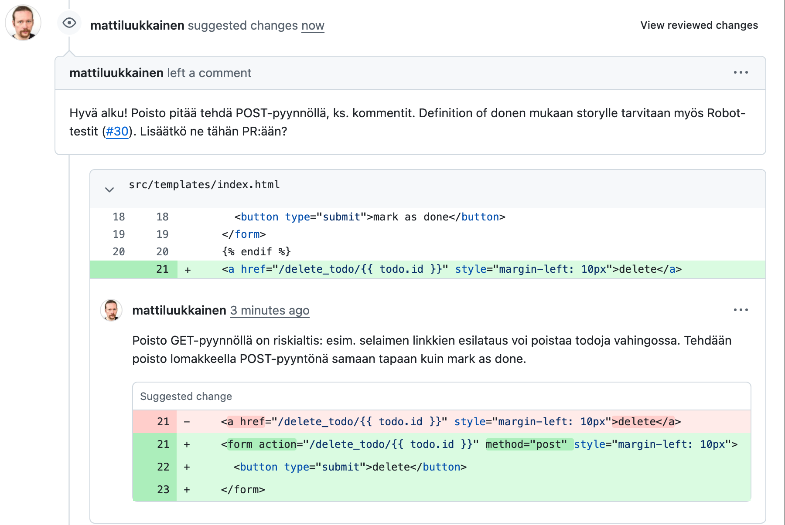
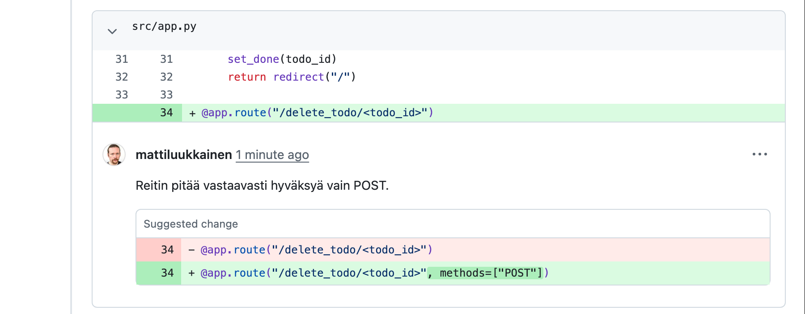
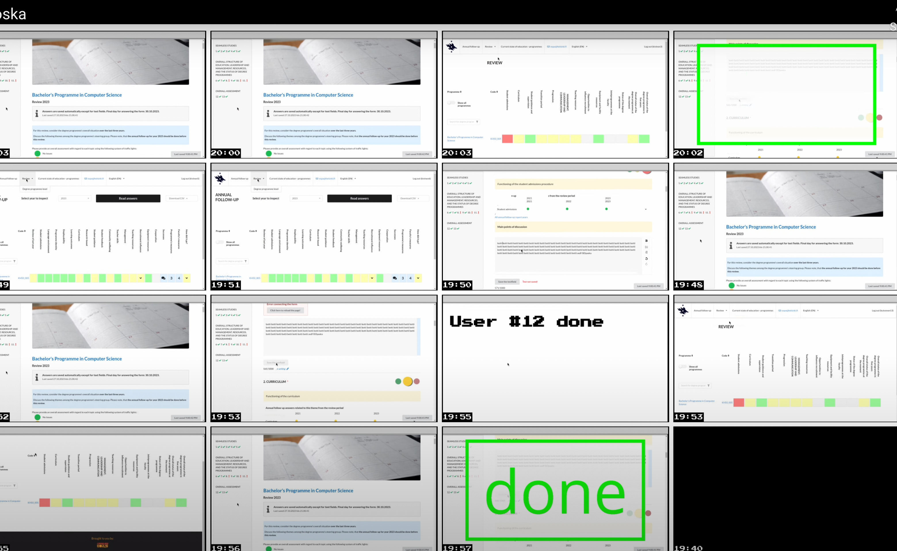
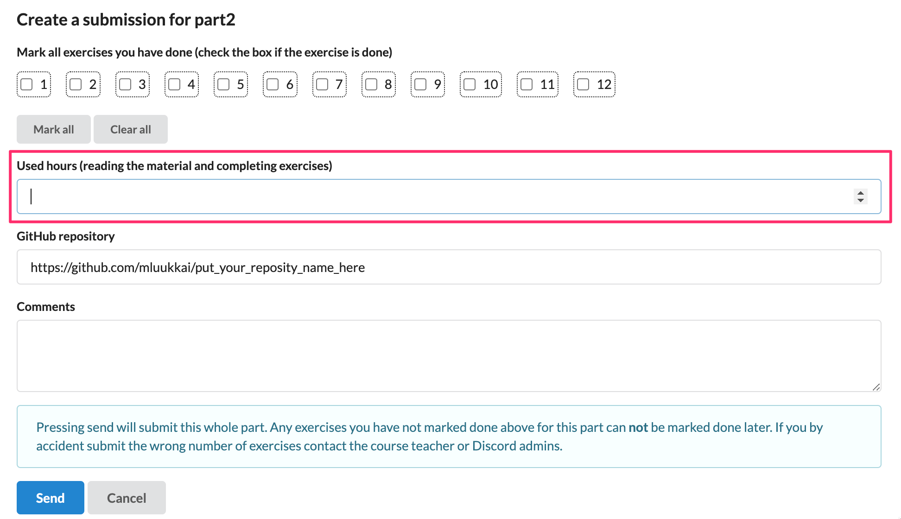
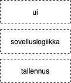
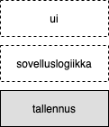
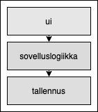
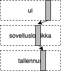
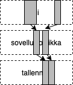
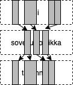

# Ohjelmistotuotanto

&nbsp;&nbsp;&nbsp;&nbsp;&nbsp;&nbsp;&nbsp;&nbsp;&nbsp;&nbsp;&nbsp;&nbsp;&nbsp;&nbsp;&nbsp;&nbsp;&nbsp;&nbsp;&nbsp;&nbsp;&nbsp;&nbsp;&nbsp;&nbsp;&nbsp;&nbsp;&nbsp;&nbsp;&nbsp;&nbsp;&nbsp;&nbsp;&nbsp;&nbsp;&nbsp;Syksy 2026

&nbsp;&nbsp;&nbsp;&nbsp;&nbsp;&nbsp;&nbsp;&nbsp;&nbsp;&nbsp;&nbsp;&nbsp;&nbsp;&nbsp;&nbsp;&nbsp;&nbsp;&nbsp;&nbsp;&nbsp;&nbsp;&nbsp;&nbsp;&nbsp;&nbsp;&nbsp;&nbsp;&nbsp;&nbsp;&nbsp;&nbsp;&nbsp;&nbsp;&nbsp;&nbsp;&nbsp;&nbsp;Luento 5

&nbsp;&nbsp;&nbsp;&nbsp;&nbsp;&nbsp;&nbsp;&nbsp;&nbsp;&nbsp;&nbsp;&nbsp;&nbsp;&nbsp;&nbsp;&nbsp;&nbsp;&nbsp;&nbsp;&nbsp;&nbsp;&nbsp;&nbsp;&nbsp;&nbsp;&nbsp;&nbsp;&nbsp;&nbsp;&nbsp;&nbsp;&nbsp;&nbsp;&nbsp;&nbsp;&nbsp;9.11.2026

# Kurssipalaute

- Kurssipalaute
  - Kurssilla lopussa kerättävän palautteen lisäksi ns. jatkuva palaute https://norppa.helsinki.fi

# Paja

- BK107 
  - ma 14.30-16.30
  - ti 12-16
  - to 12-16
  - pe 12-14

# Miniprojektit

- Käynnistyvät **tänään!**


- Aloitustilaisuudet
  - ma 14-16
  - ti 14-16
  - ke 10-12
  - ke 12-14
  - to 14-16
  - to 16-18

- Seuraavat viikot: sprinttien katselmus ja suunnittelu samassa aikaikkunassa

- Loppudemot
  - **ke 9.12. klo 10-12 B123**
  - **to 10.12. klo 10-12 A111**

# CurreChat

- Käytettävissä HY:n GPT-chat
  - https://curre.helsinki.fi/chat

. . .

{ width=370 }

. . .

- Ei (ehkä) hallusinoi
- Osin herkkä kysymysten sanamuodon suhteen


# Ohjelmiston elinkaari (software lifecycle)

- Vaatimusten analysointi ja määrittely
- Suunnittelu
- Toteutus
- **Testaus ja laadunhallinta**
- Ohjelmiston ylläpito ja evoluutio


# Ohjelmistojen laadunhallinta

- Laadunhallinnan kaksi oleellista kysymystä
  - verifiointi: _are we building the product right_
  - validointi: _are we building the right product_

. . .

- **Verifiointi**: toteuttaako ohjelmisto vaatimusmäärittelyn aikana asetetut vaatimukset
  - Testataan toiminnalliset ja ei-toiminnalliset vaatimukset

. . .

- **Validointi**: täyttääkö ohjelmisto käyttäjän odotukset
  - Vaatimusmäärittelyn ei aina ole kirjattu sitä mitä käyttäjä todella tarvitsee

# Verifiointi ja Validointi

- Varmistetaan että ohjelma on _riittävän hyvä_ käyttötarkoitukseensa
  - Hyvyys on suhteellista ja riippuu ohjelman käyttötarkoituksesta
  - Ohjelman ei yleensä tarvitse olla virheetön ollakseen riittävän hyvä käytettäväksi

. . .

- Verifioinnin ja validoinnin suorittamista käytetään yleisesti nimitystä _laadunhallinta_ (engl. quality assurance, QA)
  - Jos laadunhallinta on erillisen tiimin vastuulla, käytetään tästä usein nimitystä _QA-tiimi_

# Verifioinnin ja Validoinnin tekniikat

- Verifioinnissa käytetään kahta erilaista tekniikkaa
  - Katselmointia
  - Testausta

. . .

- **Katselmoinneissa** (review) käydään läpi tuotantoprosessin aikana tehtyjä dokumentteja ja ohjelmakoodia, ja etsitään näistä ongelmia

. . .

- _Staattinen tekniikka_, suorituskelpoista koodia ei tarvita
  - Jos kohteena on ohjelmakoodi, ei sitä katselmoinnissa suoriteta

. . .

- **Testausksessa** tarkkaillaan miten ohjelma reagoi annettuihin testisyötteisiin
  - _dynaaminen tekniikka_, edellyttää ohjelmakoodin suorittamista

#

&nbsp;&nbsp;&nbsp;&nbsp;&nbsp;&nbsp;&nbsp;&nbsp;&nbsp;&nbsp;&nbsp;&nbsp;&nbsp;&nbsp;&nbsp;&nbsp;&nbsp;&nbsp;&nbsp;&nbsp;&nbsp;&nbsp;&nbsp;&nbsp;&nbsp;&nbsp;&nbsp;&nbsp;&nbsp;&nbsp;&nbsp;&nbsp;&nbsp;&nbsp;&nbsp;Katselmointi

# Vaatimusten validointi katselmoimalla dokumentaatiota

. . .

- Ohjelmistolle määritellyt vaatimukset on validoitava:
  - varmistettava, että määrittelydokumentti määrittelee oikeanlaisen ohjelmiston

. . .

- Vesiputousmallissa määrittelydokumentin kirjattujen vaatimusten validointi suoritetaan _katselmoimalla_

. . .

- Vaatimusmäärittelyn lopuksi asiakas tarkastaa vastaako määrittelydokumentti mielikuvaa tilattavasta järjestelmästä

. . .

- Katselmoinnin jälkeen määrittelydokumentti jäädytetään
  - muuttaminen vaatii yleensä monimutkaista prosessia

# Vaatimusten ketterä validointi

- Ketterässä ohjelmistotuotannossa vaatimusten validointi tapahtuu sprinttien päättävien demonstraatioiden yhteydessä

. . .

- Asiakkaalle näytetään ohjelman toimivaa versiota

. . .

- Asiakas voi itse verrata onko lopputulos haluttu
  - Jos ei, on seuraavassa sprintissä mahdollista ottaa korjausliike

# Koodin katselmointi

. . .

- Koodin katselmointi eli lukeminen jonkun muun kuin ohjelmoijan toimesta on tutkitusti tehokas keino laadun parantamisessa

. . .

- Voidaan havaita koodista ongelmia, joita testaus ei havaitse
  - noudattaako koodi sovittua tyyliä
  - onko koodi ylläpidettävää
  - onko koodissa tietoturvan kannalta vaarallisia piirteitä

. . .

- Perinteisesti käyty läpi onko koodissa tiettyjä checklisteissä listattuja riskialttiita piirteitä

#

{ width=400 }

# Staattinen analyysi

- Nykyään on tarjolla katselmointia automatisoivia _staattista analyysiä_ tekeviä työkaluja
  - Pythonilla Pylint ja yhä suositumpi Ruff
  - JavaScriptilla ESlint

. . .

- Myös pilvipalveluna toimivia työkaluja (esim. Qlty) 
  - Suorittavat tarkastukset aina kun uutta koodia pushataan GitHubiin
  - Huomaavat koodin laadun muutoksista, esim. jos koodin kompleksisuus kasvaa muutosten yhteydessä

. . .

- GitHubiin sisäänrakennettuna
  - CodeQL etsii tietoturva-aukkoja
  - Dependabot varoittaa haavoittuvista riippuvuuksista
  - salaisuuksien skannaus varoittaa repositorioon päätyneistä API-avaimista ja salasanoista

# Esimerkki qlty.sh
 
{ width=400 }

#

{ width=400 }


# Koodin katselmointi: GitHub ja pull requestit

- GitHubin _pull requestit_ tarjoavat hyvän työkalun koodikatselmointiin

. . .

- Työn kulku on seuraava
  - Sovelluskehittäjä tekee muutokset omaan haaraansa (branch) ja avaa siitä pull requestin
  - open source -projekteissa ulkopuolinen kehittäjä tekee muutokset forkkaamaansa kopioon
  - Joku, esim. _senior developer_ tekee katselmoinnin pull requestille
  - Jos koodi ei ole riittävän hyvää, annetaan pull requestin tekijälle parannusehdotuksia
  - Muutosten ollessa hyväksyttäviä pull request yhdistetään päärepositorioon

# Esimerkki: pull request miniprojektin boilerplateen

{ width=400 }

- _Closes #28_: mergeäminen sulkee storyn taskin

# Katselmoija pyytää korjauksia

{ height=230 }

# Ehdotettu muutos (suggested change)

{ width=380 }

- Tekijä voi hyväksyä ehdotuksen yhdellä napin painalluksella

# Katselmoinnin hyödyt

- Microsoftilla tehty tutkimus (Bacchelli & Bird 2013)
  - kehittäjät pitivät virheiden löytämistä katselmoinnin päätavoitteena
  - valtaosa kommenteista koski kuitenkin ylläpidettävyyttä ja ymmärrettävyyttä

. . .

- Tärkeitä hyötyjä myös tiedon levittäminen tiimissä ja vaihtoehtoisten ratkaisujen löytäminen
  - samansuuntaiset tulokset Googlella (Sadowski ym. 2018)

. . .

- Tärkein yksittäinen asia: **pidä pull requestit pieninä**
  - pienen muutoksen voi katselmoida huolellisesti
  - tuhannen rivin muutokselle annetaan helposti pelkkä "LGTM"

# Katselmointi on vuorovaikutustilanne

- Virheiden osoittaminen ja eriävä mielipide ovat ihmissuhteisiin liittyviä riskejä
  - niin katselmoijalle kuin koodin kirjoittajalle

. . .

- Kommentit kannattaa kohdistaa koodiin, ei sen kirjoittajaan

. . .

- Katselmoinnin voi tehdä myös yhdessä
  - molemmat voivat perustella ratkaisujaan ja kasvattaa ymmärrystään

# GitHub copilotin tekemä koodin katselmointi

. . .

- Pull requestin tekemien muutosten yleiskatsaus

{ width=400 }

#

Copilot antaa myös detaljoidumpia kommentteja sekä parannusehdotuksia

{ width=400 }

# Extreme programmingin katselmoinnin menetelmiä

. . .

- Toisin kuin Scrum, eXtreme Programming eli XP määrittelee useita sovelluskehityksen käytänteitä
  - Suuri osa näistä on hyvin tunnettuja parhaita käytänteitä, vietynä äärimmäiseen (extreme) muotoon

. . .

- Osa käytänteistä tähtää laadun maksimoimiseen, kolmen voidaan ajatella olevan katselmoinnin sukulaisia

# Pariohjelmointi

- _Pariohjelmoinnissa_ (pair programming) kaksi ohjelmoijaa työskentelee yhdessä samalla koneella

. . .

- Koodia kirjoittava osapuoli toimii _ohjaajana_ (driver) ja toinen _navigoijana_ (navigator)
  - Roolia vaihdetaan sopivin väliajoin

. . .

- Navigoija tekee koodiin **jatkuvaa katselmointia**

# Pariohjelmoinnin etuja

- Parantaa ohjelmoijien kuria ja työhön keskittymistä

. . .

- Hyvä oppimisen väline
  - ohjelmoijat oppivat toisiltaan erityisesti noviisit kokeneimmilta
  - järjestelmän tietyn osan tuntee aina useampi ohjelmoija

. . .

- Tutkimusten mukaan parantaa laatua jossain määrin, mutta kokonaistyömäärä kasvaa
  - eniten hyötyä monimutkaisissa tehtävissä ja kun tavoitteena myös oppiminen

. . .

- Myönteinen vaikutus tiimidynamiikkaan
  - kytkeytyy psykologiseen turvallisuuteen: edellyttää sitä ja toisaalta vahvistaa sitä
  - jatkuva pariohjelmointi koetaan kuormittavaksi, siksi usein valikoidusti

# Pariohjelmoinnin yleisyys

- Pariohjelmointi tai useamman ihmisen versio siitä, _mob-programming_ on melko yleistä

. . .

- Määritelmän mukaista systemaattista pariohjelmointia tehdään aika harvassa paikassa aamusta iltaan

. . .

- Yleensä ohjelmoidaan yksin, mutta spontaania pariutumista ja ryhmäytymistä tapahtuu
  - erityisesti teknisesti haasteellisissa koodin osissa
  - tai jos kyse itselle tuntemattomasta osasta koodia

# Yhteisomistajuus

- _Koodin yhteisomistajuus_ (collective code ownership): kukaan yksittäinen ohjelmoija ei hallitse yksin mitään kohtaa koodista
  - Kaikilla lupa tehdä muutoksia mihin tahansa kohtaan koodia

. . .

- Pariohjelmointi tukee yhteisomistajuutta

. . .

- Yhteisomistajuudessa on riskinsä: koodia tuntematon voi saada pahaa jälkeä aikaan
  - XP eliminoi riskejä testauksiin liittyvillä käytänteillä
  - kun virhe pääsee läpi, selvitetään onko testeissä samanlainen aukko muuallakin

. . .

- _Ohjelmointistandardi_ (coding standards): tiimi määrittelee koodityylin, johon kaikki ohjelmoijat sitoutuvat
  - Tyylillä tarkoitetaan nimeämiskäytäntöä, koodin muotoilua ja myös tiettyjä ohjelman rakenteeseen liittyviä seikkoja

. . .

- Noudattamista kontrolloidaan katselmoimalla sekä automaattisesti staattisen analyysin työkaluilla kuten Pylintillä

# TAUKO 10 min

#

&nbsp;&nbsp;&nbsp;&nbsp;&nbsp;&nbsp;&nbsp;&nbsp;&nbsp;&nbsp;&nbsp;&nbsp;&nbsp;&nbsp;&nbsp;&nbsp;&nbsp;&nbsp;&nbsp;&nbsp;&nbsp;&nbsp;&nbsp;&nbsp;&nbsp;&nbsp;&nbsp;&nbsp;&nbsp;&nbsp;&nbsp;&nbsp;&nbsp;&nbsp;&nbsp;&nbsp;&nbsp;Testaus

# Testaus

- Ohjelmiston osoittaminen virheettömäksi on mahdotonta

. . .

- Testauksen tarkoituksena vakuuttaa asiakas ja kehittäjät siitä, että ohjelmisto on _tarpeeksi hyvä_ käytettäväksi

. . .

- Testauksella on kaksi eriävää tavoitetta
  - osoittaa, että ohjelmisto täyttää sille asetetut vaatimukset
  - löytää ohjelmistosta virheitä

. . .

- Tähtää ohjelman _ulkoisen laadun_ (external quality) eli käyttäjän kokeman laadun parantamiseen
  - toteuttaako halutun toiminnallisuuden
  - onko riittävän bugiton käytettäväksi
  - sopiiko sovellus sen käyttötarkoitukseen

# Testauksen tasot

. . .

- _Yksikkötestaus_ (unit testing)
  - Yksittäisten luokkien, metodien ja moduulien testaus erillään muusta kokonaisuudesta

. . .

- _Integraatiotestaus_ (integration testing)
  - Yksittäin testattujen komponenttien liittäminen yhteen eli integrointi ja kokonaisuuden testaus

. . .

- _Järjestelmätestaus_ (system testing)
  - Toimiiko ohjelmisto vaatimuksiin kirjatulla tavalla?
  - Tutkii järjestelmää kokonaisuudessaan: _end to end -testaus_
  - Jakautuu useisiin alalajeihin

. . .

- _Käyttäjän hyväksymistestaus_ (user acceptance testing)
  - Loppukäyttäjän tuotteelle suorittama testaus

# "V-malli"

{ width=400 }

# Järjestelmätestaus

- Tarkoitus varmistaa, että järjestelmä toimii vaatimuksiin kirjatulla tavalla
  - Perinteisesti erilliset testaajat tai laadunhallintatiimi
  - Ketterässä ihanteena, että testaus kuuluu koko (cross functional) tiimille

. . .

- Testaus tapahtuu yleensä ilman tietoa järjestelmän sisäisestä rakenteesta eli kyseessä _black box_ -testaus

. . .

- Testataan järjestelmää saman rajapinnan kautta, jonka kautta järjestelmää käytetään

. . .

- Tarkastelevat sovelluksen toiminnalisuutta kaikilla tasoilla käyttöliittymästä sovelluslogiikkaan ja tietokantaan
  - Käytetään nimitystä _end to end -testaus_

# Järjestelmätestaus

- Perustuu järjestelmän potentiaalisiin käyttöskenaarioihin
  - user storyinä olevista vaatimuksista helppo muotoilla testejä
  - jos storyillä hyväksymiskriteeriot, tilanne on vieläkin parempi

. . .

- Kutsutaan myös _toiminnallisiksi testeiksi_ (functional test)

. . .

- Toiminnallisen testauksen lisäksi järjestelmätestaukseen kuuluu mm.
  - Käytettävyystestaus
  - Suorituskykytestaus
  - Kuormitustestaus
  - Tietoturvan testaus
  - Saavutettavuuden testaus

# Kuormitustestaus: esimerkki

. . .

{ width=400 }

# Kuormitustestaus: ennen

{ width=400 }

# Kuormitustestaus: jälkeen

{ width=400 }

# Saavutettavuuden testaaminen: palautusjärjestelmä

. . . 


# Testitapausten valinta

- Yksi _Testitapaus_ testaa toiminnallisuutta joillakin syötteillä

. . .

- Kattava testaaminen on mahdotonta ja testaus työlästä
  - Oleellista löytää kohtuullisen kokoinen _testitapausten joukko_, jonka avulla löytyy suuri määrä virheitä

. . .

- Useat syötteet ohjelmiston toiminnan kannalta samanlaisia
  - nämä muodostavat _ekvivalenssiluokan_

. . .

- Jaetaan syötteet ekvivalenssiluokkiin ja tehdään yksi testitapaus jokaiseta ekvivalenssiluokkasta

. . .

- Erityisen kiinnostavia syötearvoja ovat ekvivalenssiluokkien väliset _raja-arvot_


# Testisyötteiden valinta: palautussovellus

- Mitä testitapauksia kannattaisi valita palautussovelluksen testaamiseen?

{ width=350 }

# Testisyötteiden valinta: palautussovellus

- Tunnit
  - tyhjä
  - negatiivinen
  - nolla
  - positiivinen järkevä arvo (esim. 5)
  - positiivinen mutta epärealistinen (esim. 1000)
  - merkkejä sisältävä syöte

. . .

- Repositorio
  - tyhjä
  - validi repositoriolinkki
  - epävalidi merkkijono 

# Yksikkötestaus

. . .

- Kohteena siis yksittäiset metodit ja luokat

  - _Developer testing_: sovelluskehittäjien vastuulla
      
. . .

- Testattavan koodin rakenne otetaan huomioon testejä laatiessa, _lasilaatikkotestausta_ (white box testing)

. . .

- Päätarkoitus _sisäisen laadun_ (internal quality) kontrollointi
  - onko virheiden jäljitys ja korjaaminen helppoa
  - onko koodia helppo laajentaa ja jatkokehittää
  - pystytäänkö koodin toiminnallisuuden oikeellisuus varmistamaan muutoksia tehtäessä

# Yksikkötestaus

- Iteratiivisessa kehityksessä sisäisellä laadulla suuri merkitys
  - ohjelmistoa laajennetaan koko ajan

. . .

- Edesauttaa myös ulkoista eli asiakkaan kokemaa laatua
  - Yksikkötestit voivat eliminoida joitain asiakkaalle näkyviä virheitä, joita järjestelmätestauksen testitapaukset eivät löydä

. . .

- Bugit parempi paikallistaa ajoissa
  - yksikkötestauksessa löydetty bugi on yleensä helpompi ja nopeampi korjata kuin järjestelmä- tai integraatiotestauksessa löytyvä

. . .

- Koska yksikkötestejä joudutaan suorittamaan moneen kertaan, tulee niiden suorittaminen _automatisoida_

# Mitä tulisi (yksikkö)testata?

- Automatisoidun testauksen esi-isän Kent Beckin vastaus:
  - "Do I have to write a test for everything?"
  - "No, just test everything that could reasonably break"

. . .

- Optimitilanteessa testitapaukset
  - kaikkien metodit ja niiden kutsukombinaatiot hyväksyttävillä parametrien arvoilla
  - ja virheellisillä parametrien arvoilla

. . .

- Ekvivalenssiluokat ja niiden raja-arvot kannattaa huomioida
  - testien parametrien ekvivalenssiluokat ja raja-arvot pääteltävissä koodista

# Ominaisuuspohjainen testaus

- _Property-based testing_: syötteitä ei valita käsin, vaan kuvataan ominaisuus, jonka pitää päteä kaikilla syötteillä
  - kirjasto generoi satoja syötteitä ja etsii ominaisuuden rikkovia

```python
@given(st.integers(min_value=0, max_value=100),
       st.integers(min_value=-10, max_value=200))
def test_ottaminen_ei_hukkaa_tavaraa(alku_saldo, maara):
    varasto = Varasto(100, alku_saldo)
    otettu = varasto.ota_varastosta(maara)

    assert varasto.saldo >= 0
    assert otettu + varasto.saldo == alku_saldo
```

- Pythonissa Hypothesis-kirjasto, joka myös pienentää virheen aiheuttavan syötteen yksinkertaisimmaksi

# Testauskattavuus

- Testien laajuutta voidaan mitata _testauskattavuuden_ (test coverage) käsitteellä

. . .

- Muutamaa eri tyyppiä
  - **rivikattavuus**
  - **haarautumakattavuus**
  - ehtokattavuus
  - polkukattavuus

. . .

- Rivi- ja haarautumakattavuudelle hyvä työkalutuki, esim. coverage Pythonille

#

{ width=400 }

# Mitä kattavuus kertoo?

- Kattavuus kertoo, mitä **ei** ole testattu
  - korkea kattavuus ei vielä kerro, että testit tarkistavat jotain järkevää
  - kattavuuden ja testien virheiden löytämiskyvyn välinen yhteys on tutkimuksissa heikko

. . .

- Kattavuutta ei kannata asettaa tavoitteeksi (Goodhartin laki)
  - Googlen ohjeistus: 60 % hyväksyttävä, 75 % suositeltava, 90 % esimerkillinen

. . .

- Testien hyvyyttä voi arvioida _mutaatiotestauksella_
  - koodiin istutetaan pieniä bugeja: huomaavatko testit ne?
  - työkaluja: mutmut (Python), PIT (Java), Stryker (JavaScript)
  - hyödyllinen erityisesti tekoälyagentin kirjoittamien testien arvioinnissa

# Ohjelmiston integraatio

. . .

- Järjestelmän yksittäiset, erillään yksikkötestatut luokat tulee integroida toimivaksi kokonaisuudeksi

. . .

- Integroinnin yhteydessä suoritetaan integrointitestaus
  - Toimivatko komponentit yhdessä?

. . .

- Kaksi lähestymistapaa:
  - rakenteeseen perustuva
  - toiminnallisuuksiin perustuva

# Rakenteeseen perustuva integraatio

- Integroidaan arkkitehtuurikomponentti kerrallaan

. . .

- Verkkokaupassa: sovelluslogiikan luokat, käyttöliittymän luokat ja tietokantarajapinta ensin omina kokonaisuuksinaan

. . .

{ width=100 }

# Rakenteeseen perustuva integraatio

- Integroidaan arkkitehtuurikomponentti kerrallaan

- Verkkokaupassa: sovelluslogiikan luokat, käyttöliittymän luokat ja tietokantarajapinta ensin omina kokonaisuuksinaan

{ width=100 }

# Rakenteeseen perustuva integraatio

- Integroidaan arkkitehtuurikomponentti kerrallaan

- Verkkokaupassa: sovelluslogiikan luokat, käyttöliittymän luokat ja tietokantarajapinta ensin omina kokonaisuuksinaan

{ width=100 }

# Rakenteeseen perustuva integraatio

- Integroidaan arkkitehtuurikomponentti kerrallaan

- Verkkokaupassa: sovelluslogiikan luokat, käyttöliittymän luokat ja tietokantarajapinta ensin omina kokonaisuuksinaan

{ width=100 }

# Rakenteeseen perustuva integraatio

- Integroidaan arkkitehtuurikomponentti kerrallaan

- Verkkokaupassa: sovelluslogiikan luokat, käyttöliittymän luokat ja tietokantarajapinta ensin omina kokonaisuuksinaan

{ width=100 }

# Ohjelmiston integraatio

- Rakenteeseen perustuva integraatio on vesiputuoksen toimintatapa

. . .

- Tämän tyylinen _big bang_ -integraatio on osoittautunut todella riskialttiiksi
  - Seurauksena usein ns. **integraatiohelvetti**

. . .

- Moderni ohjelmistotuotanto suosii ns. _jatkuvaa integraatiota_
  - Hyvin tiheässä tahdissa tapahtuvaa ominaisuuksiin perustuvaa integrointia


# Ominaisuuksiin perustuva integraatio

- Toiminnallisuus kerrallaan

. . .

- Esim. integroidaan kerrallaan kaikki storyn _lisää tuote ostoskoriin_ toteuttava koodi
  - Tämän jälkeen integroidaan seuraavan storyn koodi

. . .

{ width=100 }

# Ominaisuuksiin perustuva integraatio

- Toiminnallisuus kerrallaan

- Esim. integroidaan kerrallaan kaikki storyn _lisää tuote ostoskoriin_ toteuttava koodi
  - Tämän jälkeen integroidaan seuraavan storyn koodi

{ width=100 }

# Ominaisuuksiin perustuva integraatio

- Toiminnallisuus kerrallaan

- Esim. integroidaan kerrallaan kaikki storyn _lisää tuote ostoskoriin_ toteuttava koodi
  - Tämän jälkeen integroidaan seuraavan storyn koodi

{ width=100 }

# Ominaisuuksiin perustuva integraatio

- Toiminnallisuus kerrallaan

- Esim. integroidaan kerrallaan kaikki storyn _lisää tuote ostoskoriin_ toteuttava koodi
  - Tämän jälkeen integroidaan seuraavan storyn koodi

{ width=100 }

# Integraatiotestauksen käytänteitä

- Integraatiotesteissä tarvitaan usein oikea tietokanta tai muu ulkoinen palvelu
  - kevyt korvaava tietokanta (esim. SQLite) voi peittää ongelmia
  - nykyään käynnistetään oikea tietokanta testien ajaksi kontissa (esim. Testcontainers)

. . .

- Useista erikseen kehitettävistä palveluista koostuva sovellus: _sopimustestaus_ (contract testing)
  - palvelun käyttäjä kirjaa odottamansa pyynnöt ja vastaukset
  - palvelun tarjoaja testaa erikseen täyttävänsä sopimuksen
  - esim. Pact

# Regressiotestaus

- Iteratiivisessa ohjelmistotuotannossa, jokainen iteraatio tuottaa ohjelmistoon uusia ominaisuuksia
  - Samalla tulee huolehtia, että ei rikota jo toimivia osia

. . .

- Testit on suoritettava uudelleen aina kun ohjelmistoon tehdään muutoksia
- Tätä käytäntöä sanotaan _regressiotestaukseksi_

. . .

- Regressiotestijoukko koostuu kaikista ohjelmistolle tehdyistä testeistä
  - sisältää yksikkö-, integraatio- ja järjestelmätesteistä

. . .

- Testaus on työlästä ja regressiotestauksen tarve tekee siitä entistä työläämpää
  - _Testaus kannattaa automatisoida_ mahdollisimman suurissa määrin

# Epävakaat testit

- _Flaky test_: menee välillä läpi ja välillä ei, vaikka koodi ei ole muuttunut
  - syynä usein ajoitus, testien suoritusjärjestys, ulkoiset palvelut tai jaettu tila

. . .

- Jos testit punastuvat satunnaisesti, epäonnistumisia aletaan sivuuttaa
  - silloin myös todelliset virheet jäävät huomaamatta

. . .

- Googlella noin 16 % testeistä jossain määrin epävakaita

. . .

- Martin Fowler: epävakaa testi heti karanteeniin ja korjataan pikaisesti

# Testauksen tasot: kertaus

. . .

- _Yksikkötestaus_ (unit testing)
  - Yksittäisten luokkien, metodien ja moduulien testaus erillään muusta kokonaisuudesta

- _Integraatiotestaus_ (integration testing)
  - Yksittäin testattujen komponenttien liittäminen yhteen eli integrointi ja kokonaisuuden testaus

- _Järjestelmätestaus_ (system testing)
  - Toimiiko ohjelmisto vaatimuksiin kirjatulla tavalla?
  - Tutkii järjestelmää kokonaisuudessaan: _end to end -testaus_
  - Jakautuu useisiin alalajeihin

- _Käyttäjän hyväksymistestaus_ (user acceptance testing)
  - Loppukäyttäjän tuotteelle suorittama testaus

# Huomenna

. . .

- Ketterien menetelmien suosimia testauksen ja laadunhallinnan käytänteitä
