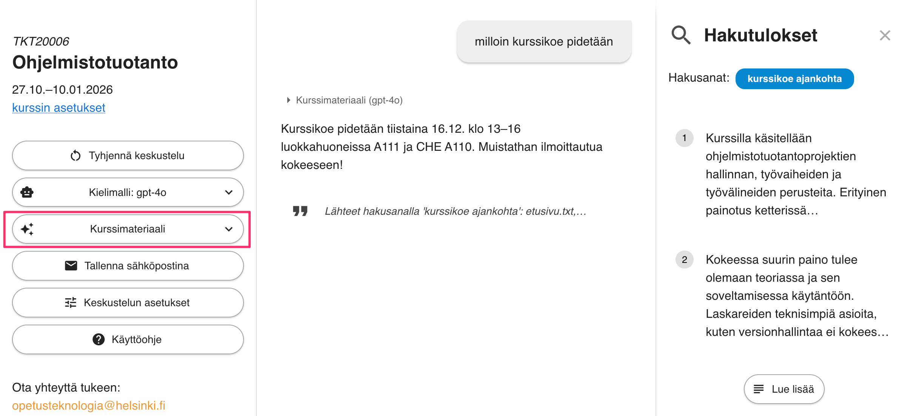
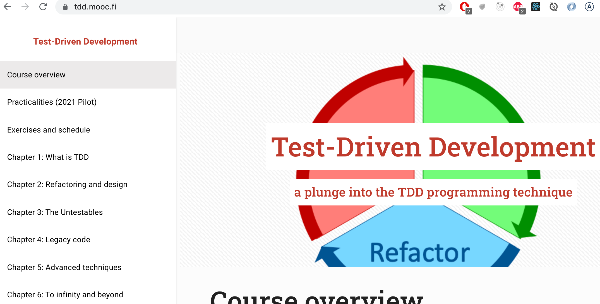
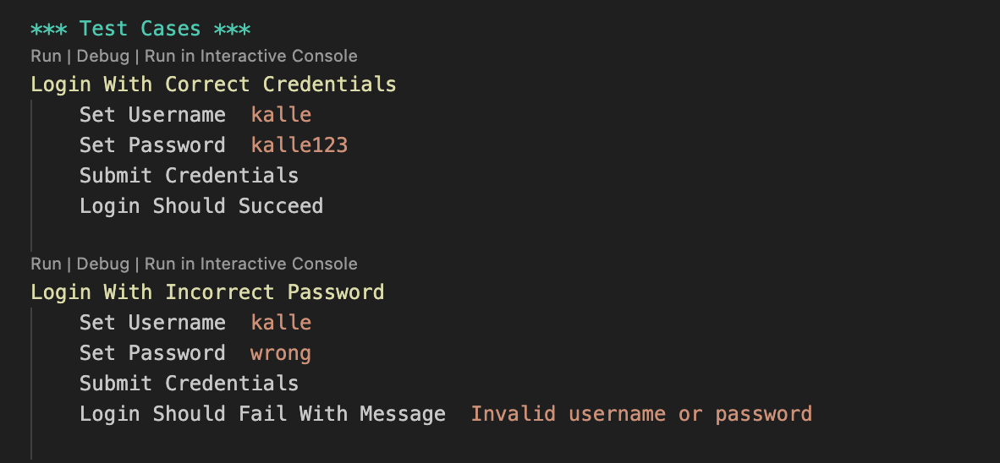
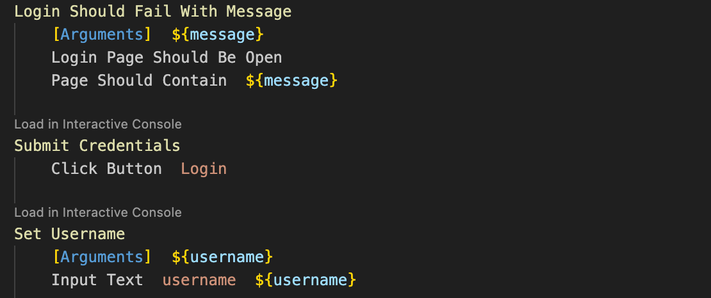
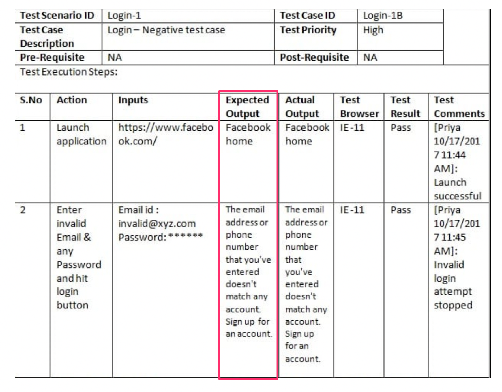
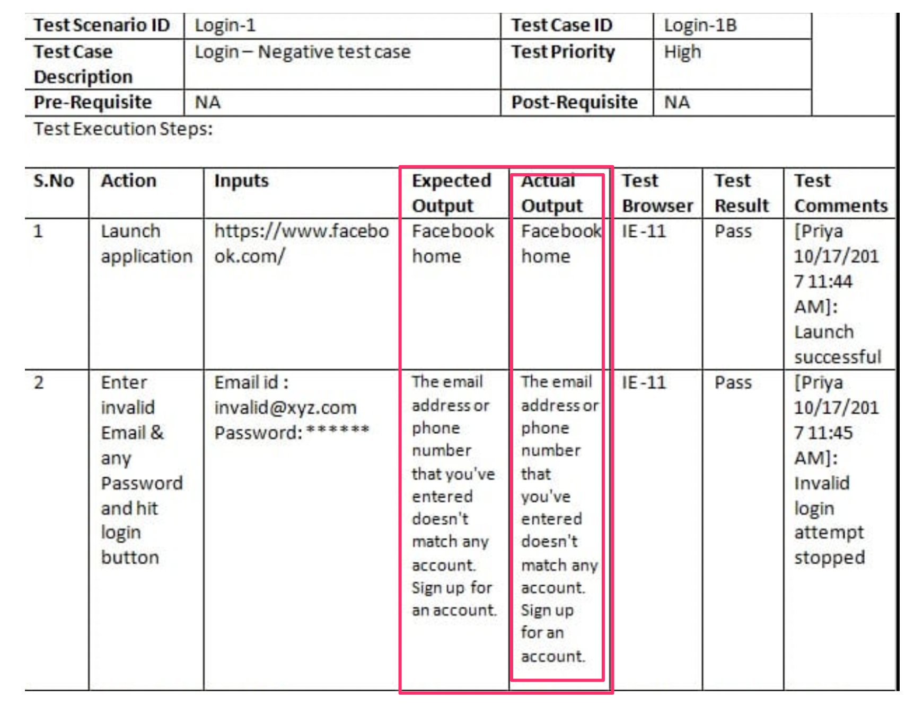
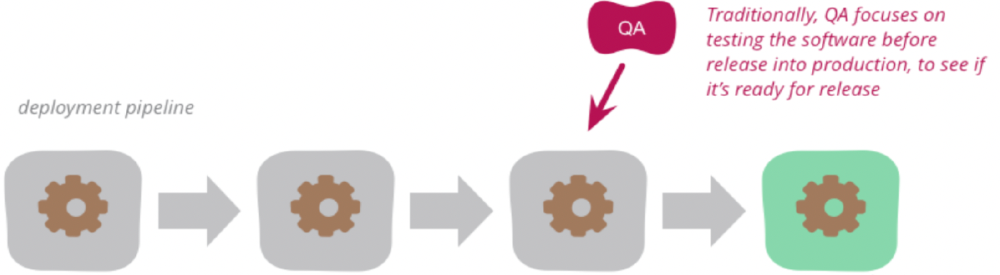
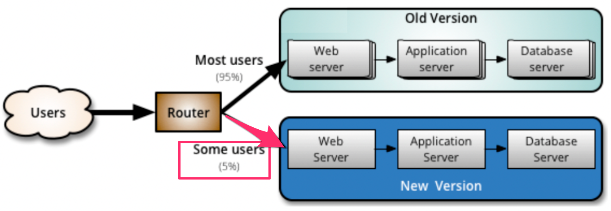

# Ohjelmistotuotanto

&nbsp;&nbsp;&nbsp;&nbsp;&nbsp;&nbsp;&nbsp;&nbsp;&nbsp;&nbsp;&nbsp;&nbsp;&nbsp;&nbsp;&nbsp;&nbsp;&nbsp;&nbsp;&nbsp;&nbsp;&nbsp;&nbsp;&nbsp;&nbsp;&nbsp;&nbsp;&nbsp;&nbsp;&nbsp;&nbsp;&nbsp;&nbsp;&nbsp;&nbsp;&nbsp;Syksy 2026

&nbsp;&nbsp;&nbsp;&nbsp;&nbsp;&nbsp;&nbsp;&nbsp;&nbsp;&nbsp;&nbsp;&nbsp;&nbsp;&nbsp;&nbsp;&nbsp;&nbsp;&nbsp;&nbsp;&nbsp;&nbsp;&nbsp;&nbsp;&nbsp;&nbsp;&nbsp;&nbsp;&nbsp;&nbsp;&nbsp;&nbsp;&nbsp;&nbsp;&nbsp;&nbsp;&nbsp;&nbsp;Luento 6

&nbsp;&nbsp;&nbsp;&nbsp;&nbsp;&nbsp;&nbsp;&nbsp;&nbsp;&nbsp;&nbsp;&nbsp;&nbsp;&nbsp;&nbsp;&nbsp;&nbsp;&nbsp;&nbsp;&nbsp;&nbsp;&nbsp;&nbsp;&nbsp;&nbsp;&nbsp;&nbsp;&nbsp;&nbsp;&nbsp;&nbsp;&nbsp;&nbsp;&nbsp;&nbsp;&nbsp;10.11.2026

# Kurssipalaute

- Kurssipalaute
  - Kurssilla lopussa kerättävän palautteen lisäksi ns. jatkuva palaute https://norppa.helsinki.fi

# Paja

- BK107 
  - ma 14.30-16.30
  - ti 12-16
  - to 12-16
  - pe 12-14

# Miniprojektit

- Käynnissä!


- Aloitustilaisuudet
  - to 14-16
  - ke 10-12
  - ke 12-14
  - to 14-16
  - to 16-18

- Seuraavat viikot: sprinttien katselmus ja suunnittelu samassa aikaikkunassa

- Loppudemot
  - **ke 9.12. klo 10-12 B123**
  - **to 10.12. klo 10-12 A111**

# CurreChat

- Käytettävissä HY:n GPT-chat
  - https://curre.helsinki.fi/chat

. . .

{ width=370 }

. . .

- Ei (ehkä) hallusinoi
- Osin herkkä kysymysten sanamuodon suhteen

# Testauksen tasot

- _Yksikkötestaus_ (unit testing)
  - Yksittäisten luokkien, metodien ja moduulien testaus erillään muusta kokonaisuudesta

- _Integraatiotestaus_ (integration testing)
  - Yksittäin testattujen komponenttien liittäminen yhteen eli integrointi ja kokonaisuuden testaus

- _Järjestelmätestaus_ (system testing)
  - Toimiiko ohjelmisto vaatimuksiin kirjatulla tavalla?
  - Tutkii järjestelmää kokonaisuudessaan: _end to end -testaus_
  - Jakautuu useisiin alalajeihin

- _Käyttäjän hyväksymistestaus_ (user acceptance testing)
  - Loppukäyttäjän tuotteelle suorittama testaus

. . .

- Regressiotestaus

# Ketterien menetelmien testauskäytänteet

. . .

- Sprintin aikana toteutettavat ominaisuudet integroidaan muuhun koodiin sekä testataan

. . .

- Sykli ominaisuuden määrittelystä sen ohjelmointiin ja testaukseen on erittäin lyhyt

. . .

- Testausta sprintin "ensimmäisestä päivästä" lähtien, testaus integroitu suunnitteluun ja toteutukseen

. . .

- Automatisointi erittäin tärkeässä roolissa
  - testejä suoritetaan usein

# Testaajat osana kehitystiimiä

- Ideaalitilanteessa testaajia sijoitettu kehittäjätiimiin, myös ohjelmoijat kirjoittavat testejä
  - tiimit _cross functional_

. . .

- Testaajan rooli: _virheiden etsijästä virheiden estäjään_
  - testaaja auttaa tiimiä kirjoittamaan automatisoituja testejä, jotka pyrkivät estämään bugien pääsyn koodiin
  - _build quality in_

# Ketterien menetelmien testauskäytänteitä

Tänään aiheena

. . .

- Test driven development (TDD)
- User storyjen tasolla tapahtuva automatisoitu testaus
- Continuous Integration (CI) eli jatkuva integraatio
- Exploratory testing, suomeksi tutkiva testaus
- Tuotannossa tapahtuva testaus

# Test driven development (TDD)

{ width=340 }

. . .

1. Kirjoitetaan testi, joka ei mene läpi

. . .

2. Kirjoitetaan koodia sen verran, että testi menee läpi

. . .

3. Jos huomataan koodin rakenteen menneen huonoksi, refaktoroidaan

. . .

4. Jatketaan askeleesta 1

# Test driven development (TDD)

- Yksi XP:n käytänteistä, Kent Beckin kehittämä
  - Joskus käytössä _tests first development_

. . .

- TDD:llä ohjelmoitaessa toteutettavaa komponenttia ei yleensä ole tapana suunnitella tyhjentävästi etukäteen

. . .

- Testit kirjoitetaan ensisijaisesti ajatellen komponentin käyttöä
  - huomio komponentin rajapinnassa ja sen helppokäyttöisyydessä
  - ei niinkään komponentin sisäisessä toteutuksessa

. . .

- Komponentin sisäinen rakenne muotoutuu refaktorointien kautta

. . .

- _"Ensin testataan, sitten koodataan, suunnitellaan vasta lopussa"_

#

- TDD:ssä korostetaan lopputuloksen yksinkertaisuutta

. . .

- Toteutetaan toiminnallisuutta vain sen verran, mitä testien läpimeno edellyttää
  - Ei toteuteta ”varalta” ekstratoiminnallisuutta
  - _Simplicity – the art of maximizing the amount of work not done – is essential_

. . .

- Koodista on vaikea tehdä testattavaa jos se ei ole modulaarista ja löyhästi kytketyistä komponenteista koostuvaa
  - koodista laadukasta ylläpidettävyyden ja laajennettavuuden kannalta

. . .

- Muita TDD:n hyviä puolia:
  - Rohkaisee ottamaan pieniä askelia kerrallaan ja toimimaan fokusoidusti
  - Virheet havaitaan nopeasti suuren testijoukon takia

# TDD:llä on myös ikävät puolensa

- Testikoodia tulee paljon, usein suunnilleen saman verran kuin varsinaista koodia
  - Toisaalta TDD:llä tehty tuotantokoodi on usein hieman normaalisti tehtyä koodia lyhempi

. . .

- Jos ja kun koodi muuttuu, tulee testejä ylläpitää

- Legacy-koodin laajentaminen TDD:llä voi olla haastavaa

. . .

- Tutkimusnäyttö TDD:n hyödyistä vähäistä
  - laatu paranee hieman, vaikutus tuottavuuteen epäselvä
  - hyödyt näyttävät tulevan pienin askelin etenemisestä ja tiheästä testaamisesta, ei niinkään testin kirjoittamisesta ennen koodia

. . .

- Saanut uutta merkitystä tekoälyagenttien myötä: testit ovat tarkka tapa kertoa agentille, mitä koodin halutaan tekevän

# 15.1.2026-

. . .

Open Uni: Test-Driven Development 4 + 1 cr

- Esko Luontola Nitor (Suomen johtava TDD-asiantuntija)

{ width=350 }

# Storyjen testaaminen

. . .

- User storyn käsite pitää sisällään _hyväksymiskriteerit_

. . .

- Storyn _asiakas voi lisätä tuotteen ostoskoriin_ eräs hyväksymiskriteeri voisi olla
  - ollessaan tuotelistauksessa ja valitessaan tuotteen jota on varastossa, menee tuote ostoskoriin 
  - ja ostoskorin hinta sekä korissa olevien tuotteiden määrä päivittyy oikein

. . .

- Hyväksymiskriteereistä saadaan muodostettua suurin osa ohjelmiston järjestelmätason toiminnallisista testeistä

# Järjestelmätestauksen automatisointi

- Hyväksymiskriteerit on tarkoituksenmukaista kirjoittaa heti storyn toteuttavan sprintin alussa
  - yhteistyössä kehitystiimin ja product ownerin kesken
  - asiakkaan kielellä, käyttämättä teknistä jargonia

. . .

- Ideaalitilanteessa storyjen hyväksymiskriteereistä tehdään automaattisesti suoritettavia

. . .

- Olemassa monia työkaluja
  - eräs suosituista, erityisesti Suomessa, on suomalainen Python-pohjainen _Robot framework_
  - maailmalla tunnetumpia mm. Cucumber ja Playwright

. . .

- BDD:ssä kriteerit kirjoitetaan usein _Given–When–Then_-muotoon
  - _Given_ käyttäjä on rekisteröitynyt, _When_ hän kirjautuu, _Then_ hän näkee etusivun


# Käyttäjähallinnan tarjoama palvelu

- Palvelun vaatimukset määrittelevät user storyt
  - A new user account can be created if a proper unused username and a proper password are given
  - User can log in with a valid username/password-combination

. . .

- Robot-frameworkia käytettäessä jokaisesta storystä kirjoitetaan .robot- päätteinen tiedosto
  - sisältää joukon storyyn liittyvä hyväksymistestejä

. . .

- Storyn hyväksymätestit kirjoitetaan hyödyntäen _avainsanoja_

# Testit asiakkan kielellä

{ width=400 }

- _Set username_, _Submit credentials_ ym avainsanoja

# Avainsanat mäpätään suoritettavaksi

- Avainsanojen määrittely toisten avainsanojen avulla

{ width=340 }

- osa avainsanoista Playwrightiin perustuvan Browser-kirjaston tarjoamia

. . .

- tai koodina

# Ohjelmiston integraatio

. . .

- Vesiputousmallissa toteutusvaiheen päättää integrointi
  - Yksittäin testatut komponentit yhdessä toimivaksi kokonaisuudeksi
  - Yhteistoiminnallisuus varmistetaan **integraatiotestien** avulla

. . .

- Perinteisesti integrointi on tuonut esiin paljon ongelmia

. . .

- Suurten projektien integrointivaihe on kestänyt ennakoimattoman kauan

. . .

- Integrointivaiheen ongelmat ovat aiheuttaneet ohjelmaan suunnittelutason muutoksia

. . .

- **Integratiohelvetti**

# Pois integraatiohelvetistä

- 90-luvulla huomattiin, että riskien minimoimiseksi integraatio kannattaa tehdä useammin kuin vain projektin lopussa

. . .

- Muodostui uusi paras käytänne: _daily build_ ja _smoke test_
  - The _smoke test_ should exercise the entire system from end to end
  - It does not have to be exhaustive
  - but it should be capable of exposing major problems

. . .

- Daily buildia ja smoke testiä käytettäessä järjestelmän integraatio tehdään (ainakin jollain tarkkuustasolla) joka päivä

. . .

- Komponenttien yhteensopivuusongelmat huomataan nopeasti ja niiden korjaaminen helpottuu

. . .

- **Tiimin moraali paranee**, kun ohjelmistosta on olemassa päivittäin kasvava toimiva versio

# Päivittäisestä jatkuvaan integraatioon

- Syntyi idea toistaa integraatiota vielä päivittäistä sykliäkin useammin: _jatkuva integraatio eli continuous integration_
  - eräs XP:n käytenäteistä

. . .

- Koodi, automatisoidut testi, konfiguraatiot ja build-skriptit pidetään keskitetyssä repositoriossa

. . .

- _CI-palvelin_: vastaa konfiguraatioilta mahdollisimman läheisesti tuotantoympäristöä
  - nykyään build suoritetaan yleensä puhtaassa, kertakäyttöisessä virtuaalikoneessa tai kontissa

. . .

- CI-palvelin tarkkailee repositoriota, muutosten tapahtuessa se hakee koodin, kääntää sen ja suorittaa testit

. . .

- Jos koodi ei käänny tai testit eivät mene läpi, seurauksena poikkeustilanne joka korjattava _välittömästi_

. . .

- **Integraatiosta vaivaton operaatio**: ohjelmistosta olemassa koko ajan integroitu ja testattu tuore versio

#

- Sovelluskehittäjä aloittaa työskentelyn hakemalla koodin uusimman version versionhallinnasta

. . .

- Kehittäjä integroi koodinsa heti muuhun koodiin ja tekee riittävän määrän automatisoituja testejä

. . .

- Jokainen kehittäjä integroi koodinsa muuhun koodiin mahdollisimman usein, vähintään kerran päivässä

. . .

- CI rohkaisee jakamaan työn pieniin osiin, jotka saadaan testeineen valmiiksi yhden työpäivän aikana
  - **CI-työprosessin noudattaminen vaatii kurinalaisuutta**

. . .

- Laskareissa käytetty _GitHub Actions_ suosituin SaaS-palveluna toimiva CI-ratkaisu
  - muita esim. GitLab CI/CD ja CircleCI

. . .

- Vanhempi Jenkins edelleen laajasti käytetty erityisesti yritysten omissa ympäristöissä
  - Jenkins asennetaan yleensä omalle palvelimelle

# Tauko 10 min

# Deployment pipeline

- CI:tä viedään vielä askel pidemmälle

. . .

- Integraatioprosessiin lisätään automaattinen vienti **staging-palvelimelle**
  - Ympäristö, joka kaikin tavoin mahdollisimman lähellä tuotantoympäristöä

. . .

- Kun uusi versio viety staging-palvelimelle, suoritetaan sille hyväksymistestaus

. . .

- ...jonka jälkeen siirto **tuotantopalvelimelle**

. . .

- Parhaassa tapauksessa staging-ympäristössä tehtävien hyväksymätestien suoritus on automatisoitu
  - Ohjelmisto kulkee koko _deployment pipelinen_ läpi automaattisesti

# Deployment pipeline

- Vaiheet, joiden suorittaminen edellytetään, että commitattu koodi saadaan siirrettyä staging/tuotantoympäristöön

{ width=400 }

# Termejä: jatkuva toimittaminen ja toimitusvalmius

-  **Jatkuvasta toimittaminen engl. continuous deployment**
    - Jokainen testit läpäisevä commit päätyy automaattisesti tuotantoon

. . .

- **Jatkuvaa toimitusvalmius engl. continuous delivery**:
  - tuotantoonvientipäätös tehdään ihmisen toimesta 

. . .

- Suuret web-palvelut julkaisevat jopa kymmeniä uusia versioita päivässä
  - Amazon, Netflix, Meta, Unity, Smartly...
  - DORA-tutkimuksessa parhaiten suoriutuvat vievät muutoksia tuotantoon tarpeen mukaan, usein useita kertoja päivässä

# Tutkiva testaaminen

. . .

- Jotta järjestelmä saadaan riittävän virheettömäksi, on testaus suoritettava erittäin perusteellisesti

. . .

- Perinteinen tapa on laatia ennen testausta hyvin perinpohjainen suunnitelma
  - Jokaisesta testistä on kirjattu testisyötteet ja odotettu tulos

. . .

- Tuloksen tarkastaminen
  - Verrataan ohjelmiston toimintaa testitapaukseen kirjattuun odotettuun tulokseen

#

{ width=400 }

#

{ width=400 }

#

{ width=400 }

#

- Automatisoitujen hyväksymistestien luonne sama, syöte on tarkkaan kiinnitetty samoin kuin odotettu tuloskin

. . .

- Jos testataan vain etukäteen mietittyjen testien avulla, ei kaikkia yllättäviä tilanteita osata ennakoida

. . .

- Hyvät testaajat ovat aina tehneet virallisen dokumentoidun testauksen lisäksi epävirallista "ad hoc"-testausta

. . .

- Tästä tullut virallisesti hyväksytty testauksen muoto, kulkee nimellä _tutkiva testaaminen_ (engl. exploratory testing)

# Tutkiva testaaminen

- _Exploratory testing is simultaneous learning, test design and test execution_

. . .

- Testitapauksia ei suunnitella kattavasti etukäteen
  - Testaaja pyrkii kokemuksensa avulla löytämään järjestelmästä virheitä
  - Testaaja ohjaa toimintaansa suorittamiensa testien tuloksen perusteella

. . .

- Tutkiva testaaminen ei etene sattumanvaraisesti
  - Testaussessiolle asetetaan tavoite: mitä tutkitaan ja minkälaisia virheitä etsitään

. . .

- Voi liittyä esim. muutaman user storyn toiminnallisuuteen
  - _testataan ostosten lisäystä ja poistoa ostoskorista_

# Tutkiva testaaminen

- Keskeistä on kaikkien ohjelmiston tapahtuvien asioiden havainnointi
  - Etukäteen määritellyissä testeissä havainnoidaan ainoastaan reagoiko järjestelmä odotetulla tavalla

. . .

- Kiinnitetään huomio myös varsinaisen testauksen kohteen ulkopuoleisiin asioihin
  - Klikkaillaan käyttöliittymän nappuloita epäloogisissa tilanteissa
  - Jos huomataan selaimen osoiterivillä URL https://www.webshopshop.com/ostoskori?id=10 katsotaan mitä tapahtuu jo id muutetaan käsin
  - ...

. . .

- Tietoturvan testaamisessa on monia tyypillisiä skenaariota, joita testataan tutkivan testaamisen menetelmin
  - Esim. SQL- ja JavaScript-injektiot

# Tutkiva testaaminen


. . .

- Tutkiva testaaminen turhan raskas regressiotestaamisen menetelmänä
  - Testataan sprintin yhteydessä toteutettuja uusia ominaisuuksia
  - Löydettyjen virheiden toistuminen jatkossa kannattaa eliminoida tekemällä automatisoituja regressiotestejä

. . .

- Ei vaihtoehto normaaleille tarkkaan etukäteen määritellyille testeille vaan niitä täydentävä testauksen muoto


# Tuotannossa tapahtuva testaaminen ja laadunhallinta

. . .

- Perinteisesti ajateltu: kaikki laadunhallintaan tehdään ennen kuin uudet toiminnallisuudet otetaan käyttöön 

{ width=400 }

# Tuotannossa tapahtuva testaaminen ja laadunhallinta

- Perinteisesti ajateltu: kaikki laadunhallintaan tehdään ennen kuin uudet toiminnallisuudet otetaan käyttöön 

{ width=400 }


- Nykyään osa laadunhallinnasta tehdään *monitoroimalla* tuotannossa olevaa ohjelmistoa

# Canary release

- Kaksi rinnakkaista tuotantoympäristöä, joista uudet ominaisuudet viedään toiseen

. . .

{ width=400 }

- Uuden ominaisuuden sisältävään ympäristöön ohjataan osa järjestelmän käyttäjistä

. . .

- Uuden ominaisuuden sisältämää versiota _monitoroidaan_ 
  - jos ei ongelmia  ohjataan kaikki liikenne uuteen versioon

#

- Uuden version toimivaksi varmistaminen perustuu järjestelmän _monitorointiin_

. . .

- Esim. sosiaalisen median palvelussa 
  - palvelun muistin ja prosessoriajan kulutusta 
  - verkkoliikenteen määrää 
  - sovelluksen eri sivujen vasteaikoja
  - kirjautuneiden käyttäjien määrää
  - luettujen ja lähetettyjen viestien määriä per käyttäjä
  - kirjautuneen käyttäjän sovelluksessa viettämää aikaa

. . .

- Monitoroidaan palvelimen yleisen toimivuuden lisäksi 
_käyttäjätason metriikoita_ (engl. business level metrics)

. . .

- Jos suuria eroja aiempaan: **rollback edelliseen versioon**
  - esim. kirjautuneet käyttäjät eivät lähetä viestejä samaa määrää kuin keskimäärin normaalisti

. . .

- Testauksen ja kaikkien tuotantoon vientiin liittyvän on syytä tapahtua automatisoidusti

# Havainnoitavuus ja palvelutasotavoitteet

- Ennalta valitut mittarit kertovat, _että_ jotain on vialla, mutta eivät välttämättä _miksi_

. . .

- _Havainnoitavuus_ (observability): sovellus tuottaa lokeja, metriikoita ja pyyntöjen kulkua kuvaavia jälkiä (traces)
  - avoin standardi OpenTelemetry

. . .

- Googlen Site Reliability Engineering: palvelutasotavoitteet (SLO)
  - esim. 99,9 % pyynnöistä onnistuu ja 95 % vastataan alle 300 ms:ssa
  - canary voidaan perua automaattisesti, jos uusi versio rikkoo tavoitteita

# Virhebudjetti ja syyllistämätön jälkianalyysi

- _Virhebudjetti_ (error budget): jos tavoite 99,9 %, saa 0,1 % pyynnöistä epäonnistua
  - budjettia jäljellä: uusia ominaisuuksia tuotantoon normaalisti
  - budjetti lopussa: painopiste luotettavuuden parantamiseen

. . .

- Vakavan häiriön jälkeen _jälkianalyysi_ (postmortem): mitä tapahtui, miksi, miten estetään jatkossa

. . .

- Analyysi on _syyllistämätön_ (blameless)
  - virheet nähdään järjestelmän ja prosessien ongelmina, ei yksilöiden
  - jos virheistä rangaistaan, niitä piilotellaan eikä niistä opita
  - sama ajatus kuin psykologisessa turvallisuudessa

# Tuotannossa testaaminen ja tietokanta

- Canary releasen aikana uusi ja vanha versio käyttävät usein samaa tietokantaa
  - entä jos uusi versio vaatii muutoksen tietokannan skeemaan?

. . .

- Ratkaisu: _expand/contract_ eli parallel change
  - esim. sarake _nimi_ jaetaan sarakkeiksi _etunimi_ ja _sukunimi_
  - **expand**: lisätään uudet sarakkeet vanhan rinnalle, sovellus kirjoittaa molempiin
  - **contract**: kun kaikki käytössä olevat versiot käyttävät uusia sarakkeita, vanha poistetaan

. . .

- Sekä vanha että uusi versio toimivat jokaisessa vaiheessa

# Feature toggle

- _Feature togglejen_ (nykyään yleisemmin _feature flag_) avulla voidaan canary releaset toteuttaa käyttämällä yhtä tuotantopalvelinta

. . .

- Koodiin _ehtolauseita_: osa liikenteestä ohjataan vanhan toteutuksen sijaan testauksen alla olevaan toteutukseen

. . .

- Esim. some-palvelussa feature toggle: _osalle käytetään näytetään uuden algoritmin perusteella generoitu lista uutisia_

```python
def recommended_news_generator(user): 
    if is_in_canary_release(user):
        return experimental_recommendation_algorithm(user)
    else:
        return recommendation_algoritm(user)
```

# Feature togglejen soveltaminen

- Aluksi piilotetaan uusi ominaisuus käyttäjiltä feature toggleilla
  - eli toggle palauttaa vanhan version normaaleille käyttäjille

. . .

- Sovellus kehittäjien mahdollista valita kumman version toggle palauttaa

. . .

- Kun valmiina laajempaan testiin, julkaistaan esim. 
    - ensin kehittäjäyrityksen omaan käyttöön 
    - sitten osalle käyttäjistä canary releasena

. . .

- Lopulta feature toggle ja vanha toteutus voidaan poistaa

# 

- Suuret internetpalvelut soveltavat laajalti canary releaseihin ja feature flageihin perustuvaa kehitysmallia
  - Meta, Netflix, Google, GitHub, ...
  - Suomessa esim. Veikkaus

{ width=400 }

. . .

- A/B-testaus: arvioidaan onko uusi toteutus parempi kuin vanha

. . .

- Kerrallaan voi olla menossa useita kymmeniä A/B-testattavia eksperimenttejä
