# Ohjelmistotuotanto

&nbsp;&nbsp;&nbsp;&nbsp;&nbsp;&nbsp;&nbsp;&nbsp;&nbsp;&nbsp;&nbsp;&nbsp;&nbsp;&nbsp;&nbsp;&nbsp;&nbsp;&nbsp;&nbsp;&nbsp;&nbsp;&nbsp;&nbsp;&nbsp;&nbsp;&nbsp;&nbsp;&nbsp;&nbsp;&nbsp;&nbsp;&nbsp;&nbsp;&nbsp;&nbsp;Syksy 2026

&nbsp;&nbsp;&nbsp;&nbsp;&nbsp;&nbsp;&nbsp;&nbsp;&nbsp;&nbsp;&nbsp;&nbsp;&nbsp;&nbsp;&nbsp;&nbsp;&nbsp;&nbsp;&nbsp;&nbsp;&nbsp;&nbsp;&nbsp;&nbsp;&nbsp;&nbsp;&nbsp;&nbsp;&nbsp;&nbsp;&nbsp;&nbsp;&nbsp;&nbsp;&nbsp;&nbsp;&nbsp;Luento 7

&nbsp;&nbsp;&nbsp;&nbsp;&nbsp;&nbsp;&nbsp;&nbsp;&nbsp;&nbsp;&nbsp;&nbsp;&nbsp;&nbsp;&nbsp;&nbsp;&nbsp;&nbsp;&nbsp;&nbsp;&nbsp;&nbsp;&nbsp;&nbsp;&nbsp;&nbsp;&nbsp;&nbsp;&nbsp;&nbsp;&nbsp;&nbsp;&nbsp;&nbsp;&nbsp;&nbsp;16.11.2026

# Kurssipalaute

- Kurssipalaute
  - Kurssilla lopussa kerättävän palautteen lisäksi ns. jatkuva palaute https://norppa.helsinki.fi

# Paja, Discord, miniprojektit ja koe

- Apua tehtäviin pajassa BK107: ma 16-19, ti 13-16, to 16-19, pe 13-16

- Kurssin Discord: https://study.cs.helsinki.fi/discord/join/ohtu
  - kanavalle liitytään komennolla _/join course TKT20006 - Ohjelmistotuotanto - ohtu_

- Miniprojektit käynnissä!
  - tämä ja pari seuraavaa viikkoa: sprinttien katselmointi ja suunnittelu samassa aikaikkunassa
  - sovellus viedään yliopiston OKD-klusterille, storyt arvioidaan OKD:ssa toimivasta versiosta
  - loppudemot **ti 8.12. klo 14–16 B123** ja **ke 9.12. klo 10–12 B123**

. . .

- Kurssikoe tiistaina 15.12. klo 13-16 A111 ja B123
  - **ilmoittaudu viimeistään la 5.12. klo 23.59!**

# Ketterien menetelmien testauskäytänteitä

. . .

- Sprintissä toteutettavat storyt integroidaan ja testataan sprintin aikana

. . .

- Automatisointi tärkeässä roolissa

. . .

- Ideaalitilanteessa testaajia sijoitettu kehittäjätiimiin, myös ohjelmoijat kirjoittavat testejä
  - tiimit _cross functional_ 

# Ketterien menetelmien testauskäytänteitä

. . .

- Test driven development (TDD)
  - Sivutuotteena paljon automaattisesti suoritettavia testejä

. . .

- User storyjen tasolla tapahtuva automatisoitu testaus
  - Robot

. . .

- Exploratory testing, suomeksi tutkiva testaus
  - Järjestelmätestauksen tekniikka, jossa testaaminen tapahtuu ilman formaalia testaussuunnitelmaa

. . .

- Jatkuva integraatio (CI) ja jatkuva toimitusvalmius (continuous delivery, CD)
  - Ulottuu jopa sovelluksen tuotantoonviemiseen

. . .

- Tuotannossa tapahtuva testaus
  - Tehdään osa laadunhallinnasta *monitoroimalla* tuotannossa olevaa ohjelmistoa

# Canary release

- Uusi versio viedään vanhan rinnalle omaan tuotantoympäristöönsä

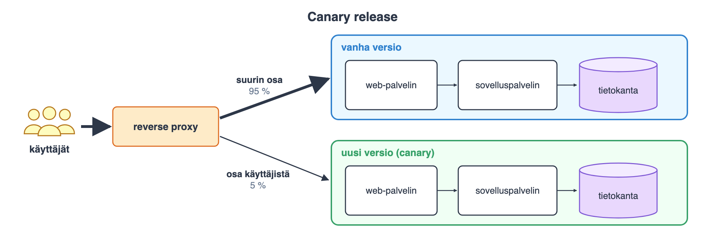{ width=400 }

- Uuden ominaisuuden sisältämää versiota _monitoroidaan_ 
  - jos ongelmia ei ilmene, liikenne ohjataan vähitellen uuteen versioon

# Feature flag

- Canary release toteutetaan usein feature flagilla: erillistä tuotantoympäristöä ei tarvita

. . .

- Koodiin _ehtolauseita_: osa käyttäjistä ohjataan uuteen, testauksen alla olevaan toteutukseen

```python
def recommended_news_generator(user): 
    if is_in_canary_release(user):
        return experimental_recommendation_algorithm(user)
    else:
        return recommendation_algorithm(user)
```

. . .

- Vaiheittainen julkaisu: ensin piilossa, sitten yrityksen omaan käyttöön, sitten canary releasena osalle käyttäjistä

. . .

- Käytetään paljon A/B-testaamiseen

. . .

- Lopulta flag ja vanha toteutus poistetaan

# Versionhallinnan käyttötavoista

# Feature branchit {.t}

. . .  

- Uusi ominaisuus, esim. user story toteutetaan ensin omaan versionhallinnan haaraansa

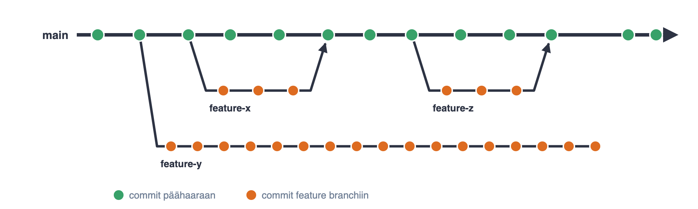{ width=360 }

# Feature branchit {.t}

- Uusi ominaisuus, esim. user story toteutetaan ensin omaan versionhallinnan haaraansa

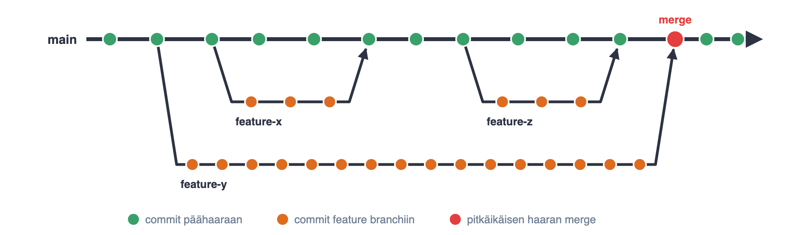{ width=360 }

  - ja ominaisuuden valmistuttua haara mergetään pääkehityshaaraan

. . .

- _Pitkäikäiset_ feature branchit aiheuttavat helposti pahoja _merge-konflikteja_ sprintin lopussa: _merge hell_

. . .

- Martin Fowler: _Everyone Pushes Commits To the Mainline Every Day_ (Continuous integration)

# Trunk based development {.t}

. . .

- _Trunk based development_: pitkäikäisiä feature brancheja ei käytetä ollenkaan
  - Kaikki koodi suoraan pääkehityshaaraan
  - ... josta käytetään nimitystä _trunk_

. . .

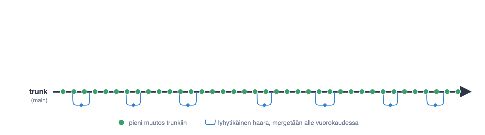{ width=400 }

# Trunk based development {.t}

- _Trunk based development_: pitkäikäisiä feature brancheja ei käytetä ollenkaan
  - Kaikki koodi suoraan pääkehityshaaraan
  - ... josta käytetään nimitystä _trunk_

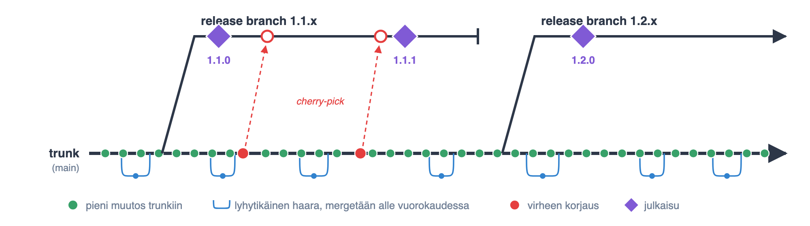{ width=400 }

- Ohjelmiston kustakin julkaistusta versiosta saatetaan tehdä oma _release branch_
  - Korjaukset tehdään trunkiin ja poimitaan (cherry-pick) release branchiin

# Trunk based development
 
- Pakottaa sovelluskehittäjät tekemään pieniä, nopeasti päähaaraan mergettäviä muutoksia

. . .

- Käytetään feature flageja
  - puolivalmiitakin ominaisuuksia voidaan helposti ohjelmoida päähaaraan ilman toiminnallisuuden rikkomista

. . .

- Edellyttää sovelluskehittäjiltä _todella hyvää_ kuria ja systemaattisuutta
  - feature flagien holtiton käyttö johtaa _feature flag -helvettiin_
  - aloittelijoille feature branchit ovat turvallisempi tapa

. . .

- Kehitysmallia noudattavat esim. Google, Meta ja Netflix

# Lyhytikäiset haarat

- Trunk based development ei välttämättä tarkoita, että jokainen commit tehdään suoraan pääkehityshaaraan

. . .

- Yleinen käytäntö: _lyhytikäiset_ haarat
  - muutos omaan haaraansa, siitä pull request ja katselmointi
  - pull request mergetään pääkehityshaaraan viimeistään päivän sisällä

. . .

- DORA: päähaaraan mergetään vähintään kerran päivässä


# Dev vs Ops

- Jatkuvan toimitusvalmiuden, jatkuvan toimittamisen ja tuotannossa testaamisen soveltaminen on haastavaa

. . .

- Perinteisesti tarkka erottelu _sovelluskehittäjien_ (developers, dev) ja _ylläpitäjien_ (operations, ops) välillä
  - sovelluskehittäjät eivät pääse kirjautumaan tuotantopalvelimille 
  - tuotantoon vieminen ja tietokannan skeemapäivitykset tapahtuvat ylläpitäjien toimesta

. . .

- Jos näin on, tuotantopalvelimelle pystytään viemään uusia versioita vain harvoin, esim. 4 kertaa vuodessa

. . .

- Joustavammat toimintamallit vaativat kulttuurinmuutoksen

# DevOps

- _DevOps_: toimintamalli missä kehittäjät (dev) ja ylläpito (ops) työskentelevät tiiviisti yhdessä 
  - Sovelluskehittäjille pääsy tuotantopalvelimelle 
  - Scrum-tiimiin sijoitetaan ylläpitovastuilla olevia ihmisiä


. . .

- DevOps on hypetermi, jonka merkitys osin epäselvä
  - työpaikkailmoituksissa voidaan arvostaa DevOps-taitoja 
  - tai etsiä ihmistä DevOps-tiimiin
  - myynnissä mitä erilaisimpia DevOps-työkaluja

. . .

- Alkuperäinen määritelmä: _kehittäjien ja järjestelmäylläpidon yhteinen työnteon tapa_, DevOps-kulttuuri

. . .

- Työkaluja/asioita jotka liittyvät DevOpsiin:
  - automatisoitu testaus
  - jatkuva integraatio, toimitusvalmius ja toimittaminen (CI/CD)
  - virtualisointi ja kontainerisointi (Docker, Kubernetes)
  - infrastructure as code
  - pilvipalveluna toimivat palvelimet ja sovellusympäristöt (PaaS, IaaS, SaaS)

#

- Monet listatuista kypsyneet 2010-luvulla ja tehneet DevOpsin soveltamisesta helpompaa

. . .

- Eräs tärkeimmistä DevOpsia mahdollistavista asioista _infrastructure as code_
  - fyysisten palvelinten sijaan virtuaalisia ja pilvessä toimivia palvelimia, joita voi konfiguroida "ohjelmoimalla"

. . .

- Raudastakin on tullut "koodia"
  - palvelinten konfiguraatioita voidaan tallettaa versionhallintaan ja jopa testata
  - sovelluskehitys ja ylläpito ovat alkaneet muistuttaa toisiaan 

. . .

- Työkalujen käyttöönotto ei riitä, DevOpsin "tekeminen" lähtee kulttuurisista tekijöistä, tiimirakenteista, sekä asioiden sallimisesta

# The Big DevOps Misunderstanding (Oliver Wolf)

. . .

- When the term DevOps came up, it was a very simple idea:
  - You build it, you run it — Werner Vogels

. . .

- Somewhere along the way, the idea was misunderstood and the wrong definition of DevOps became the right one
  - We now have specific roles or departments that write "infrastructure as code"

. . .

- This is not DevOps, but an evolution of Systems Operations (SysOps)

#

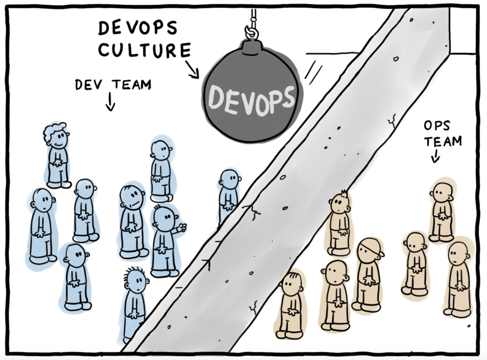{ width=400 }

#

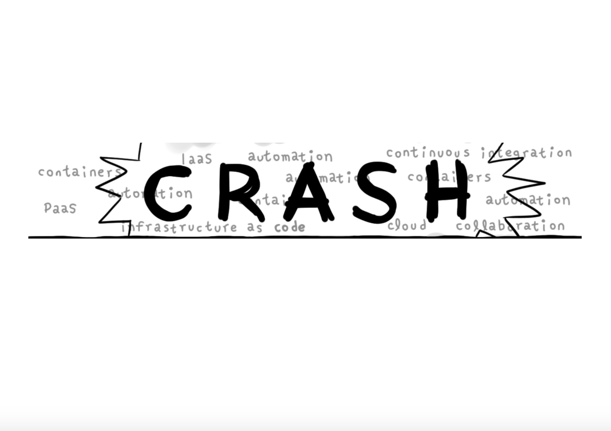{ width=400 }

#

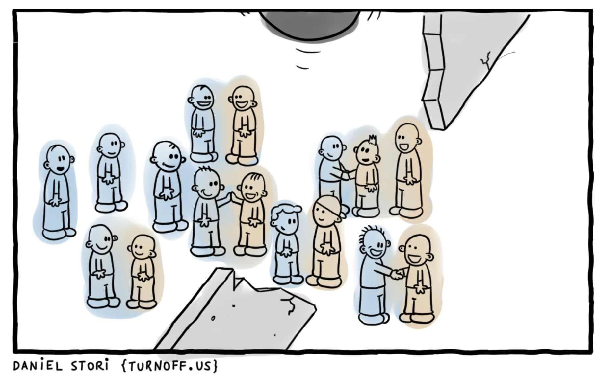{ width=400 }

# DevOps: ketteryys laajennettuna

. . .

- Scrumin ja ketterän eräs tärkeimmistä periaatteista on tehdä kehitystiimeistä itseohjautuvia ja "cross functional" 
  
. . .

- DevOps on keino viedä ketteryyttä askeleen pitemmälle
  - kehitystiimi pystyy viemään uudet toiminnallisuudet tuotantoympäristöön 
  - ja jopa testaamaan sekä operoimaan niitä tuotannossa

. . .

- DevOps siis laajentaa ketteryyden koskemaan myös järjestelmäylläpitoa

. . .

- Asettaa sovelluskehittäjille lisää osaamisvaatimuksia

  - kehittäjien pitää hallita enenevässä määrin ylläpitoasioita

# Site Reliability Engineering (SRE)

. . .

- Googlen kehittämä tapa tehdä ylläpitoa ohjelmistokehityksen keinoin
  - toistuva manuaalinen työ (toil) automatisoidaan
  - SRE-tiimin työajasta enintään puolet operointia, loput luotettavuutta parantavaa kehitystyötä

. . .

- Keskeiset käytännöt:
  - palvelutasotavoitteet (SLO)
  - virhebudjetti
  - syyllistämättömät jälkianalyysit

. . .

- Konkreettinen tapa toteuttaa DevOps-ajattelua
  - Google: _class SRE implements interface DevOps_

# TAUKO 10 min

# Ohjelmiston elinkaaren vaiheet

- Riippumatta tyylistä ja tavasta, jolla ohjelmisto tehdään, ohjelmistokehitykseen kuuluu
  - vaatimusten analysointi ja määrittely 
  - **suunnittelu**
  - toteutus
  - testaus/laadunhallinta
  - ohjelmiston ylläpito

. . . 

- Suunnittelun tavoite
  - _miten saadaan toteutettua vaatimusmäärittelyn mukaisella tavalla toimiva ohjelma_

. . .

- Osa suunnittelusta tapahtuu vasta toteutusvaiheessa, joten suunnittelun ja toteuttamisen käsittelyä ei voi eriyttää

# Ohjelmiston suunnittelu

- Jakautuu kahteen vaiheeseen:
  - arkkitehtuurisuunnittelu
  - olio/komponenttisuunnittelu
  - näiden lisäksi UI/UX-suunnittelu

. . .

- Ajoittuminen riippuu tuotantoprosessista
  - vesiputousmalli: ennen toteutusta, tarkasti dokumentoitu – puhtaana tuskin enää käytössä
  - ketterät: tarvittava määrä jokaisessa iteraatiossa, ei tarkkaa suunnitteludokumenttia

. . .

- Raskasta etukäteissuunnittelua (_Big Design Up Front_, BDUF) tehdään kuitenkin yhä
  - sopii, kun sovellusalue tunnetaan hyvin ja vaatimukset ovat vakaat

# Ohjelmiston arkkitehtuuri

. . .

- Abstraktimpi kuvaus, joka määrittelee ohjelmiston suuret linjat

. . .

- ISO/IEC/IEEE 42010: Ohjelmiston arkkitehtuuri on järjestelmän perusorganisaatio, joka sisältää 
  - järjestelmän osat, 
  - osien keskinäiset suhteet, 
  - osien suhteet ympäristöön 
  - sekä periaatteet, jotka ohjaavat järjestelmän suunnittelua ja evoluutiota

. . .

- Martin Fowler: _things that people perceive as hard to change_

# Ohjelmiston arkkitehtuuri

- **Ei-toiminnallisilla vaatimuksilla** suuri vaikutus arkkitehtuuriin
  - käytettävyys
  - suorituskyky, skaalautuvuus
  - vikasietoisuus, tiedon ajantasaisuus
  - tietoturva
  - ylläpidettävyys, laajennettavuus, testattavuus
  - hinta, time-to-market, ...

. . . 

- Myös **toimintaympäristö** vaikuttaa arkkitehtuuriin
  - integraatiot muihin järjestelmiin
  - käytettävät sovelluskehykset ja tietokannat
  - lainsäädäntö 

. . .

- Arkkitehtuuri syntyy joukosta _arkkitehtuurisia valintoja_ 
  - tradeoff 

# Arkkitehtuurityyli

- Ohjelmiston arkkitehtuuri perustuu yleensä yhteen tai useampaan **arkkitehtuurityyliin**
  - hyväksi havaittu tapa strukturoida tietyntyyppisiä sovelluksia

. . .

- Tyylejä suuri määrä
  - Kerrosarkkitehtuuri
  - Mikropalveluarkkitehtuuri
  - MVC
  - Pipes-and-filters
  - Palveluperustainen arkkitehtuuri
  - Client-server
  - Publish-subscribe
  - Event driven
  - REST
  - ...

# Kerrosarkkitehtuuri 

- _Kerros_ on kokoelma toisiinsa liittyviä olioita, jotka muodostavat toiminnallisuuden suhteen loogisen kokonaisuuden

. . . 

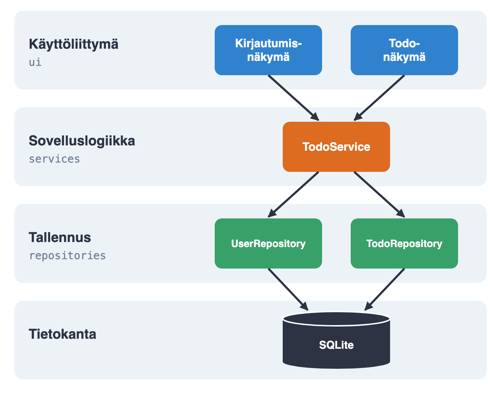{ width=250 }

. . . 

- Kerros käyttää ainoastaan alempana olevan kerroksen palveluita

#

- Kerrokset omalla abstraktiotasollaan
  - UI vs tallennus

. . .

- Kerroksittaisuus helpottaa ylläpitoa

. . .

- Sovelluslogiikan riippumattomuus käyttöliittymästä helpottaa ohjelman siirtämistä uusille alustoille

. . .

- Alimpien kerroksien palveluja voidaan osin uusiokäyttää myös muissa sovelluksissa

. . .

- Saattaa johtaa massiivisiin monoliittisiin sovelluksiin
  - vaikea laajentaa ja skaalata suurille käyttäjämäärille
  - haastavaa kehittää jos sovelluskehittäjiä suuri määrä

. . .

- Kerrosten säännöt rapautuvat helposti, jos niitä ei valvota
  - automaattinen tarkastus CI-putkessa, esim. import-linter: _fitness function_


# Mikropalveluarkkitehtuuri

- Mikropalveluarkkitehtuuri (microservice) pyrkii vastaamaan näihin haasteisiin  

. . .

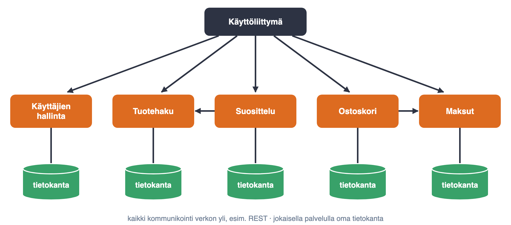{ width=400 }

- sovellus kootaan useista (jopa sadoista) pienistä verkossa toimivista autonomisista palveluista 

. . .

- jotka keskenään verkon yli kommunikoiden toteuttavat järjestelmän toiminnallisuuden

# Mikropalveluarkkitehtuuri

- Yksittäisistä palveluista pyritään tekemään mahdollisimman riippumattomia
  - palvelut eivät kutsu toistensa metodeja, kommunikointi aina verkon välityksellä
  - eivät käytä yhteistä tietokantaa
  - eivät jaa koodia

. . . 

- Mikropalvelut ovat pieniä ja huolehtivat vain "yhdestä asiasta"

. . . 

- Verkkokaupan mikropalveluita voisivat olla
  - käyttäjien hallinta
  - tuotteiden hakutoiminnot
  - tuotteiden suosittelu
  - ostoskorin toiminnallisuus
  - ostosten maksusta huolehtiva toiminnallisuus

# Mikropalveluiden etuja

- Laajentaminen helpompaa: toteutetaan uusi palvelu tai laajennetaan ainoastaan _jotain_ palvelua

. . . 

- Skaalaaminen helpompaa: pullonkaulan aiheuttavia palveluja voidaan suorittaa useita rinnakkain

. . . 

- Palvelut voidaan koodata eri ohjelmointikielillä ja sovelluskehyksillä

. . . 

- Työn jakaminen isolle kehittäjämäärälle helpompaa
  - kukin tiimi omistaa palvelunsa ja voi kehittää ja julkaista niitä muista riippumatta

. . . 

- Vikojen eristäminen: suosittelupalvelun kaatuessa ostokset onnistuvat silti
  - edellyttää, että palvelut on suunniteltu kestämään toistensa vikoja

# Lähtökohta: The Bezos mandate 2002

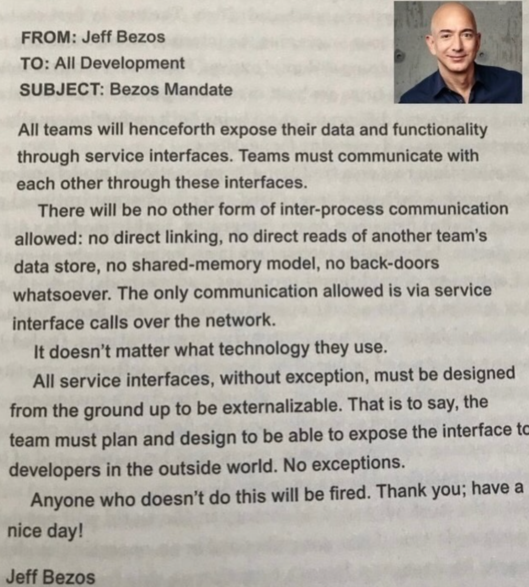{ width=400 }

# Lähtökohta: The Bezos mandate 2002

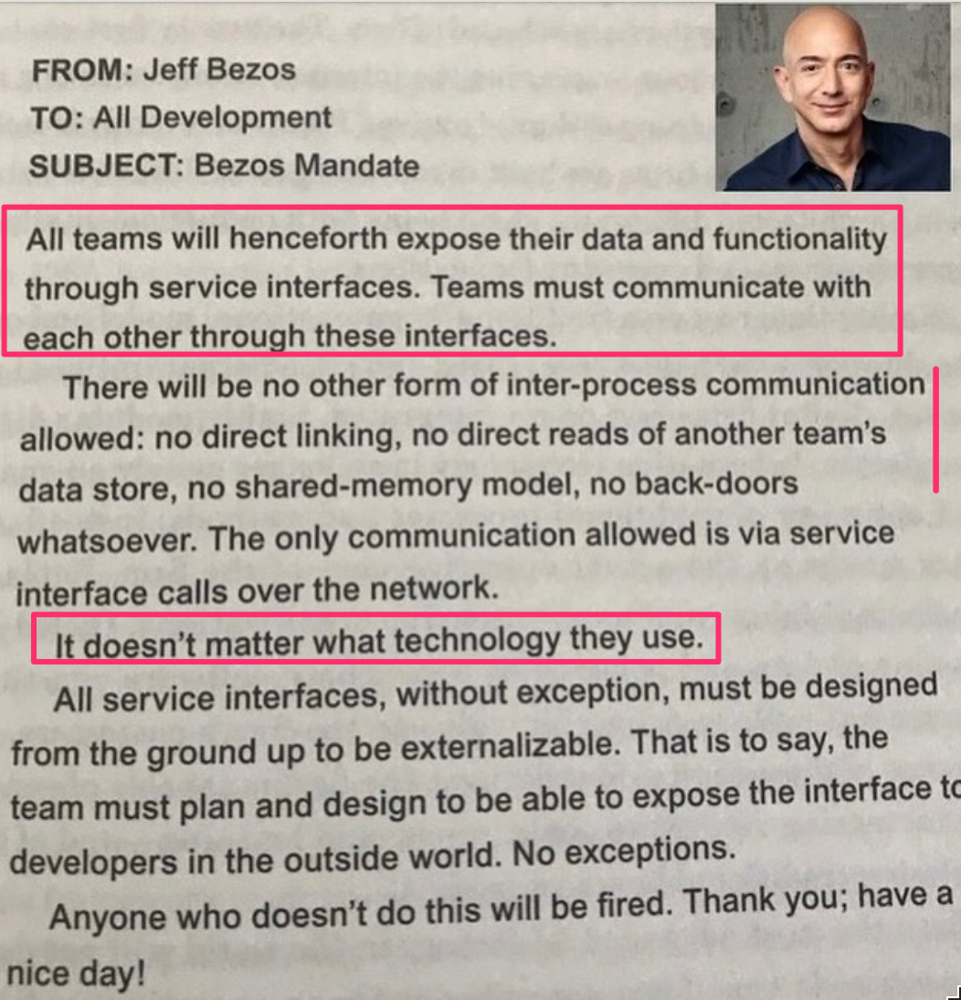{ width=400 }

# Lähtökohta: The Bezos mandate 2002

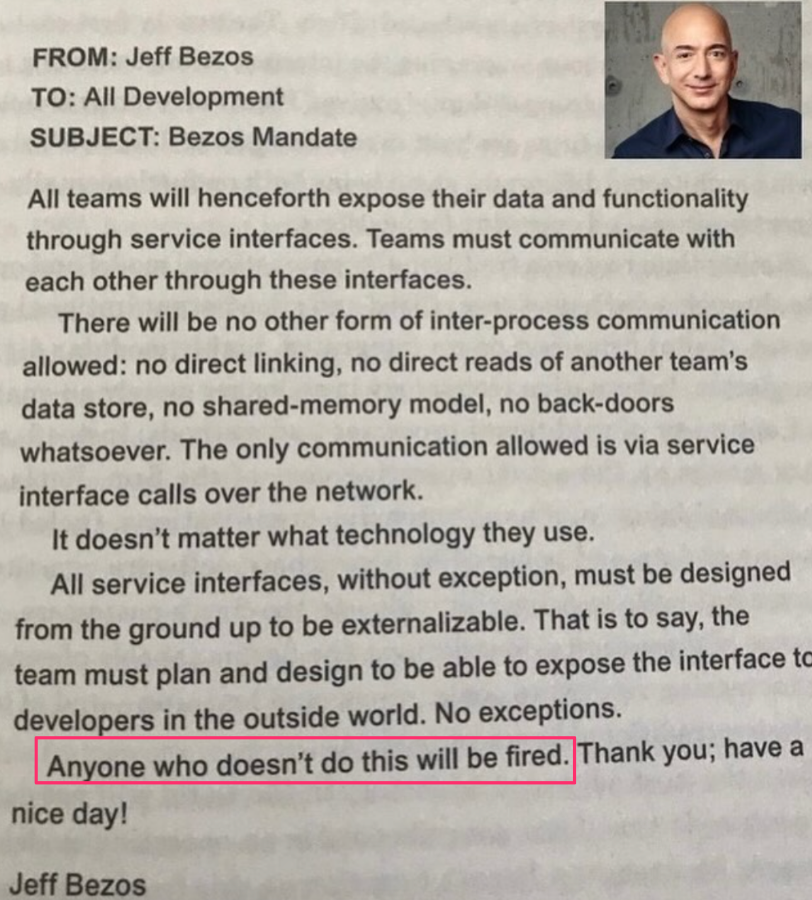{ width=400 }

# Mikropalveluiden haasteita

. . .

- Sovelluksen jakaminen järkeviin mikropalveluihin on vaikeaa

. . .

- Testaaminen ja debuggaus voi olla hankalaa koska asioita tapahtuu niin monessa paikassa

. . .

- Kymmenistä tai jopa sadoista mikropalveluista koostuvan ohjelmiston operoiminen on haastavaa
  - vaatii pitkälle menevää automatisointia

. . .

- Mikropalveluiden menestyksekäs soveltaminen edellyttää vahvaa DevOps-kulttuuria

. . .

- Kehitetty massiivisiin järjestelmiin (mm. Amazon, Netflix)
  - onko järkevä kaikkialla?

# Mikropalvelut vai monoliitti?

- Mikropalveluiden ei pitäisi olla oletusratkaisu (mm. Sam Newman)
  - Martin Fowler: _monolith first_, pilkotaan palveluiksi vasta todelliseen tarpeeseen

. . .

- Myös toiseen suuntaan kuljetaan
  - Amazon Prime Video 2023: hajautettu valvontajärjestelmä yhdeksi sovellukseksi, infrakustannukset -90 %

. . .

- _Modulaarinen monoliitti_
  - julkaistaan yhtenä kokonaisuutena, mutta jaettu sisäisesti moduuleihin, joilla selkeät rajapinnat
  - moduulit eivät käytä toistensa sisäisiä osia tai tietokantatauluja
  - moduulirajat voi myöhemmin muuttaa palvelurajoiksi

#

# Ketterän testauksen nelikenttä

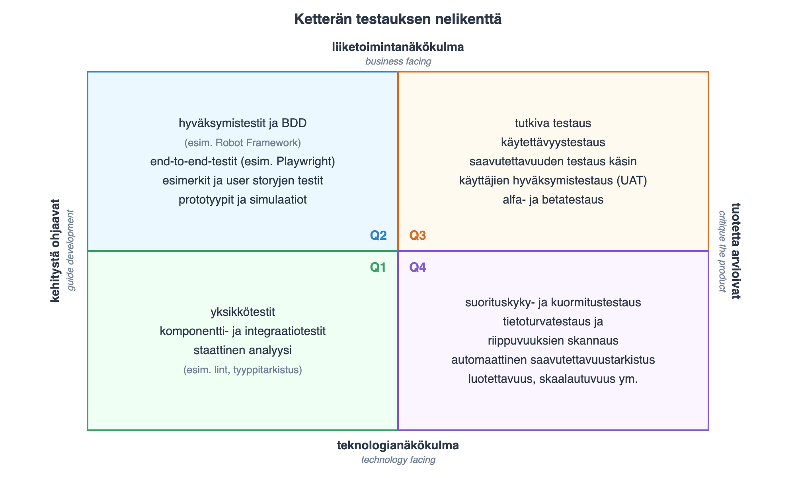{ width=330 }

- Brian Marick 2003, Lisa Crispin ja Janet Gregory: Agile Testing ja More Agile Testing

# Holistic testing

- Nelikenttä kertoo _minkälaista_ testausta tarvitaan, mutta ei _milloin_ testataan
  - eikä tunne tuotannossa testaamista

. . .

- Gregory ja Crispin: _Holistic Testing_
  - testaus kulkee mukana koko jatkuvan kehityksen silmukan ajan
  - ideoinnista ja suunnittelusta toteutukseen, tuotantoon vientiin, tuotannon havainnointiin ja siitä oppimiseen

# Testauspyramidi

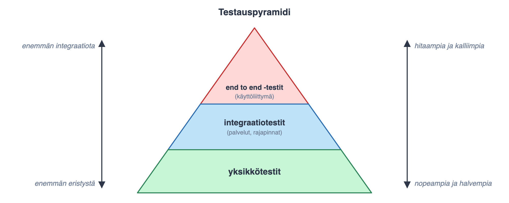{ width=380 }

- Mike Cohn: pääosa testeistä yksikkötestejä, end to end -testejä mahdollisimman vähän

# Pyramidi, pokaali ja kenno

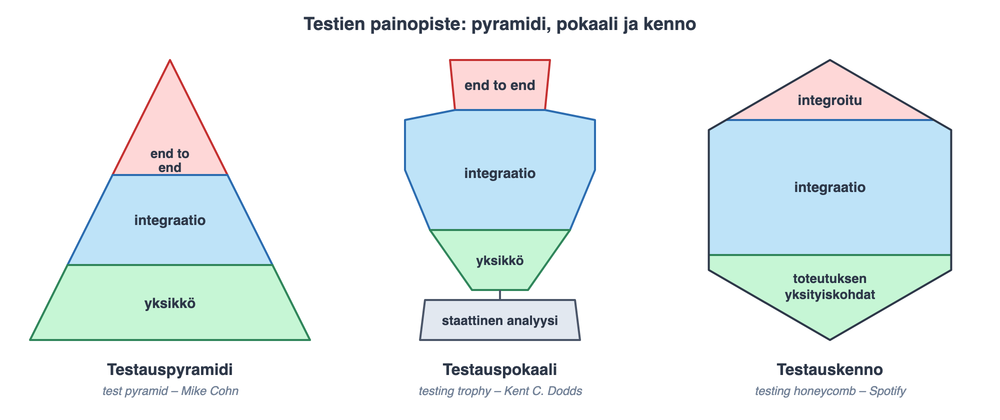{ width=400 }

- Pokaalissa (Kent C. Dodds) ja kennossa (Spotify) painopiste integraatiotesteissä
- Yhtä totuutta ei ole

# Testaus ja tekoäly

- Testien tekemisestä on tullut halpaa: kannattaa tehdä paljon ja kaikille tasoille
  - testit ovat koodausagentin turvaverkko regressioita vastaan
  - agentin kirjoittamien testien laatua on kuitenkin pidettävä silmällä
    - testit eivät testaa olennaista, tai testiä muutetaan koodin korjaamisen sijaan

. . .

- Kokonaan uudenlaisia testejä, esim. ajoittain suoritettava skripti, joka vertaa tietokannan tilaa käyttöliittymässä näkyvään

. . .

- Kaikkea tekoälyn koodia ei ehditä katselmoida rivi riviltä
  - varmuus toimivuudesta saavutettava muuten: automatisoitua testausta vahvistamalla

# Testaus ja tekoäly

- Tekoäly on hyvä katselmoija: pyydä usein ja kerro promptissa mihin keskittyä, esim. tietoturva

. . .

- Ihmiselle jää tutkivalla testaamisella tehtävät "terveen järjen" tarkastukset
