# Ohjelmistotuotanto

&nbsp;&nbsp;&nbsp;&nbsp;&nbsp;&nbsp;&nbsp;&nbsp;&nbsp;&nbsp;&nbsp;&nbsp;&nbsp;&nbsp;&nbsp;&nbsp;&nbsp;&nbsp;&nbsp;&nbsp;&nbsp;&nbsp;&nbsp;&nbsp;&nbsp;&nbsp;&nbsp;&nbsp;&nbsp;&nbsp;&nbsp;&nbsp;&nbsp;&nbsp;&nbsp;Syksy 2026

&nbsp;&nbsp;&nbsp;&nbsp;&nbsp;&nbsp;&nbsp;&nbsp;&nbsp;&nbsp;&nbsp;&nbsp;&nbsp;&nbsp;&nbsp;&nbsp;&nbsp;&nbsp;&nbsp;&nbsp;&nbsp;&nbsp;&nbsp;&nbsp;&nbsp;&nbsp;&nbsp;&nbsp;&nbsp;&nbsp;&nbsp;&nbsp;&nbsp;&nbsp;&nbsp;&nbsp;&nbsp;Luento 8

&nbsp;&nbsp;&nbsp;&nbsp;&nbsp;&nbsp;&nbsp;&nbsp;&nbsp;&nbsp;&nbsp;&nbsp;&nbsp;&nbsp;&nbsp;&nbsp;&nbsp;&nbsp;&nbsp;&nbsp;&nbsp;&nbsp;&nbsp;&nbsp;&nbsp;&nbsp;&nbsp;&nbsp;&nbsp;&nbsp;&nbsp;&nbsp;&nbsp;&nbsp;&nbsp;&nbsp;17.11.2026

# Muistakaa...

. . .

- Kurssipalaute
  - Kurssilla lopussa kerättävän palautteen lisäksi ns. jatkuva palaute https://norppa.helsinki.fi

. . .

- Paja BK107
  - ma 16-19
  - ti 13-16
  - to 16-19
  - pe 13-16

- Kurssin Discord: https://study.cs.helsinki.fi/discord/join/ohtu
  - kanavalle liitytään komennolla _/join course TKT20006 - Ohjelmistotuotanto - ohtu_

. . .

- Miniprojekti

# Ohjelmiston elinkaaren vaiheet

- Riippumatta tyylistä ja tavasta, jolla ohjelmisto tehdään, ohjelmistojen tekemiseen kuuluu
  - vaatimusten analysointi ja määrittely 
  - **suunnittelu**
  - **toteutus**
  - testaus/laadunhallinta
  - ohjelmiston ylläpito

. . .

- Jakautuu kahteen vaiheeseen:
  - arkkitehtuurisuunnittelu
  - olio/komponenttisuunnittelu

. . .

- Näiden lisäksi UI/UX-suunnittelu

# Arkkitehtuurityyli

. . .

- Ohjelmiston arkkitehtuuri perustuu yleensä yhteen tai useampaan **arkkitehtuurityyliin** (architectural style)
  - hyväksi havaittu tapa strukturoida tietyntyyppisiä sovelluksia

- Tyylejä suuri määrä
  - Kerrosarkkitehtuuri
  - Mikropalveluarkkitehtuuri
  - MVC
  - Pipes-and-filters
  - Palveluperustainen arkkitehtuuri
  - Client-server
  - Publish-subscribe
  - Event driven
  - REST
  - ...

# Kerrosarkkitehtuuri 

- _Kerros_ on kokoelma toisiinsa liittyviä olioita, jotka muodostavat toiminnallisuuden suhteen loogisen kokonaisuuden

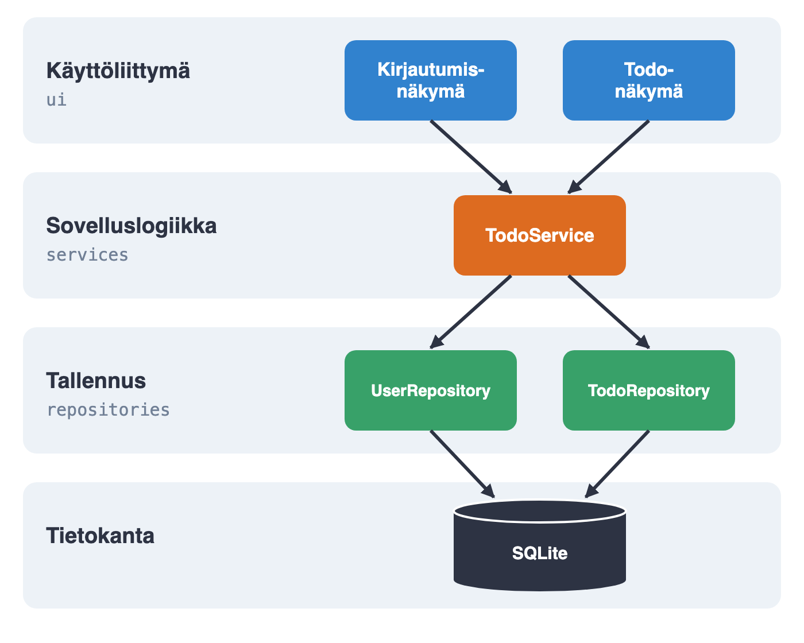{ width=250 }


# Mikropalveluarkkitehtuuri

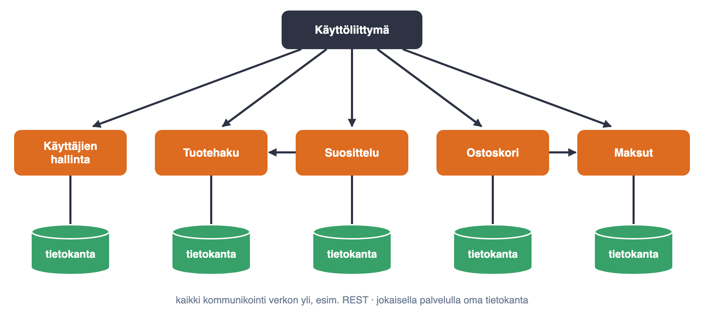{ width=400 }

- sovellus kootaan useista (jopa sadoista) pienistä verkossa toimivista autonomisista palveluista 


# Arkkitehtuurin kuvaamisesta

- Ei yhtä standardoitua notaatiota, useimmiten epäformaaleja laatikko/nuoli-kaavioita
  - UML:n komponentti- ja pakkauskaaviot olivat suosittuja 2000-luvulla, nykyään harvinaisia

. . .

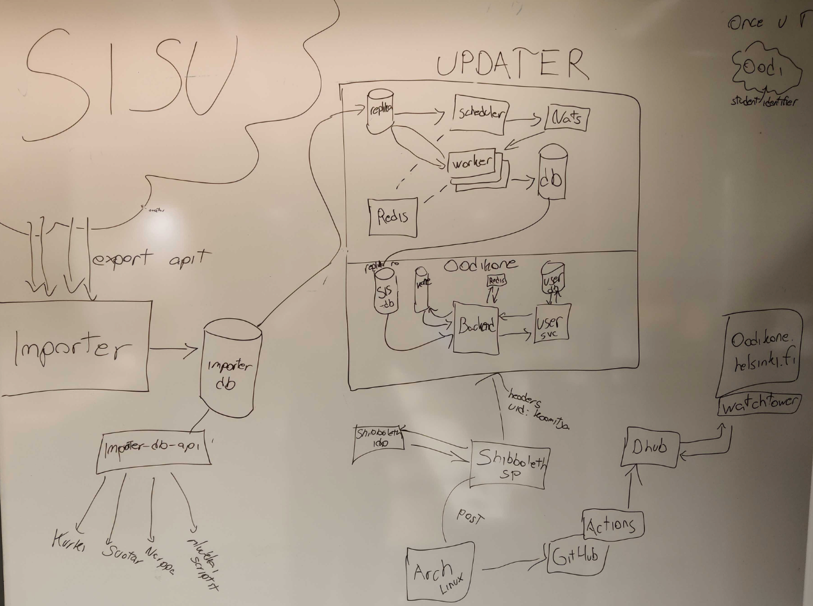{ width=240 }

. . .

- Kaavioita yhä useammin koodina (esim. Mermaid), versioidaan koodin rinnalla

# C4-malli

- Suosiota saavuttanut _C4-malli_: neljä tarkentuvaa tasoa
  - konteksti (system context), containerit (containers), komponentit (components), koodi (code)
  - jokaisella kaaviolla selkeä taso, jokainen laatikko ja nuoli nimetty

. . .

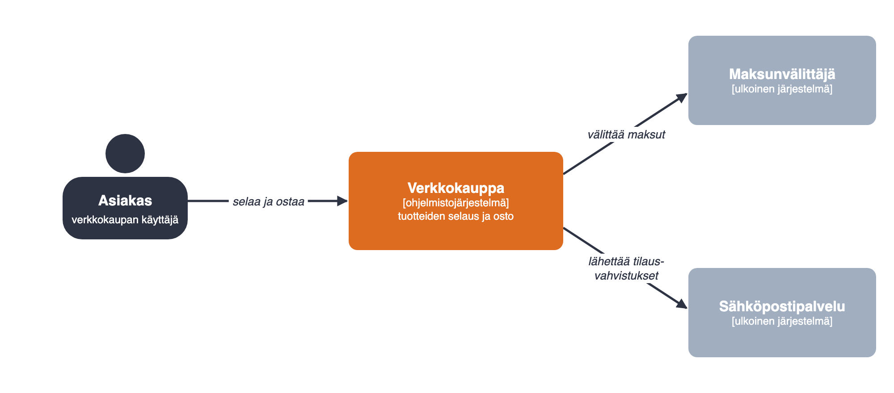{ width=300 }

- Konteksti (system context): järjestelmä, sen käyttäjät ja ulkoiset järjestelmät

# C4-malli: containerit

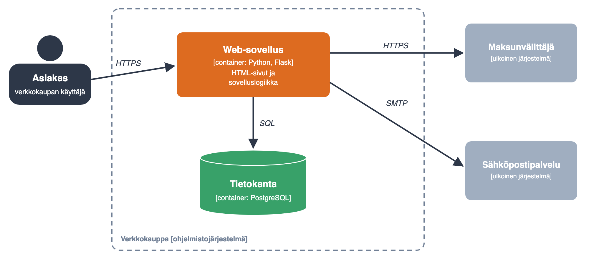{ width=400 }

- Containerit (containers): erikseen ajettavat osat, kuten sovellukset ja tietokannat, sekä niiden kommunikointi

# C4-malli: komponentit

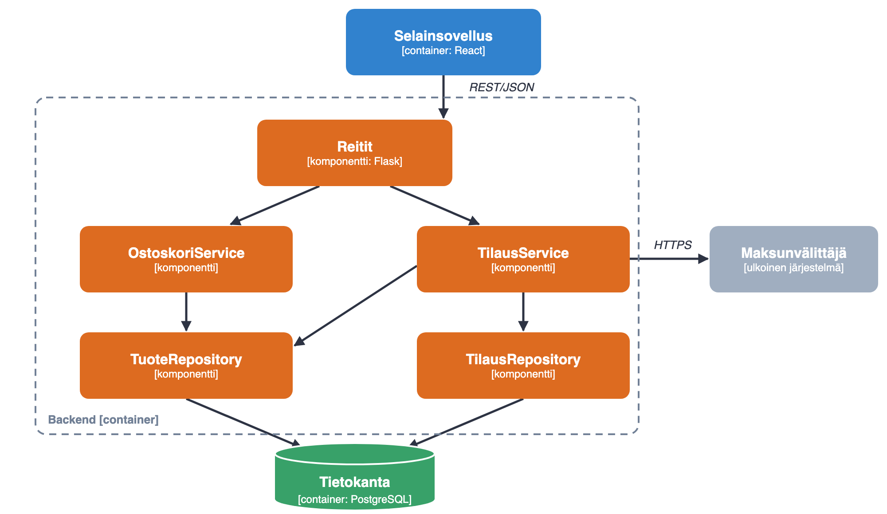{ width=330 }

- Komponentit (components): yhden containerin (web-sovellus) sisäinen rakenne

# Arkkitehtuuripäätösten kirjaaminen

- Ei pelkkiä kuvia: hyödyllinen arkkitehtuurikuvaus dokumentoi ja perustelee tehtyjä _arkkitehtuurisia valintoja_

. . .

- _Architecture Decision Record_ (ADR)
  - lyhyt Markdown-tiedosto jokaisesta merkittävästä päätöksestä, versionhallintaan koodin rinnalle
  - konteksti, päätös ja seuraukset
  - vanhaa ei muokata, muuttunut päätös kirjataan uutena ADR:nä

# ADR-esimerkki

```markdown
# ADR 3: Tietokannaksi PostgreSQL

Tila: hyväksytty 12.3.2026

## Konteksti
Tilaus- ja tuotedata on relaatioista ja
vaatii transaktioita. Tiimi osaa SQL:n.

## Päätös
Käytetään pilvipalvelun hallinnoimaa
PostgreSQL:ää.

## Seuraukset
+ tilauksille transaktiot ja eheys
+ ei omaa tietokantapalvelimen ylläpitoa
- skeemamuutokset vaativat migraatiot
- sidos pilvipalveluntarjoajaan
```

# Arkkitehtuuri ketterissä menetelmissä

. . .

- Ketterien menetelmien kantava teema on toimivan, asiakkaalle arvoa tuottavan ohjelmiston nopea toimittaminen

. . .

- Arkkitehtuurin suunnittelu ja dokumentointi on perinteisesti pitkäkestoinen, ohjelmoinnin aloittamista edeltävä vaihe

. . .

- Ketterät menetelmät ja "arkkitehtuurivetoinen" ohjelmistotuotanto siis jossain määrin ristiriidassa

. . . 

- Ketterien menetelmien yhteydessä puhutaan _inkrementaalisesta suunnittelusta ja arkkitehtuurista_

. . .

- Arkkitehtuuri mietitään riittävällä tasolla projektin alussa
  - Jotkut projektit alkavat ns. nollasprintillä ja alustava arkkitehtuuri määritellään tällöin

. . .

- "lopullinen" arkkitehtuuri muodostuu iteraatio iteraatiolta samalla kun uutta toiminnallisuutta toteutetaan 

# Inkrementaalinen arkkitehtuuri

- Tehdään alustava suunnitelma arkkitehtuurista

. . .

- Alussa ns. _walking skeleton_
  - sisältää tynkäversiot ohjelmiston komponenttirakenteesta

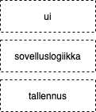{ width=120 }

. . .

- Rakennetaan skeletonin varaan tuotetta story storyltä

# Inkrementaalinen arkkitehtuuri

- Tehdään alustava suunnitelma arkkitehtuurista

- Alussa ns. _walking skeleton_
  - sisältää tynkäversiot ohjelmiston komponenttirakenteesta

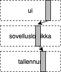{ width=120 }

- Rakennetaan skeletonin varaan tuotetta story storyltä

# Inkrementaalinen arkkitehtuuri

- Tehdään alustava suunnitelma arkkitehtuurista

- Alussa ns. _walking skeleton_
  - sisältää tynkäversiot ohjelmiston komponenttirakenteesta

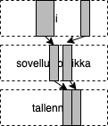{ width=120 }

- Rakennetaan skeletonin varaan tuotetta story storyltä

# Inkrementaalinen arkkitehtuuri

- Tehdään alustava suunnitelma arkkitehtuurista

- Alussa ns. _walking skeleton_
  - sisältää tynkäversiot ohjelmiston komponenttirakenteesta

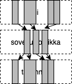{ width=120 }

- Rakennetaan skeletonin varaan tuotetta story storyltä

# Arkkitehtuuri ketterissä menetelmissä

- Perinteisesti arkkitehtuurin luonut *ohjelmistoarkkitehti*
  - ohjelmoijat velvoitettuja noudattamaan arkkitehtuuria

. . .

- Ketterä ideaali: kehitystiimi luo arkkitehtuurin yhdessä
  - _The best architectures, requirements, and designs emerge from self-organizing teams_

. . .

- Etuja:
  - kehittäjät sitoutuvat paremmin arkkitehtuurin noudattamiseen kuin "norsunluutornissa" olevan arkkitehdin määrittelemään
  - dokumentaatio voi olla kevyt, tiimi tuntee arkkitehtuurin hengen ja pystyy sitä noudattamaan

. . .

- Edellyttää, että jokainen uskaltaa ehdottaa omia ratkaisujaan ja kyseenalaistaa muiden ehdotuksia
  - muuten kokeneimman ehdotuksesta tulee arkkitehtuuri vain siksi, ettei kukaan esitä muuta

# Arkkitehdit ketterissä organisaatioissa

- Ideaali, ei kaikkialla käytäntö: monissa ketteristäkin organisaatioissa arkkitehteja
  - esim. SAFe:n arkkitehtiroolit, _staff/principal engineer_
  - ketterä arkkitehti tukee tiimejä ja sovittaa ratkaisuja yhteen, ei sanele ylhäältä

# Inkrementaalinen arkkitehtuuri: edut ja riskit

- Oletus: optimaalista arkkitehtuuria ei pystytä suunnittelemaan projektin alussa
  - Jo tehtyjä arkkitehtuuriratkaisuja muutetaan tarvittaessa

. . .

- Arkkitehtuurin suunnittelussa ketterä pyrkii _välttämään liian aikaisin tehtävää, ehkä turhaksi osoittautuvaa työtä_

. . .

- Inkrementaalinen arkkitehtuuri edellyttää koodilta hyvää sisäistä laatua ja kehittäjiltä kurinalaisuutta
  - muuten seurauksena _big ball of mud_
  - Martin Fowler: _in its common usage, incremental design is a disaster_

. . .

- Koodausagentit voimistavat riskiä: ilman ohjausta agentti tekee taktisia ratkaisuja, jotka rapauttavat arkkitehtuuria
  - periaatteet ohjetiedostoon ja ADR:iin, säännöt automaattisesti tarkastettaviksi CI:ssä

# Olio/komponenttisuunnittelu

. . .

- Sovelluksen arkkitehtuuri antaa raamit, jotka ohjaavat sovelluksen tarkempaa suunnittelua ja toteuttamista

. . .

- _Olio- tai komponenttisuunnittelu_
  - tarkentaa arkkitehtuuristen komponenttien väliset rajapinnat sekä hahmottelee ohjelman luokka- tai moduulirakenteen

. . .   

- Vesiputousmallissa komponenttisuunnittelu tehty ennen ohjelmointia ja dokumentoitu tarkkaan esim. UML:llä

. . .

- Ketterässä tarkka suunnittelu tehdään vasta ohjelmoitaessa

. . .

- Suunnittelussa pyritään maksimoimaan _koodin sisäinen laatu_ 
  - helppo ylläpidettävyys ja laajennettavuus 

. . .

- Ohjelmistosuunnittelu on "enemmän taidetta kuin tiedettä", kokemus ja hyvien käytänteiden tuntemus auttaa

# Laadukas koodi

- Tavoitteena siis **sisäiseltä laadultaan** hyvä koodi

. . .

- _Sisäinen laatu_ (internal quality)
  - onko virheiden jäljitys ja korjaaminen helppoa
  - onko koodia helppo laajentaa ja jatkokehittää
  - pystytäänkö koodin toiminnallisuuden oikeellisuus varmistamaan muutoksia tehtäessä

. . .

- Jos sisäinen laatu rapistuu
  - alkaa vaikuttaa myös ulkoiseen eli käyttäjän kokemaan laatuun
  - kehitystiimin velositeetti alkaa tippua

# Laadukkaan koodin tuntomerkkejä

. . .

- Laadukkaalla koodilla joukko yhteneviä ominaisuuksia, tai _laatuattribuutteja_, esim. seuraavat:
  - kapselointi
  - korkea koheesion aste
  - riippuvuuksien vähäisyys 
  - toisteettomuus
  - testattavuus
  - selkeys
  - yksinkertaisuus

. . .

- _Suunnittelumallit_ auttavat luomaan sisäisesti laadukasta koodia
  - kurssin aikana nähty jo _dependency injection_, _repository_
  - lisää kurssimateriaalissa ja laskareissa

# Suunnittelumallit

- _Suunnittelumalli_ (design pattern): nimetty ja dokumentoitu ratkaisu toistuvaan suunnitteluongelmaan
  - ei valmista koodia vaan ratkaisun idea, joka sovitetaan tilanteeseen
  - nimet antavat kehittäjille yhteisen sanaston

. . .

- Idea rakennusarkkitehtuurista: Christopher Alexander, _A Pattern Language_ (1977)
- Ohjelmointiin: Beck ja Cunningham 1987
- Läpimurto: _Design Patterns_ (1994), kirjoittajat _Gang of Four_
  - 23 olio-ohjelmoinnin mallia: luomiseen, rakenteeseen ja käyttäytymiseen liittyvät
  - esim. tehdas, rakentaja, dekoraattori, strategia, komento, template method

. . .

- Kritiikkiä: moni malli paikkaa 1990-luvun oliokielten rajoitteita
  - Pythonissa esim. strategia on usein pelkkä parametrina välitettävä funktio
  - mallien innokas käyttö johtaa helposti tarpeettoman monimutkaiseen koodiin

# Laadulla on merkitystä

- Periaatteet juontavat 1970-luvun tutkimukseen
  - Parnas 1972: _information hiding_
  - Stevens, Myers & Constantine 1974: koheesio ja kytkentä (coupling)

. . .

- Empiiristä näyttöä
  - Basili ym. 1996: luokat, joilla paljon riippuvuuksia, ovat virhealttiimpia
  - Tornhill & Borg 2022: 39 koodikantaa, heikkolaatuisessa koodissa 15 kertaa enemmän virheitä ja muutokset yli kaksi kertaa hitaampia

# TAUKO 10 min

# Koodin laatuattribuutti: kapselointi

- _Oliomuuttujat piilotetaan, tarvittaessa aksessorimetodit_

. . .

```python
class Ostoskori:
    def __init__(self):
        self._ostokset = []

    def lisaa(self, tuote):
        self._ostokset.append(tuote)

    def hinta(self):
        return sum(t.hinta for t in self._ostokset)
```

. . .

- Tallennustapa voidaan vaihtaa, esim. sanakirjaksi tuote → määrä, ilman että käyttävä koodi muuttuu

# Kapselointi laajemmin

- Kapseloidaan mikä tahansa asia, joka voi muuttua
  - olion sisäinen tila
  - käytettävän olion tyyppi
  - käytetty algoritmi
  - olioiden luomisen tapa
  - käytettävän komponentin rakenne

. . .

- Myös arkkitehtuurin tasolla
  - kerrosarkkitehtuuri: ylempi kerros käyttää vain alemman kerroksen rajapintaa
  - mikropalvelu kapseloi logiikkansa ja tietonsa, tarjoaa vain verkkorajapinnan

# Koodin laatuattribuutti: koheesio

. . .  

- _Koheesio_:
  - kuinka pitkälle metodin, luokan tai komponentin koodi keskittyy tietyn yksittäisen toiminnallisuuden toteuttamiseen
  - hyvänä pidetään mahdollisimman korkeaa koheesion astetta

. . .

- Luokkatason koheesio
  - luokan _vastuulla_ vain yksi asia, tunnetaan myös nimellä _single responsibility principle_

# Koheesio Flask-sovelluksessa

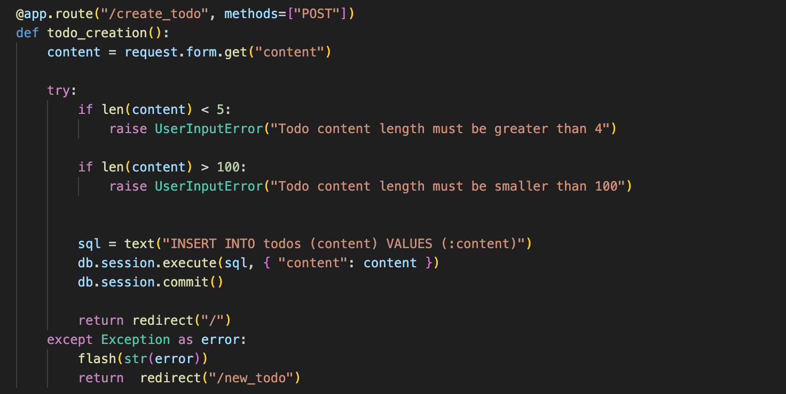{ width=400 }

. . .

- Huono koheesio: sama funktio käsittelee HTTP-pyynnön, validoi syötteen ja tekee tietokantaoperaatiot

# Koheesio Flask-sovelluksessa

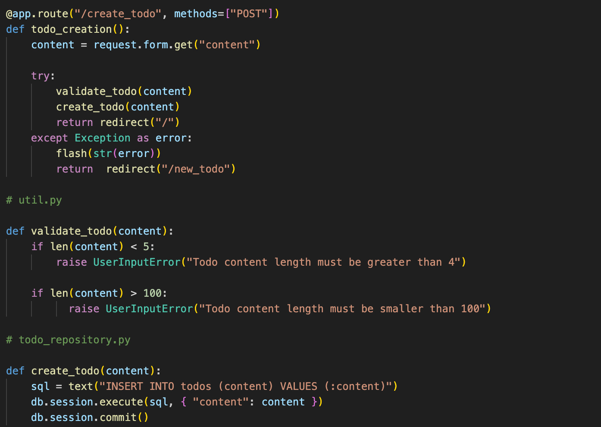{ width=400 }

. . . 

- *delegoidaan osa vastuista* eri komponenteille

# Miksi korkea koheesio?

- Muutos kohdistuu yhteen paikkaan
  - Robert Martin: luokalla vain _yksi syy muuttua_

. . .

- Helpompi ymmärtää: nimi kertoo, mitä luokka tai funktio tekee

. . .

- Helpompi testata: esim. validointia voi testata ilman HTTP-pyyntöä ja tietokantaa

. . .

- Uudelleenkäytettävyys: samaa validointia voi käyttää myös muualla, esim. REST-rajapinnassa

. . .

- Arkkitehtuurin tasolla
  - kerrosarkkitehtuuri: kukin kerros keskittyy oman abstraktiotasonsa asioihin
  - mikropalvelu toteuttaa yhden liiketoiminnallisen kokonaisuuden, esim. suosittelun

# Koodin laatuattribuutti: riippuvuuksien vähäisyys

. . .  

- Pyrkimys korkeaan koheesioon johtaa ohjelmiin, joissa suuri määrä olioita/komponentteja

. . .  

- Olioiden oltava keskenään vuorovaikutuksessa toteuttaakseen ohjelman toiminnallisuuden: _paljon keskinäisiä riippuvuuksia_

. . .  

- _Riippuvuuksien vähäisyyden_ periaate
  - eliminoidaan _tarpeettomat_ riippuvuudet
  - sekä riippuvuudet konkreettisiin asioihin

. . .
 
- Hyödynnetään _dependency injection_ -suunnittelumallia

. . .

- Basili ym. 1996: mitä enemmän luokalla riippuvuuksia, sitä todennäköisemmin siitä löytyy virheitä

# Koodin laatuattribuutti: riippuvuuksien vähäisyys

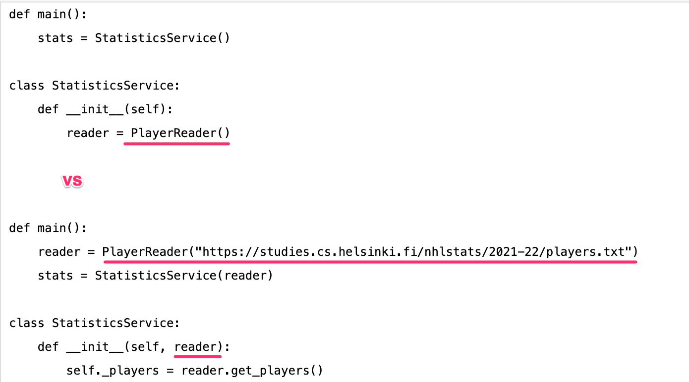{ width=400 }

# Koodin laatuattribuutti: toisteettomuus

. . .  

- Aloittelevaa ohjelmoijaa pelotellaan toisteisuuden vaaroista uran ensiaskelista alkaen: älä copypastaa koodia!

. . .

- Alan piireissä toisteisuudesta varoittava periaate kulkee nimellä DRY, don't repeat yourself
  - _every piece of knowledge must have a single, unambiguous, authoritative representation within a system_

. . .

- Koodin lisäksi periaate ulottuu koskemaan järjestelmän muitakin osia
  - tietokantaskeemaa, testejä, build-skriptejä

. . .

- Suoraviivainen copypaste helppo eliminoida metodien avulla
  - kaikki toisteisuus ei ole yhtä ilmeistä, monissa suunnittelumalleissa kyse hienovaraisempien toisteisuuden muotojen eliminoinnista

. . .

- Hyvä vs. paha copypaste
  - _three strikes and you refactor_

# Koodin laatuattribuutti: testattavuus

. . .  

- Laadukas koodi on helppo testata kattavasti yksikkö- ja integraatiotestein
  - seuraa yleensä siitä, että koodi koostuu löyhästi kytketyistä, selkeän vastuun omaavista komponenteista

. . .

- Hyvää testattavuutta auttaa turhien riippuvuuksien eliminointi dependency injection -periaatteen avulla

. . .

- Test driven development tuottaa yleensä hyvin testattavaa koodia

# Koodin laatuattribuutti: selkeys ja luettavuus

- Aikoinaan rajallisten resurssien takia koodi kirjoitettiin tiiviiksi ja tehokkaaksi luettavuuden kustannuksella

. . .

- Nykytrendi: tehdään koodia, joka nimeämisen sekä rakenteen kautta ilmaisee hyvin sen, mitä koodi tekee

. . .

- Miksi selkeä koodi on tärkeää?
  - Xia ym. 2018: 78 ammattilaista, yli 3000 työtuntia, noin 58 % ajasta kului koodin ymmärtämiseen
  - Robert Martin: lukemisen ja kirjoittamisen suhde jopa 10:1
  - oma aikoinaan niin selkeä koodi ei enää olekaan yhtä selkeää parin kuukauden kuluttua

# Koodin laatuattribuutti: yksinkertaisuus

- Suunnittelumallit lisäävät koodin joustavuutta, mutta joustavuudella on hintansa
  - luokkien määrä kasvaa, toiminnan hahmottaminen vaikeutuu

. . .

- KISS: _keep it simple, stupid_
- YAGNI: _you aren't gonna need it_ (Extreme Programming)
  - ei toiminnallisuutta tai joustavuutta sen varalta, että sitä ehkä joskus tarvitaan

. . .

- Suunnittelumalli käyttöön vasta todelliseen tarpeeseen
  - testattu ja siisti koodi on helppo refaktoroida joustavammaksi myöhemmin

. . .

- Ajankohtainen myös koodausagenttien kanssa: agentit tuottavat helposti tarpeettomia abstraktioita

# Code smell

- Koodi ei ole aina hyvää...

. . .

- Martin Fowlerin mukaan 
  - _koodihaju_ (code smell) on helposti huomattava merkki siitä että koodissa on jotain pielessä
  - jopa aloitteleva ohjelmoija saattaa pystyä havaitsemaan koodihajun
  - sen takana oleva todellinen syy voi olla jossain syvemmällä 

. . .

- Koodihaju siis kertoo, että syystä tai toisesta _koodin sisäinen laatu_ ei ole parhaalla mahdollisella tasolla

. . .

- Khomh ym. 2012: hajuisia luokkia muutetaan useammin ja niissä on useammin virheitä

# Koodihajuja 

- Koodihajuja on hyvin monenlaisia ja monentasoisia
- Esimerkkejä helposti tunnistettavista hajuista:
  - toisteinen koodi
  - liian pitkät metodit
  - luokat joissa on liikaa oliomuuttujia
  - luokat joissa on liikaa koodia
  - metodien liian pitkät parametrilistat
  - epäselkeät muuttujien, metodien tai luokkien nimet
  - kommentit, jotka selittävät _mitä_ koodi tekee
    - _miksi_-kommentit ja docstringit ovat arvokkaita

. . .

- Pari monimutkaisempaa
  - Primitive obsession
  - Shotgun surgery

# Refaktorointi

. . .

- Lääke koodin sisäisen laadun ongelmiin on _refaktorointi_  
  - koodin toiminnallisuuden ennallaan pitävä sisäisen rakenteen muutos
  
. . .

- Koodin rakennetta parantavia refaktorointeja on lukuisia, mm.
  - _rename variable/method/class_
  - _extract method_ 
  - _move field/method_ 
  - _extract superclass_ 

. . .

- Osa pystytään tekemään sovelluskehitysympäristön avustamana
  - helpompaa staattisesti tyypitetyillä kielillä kuten Java

# Miten refaktorointi kannattaa tehdä

- Refaktoroinnin edellytys on kattavien testien olemassaolo

. . .

- Eteneminen pienin askelin
  - yksi hallittu muutos kerrallaan
  - testit suoritettava mahdollisimman usein 

. . .

- Refaktorointia kannattaa suorittaa lähes jatkuvasti
  - pitää koodin rakenteen selkeänä ja helpottaa sekä nopeuttaa koodin laajentamista

. . .

- Osa refaktoroinnista on helppoa ja suoraviivaista, aina ei näin
  - joskus tarve tehdä isoja, jopa viikkojen kestoisia refaktorointeja, joissa ohjelman rakenne muuttuu paljon

# Refaktorointi tärkeä osa Test driven development -menetelmää

{ width=340 }

1. Kirjoitetaan sen verran testiä että testi ei mene läpi
2. Kirjoitetaan koodia sen verran, että testi menee läpi
3. **Jos huomataan koodin rakenteen menneen huonoksi refaktoroidaan koodin rakenne paremmaksi**
4. Jatketaan askeleesta 1

# Refaktorointi ja koodausagentit

- Agentti optimoi toimivuutta, ei ylläpidettävyyttä: lisää uutta, harvoin siistii vanhaa
  - GitClear 2025: copypasten osuus muutetuista riveistä 8,3 % → 12,3 %, refaktorointiin liittyvän siirretyn koodin osuus 25 % → alle 10 %

. . .

- Refaktorointi on pyydettävä erikseen
  - red-green-refactor myös agentin kanssa: ensin toimivaksi, sitten siistiksi
  - periaatteet ohjetiedostoon (AGENTS.md): _hyödynnä olemassa olevaa koodia, älä kopioi_

. . .

- Toisaalta refaktoroinnista on tullut halpaa: agentti tekee sen nopeasti, kunhan testit ovat kunnossa

# Tekninen velka

. . .

- Koodi ei ole aina laadultaan optimaalista

. . .

- Huonoa suunnittelua tai/ja ohjelmointia kuvaa käsite _tekninen velka_ (technical debt)
  - termin otti käyttöön Ward Cunningham 1992

. . .

- Oikoteitä ottamalla saadaan ehkä nopeasti aikaan jotain
  - hätäinen ratkaisu tullaan maksamaan korkoineen takaisin _jos_ ohjelmaa on tarkoitus laajentaa

. . .

- Jos korkojen maksun aikaa ei koskaan tule, voi "huono koodi" olla asiakkaan etu
  - esim. minimum viable product (MVP) 

. . .

- Tekninen velka voi olla järkevää tai jopa välttämätöntä
  - voidaan saada tuote nopeammin markkinoille tekemällä tietoisesti huonoa designia, joka korjataan myöhemmin

#

- Kaikki tekninen velka ei samanlaista, taustalla voi olla 
  - holtittomuus, osaamattomuus, tietämättömyys tai tarkoituksella tehty päätös

. . .

- Martin Fowler jaottelee teknisen velan neljään eri luokkaan:
  - Holtiton ja tietoinen: "meillä ei ole aikaa suunnittelulle"
  - Holtiton ja tahaton: "mikä on kerrosarkkitehtuuri?"
  - Harkittu ja tahaton: "nyt tiedämme, miten se olisi pitänyt tehdä"
  - **Harkittu ja tietoinen: "julkaistaan nyt, seurauksista huolehditaan myöhemmin"**

. . .

- Joskus tekninen velka pakottaa koodaamaan koko järjestelmän uudelleen

. . .

- Velasta on puhuttava: käsitellään tiimin yhteisenä asiana, ei etsitä aiheuttajaa

# Vibe-koodaus ja velka

- Vibe-koodaus: agentin koodi hyväksytään sitä lukematta, kunhan ohjelma näyttää toimivan

. . .

- Seurauksena kahdenlaista velkaa
  - tekninen velka: copypastea, turhia abstraktioita, refaktoroimatonta koodia
  - kognitiivinen velka: tiimi ylläpitää koodia, jota kukaan ei ymmärrä

. . .

- Velka ei ole väistämätöntä
  - Borg ym. 2025, kontrolloitu koe: tekoälyn avulla tehtyä koodia ei ollut vaikeampi jatkokehittää
  - ratkaisevaa on agentin ohjaaminen ja tuotoksen katselmointi

# Onko laatuattribuuteilla edelleen merkitystä?

- Kyllä, ainakin toistaiseksi

. . .

- Laatu auttaa agenttia, joka näkee kerrallaan vain osan koodista
  - koheesio ja löyhä kytkentä pitävät muutoksen paikallisena
  - selkeät nimet auttavat löytämään muutoskohdan

. . .

- Borg ym. 2026: kielimallit rikkoivat laadukasta koodia refaktoroidessaan 15–30 % harvemmin
  - ero hävisi järeimmillä malleilla

. . .

- Laatu auttaa myös ihmistä: agentin tuotosta ei pysty katselmoimaan, jos koodi ei ole ymmärrettävää

#

# Kurssipalautejärjestelmä Norppa

- Kerrosarkkitehtuuri
- Mikropalvelu
- Event driven

#

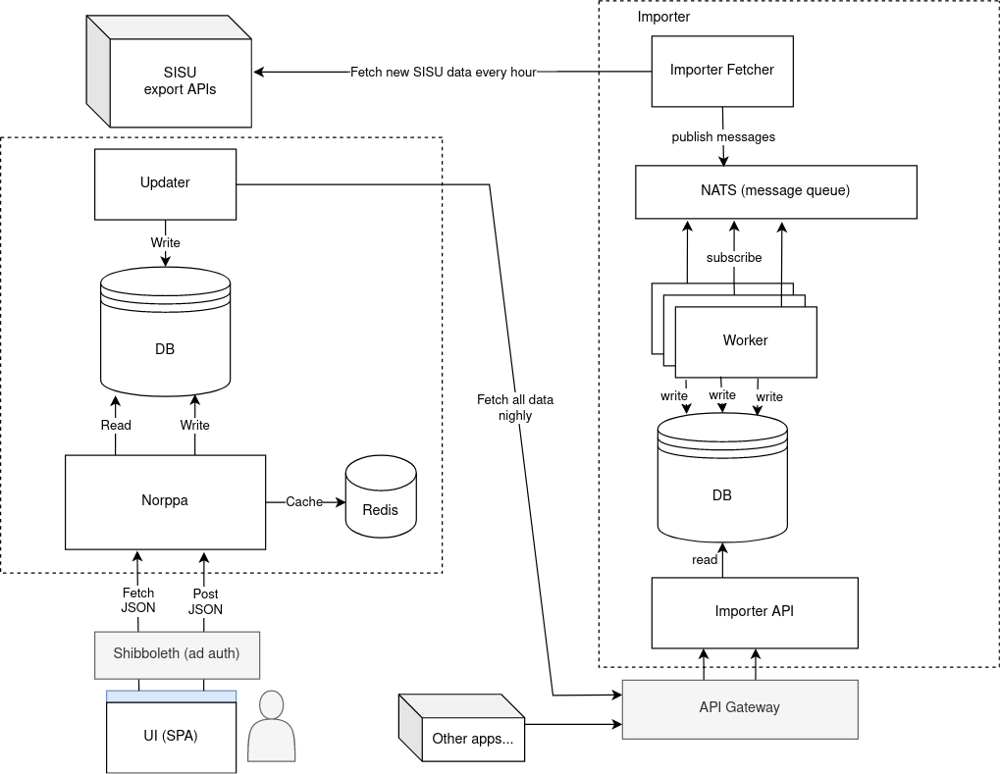{ width=400 }

# kerrosarkkitehtuuri

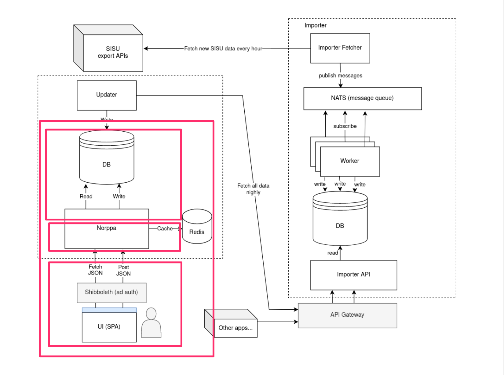{ width=400 }

# mikropalvelut

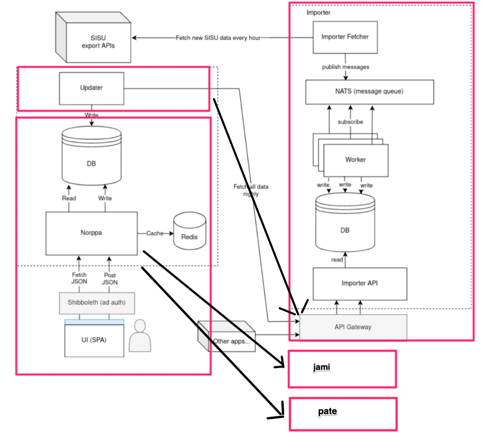{ width=350 }

# event driven / messaging

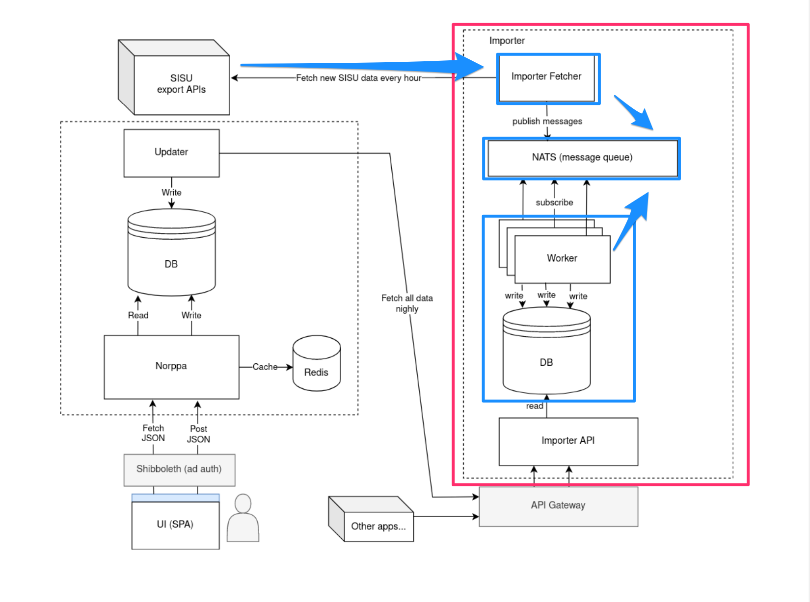{ width=400 }
