# Ohjelmistotuotanto

&nbsp;&nbsp;&nbsp;&nbsp;&nbsp;&nbsp;&nbsp;&nbsp;&nbsp;&nbsp;&nbsp;&nbsp;&nbsp;&nbsp;&nbsp;&nbsp;&nbsp;&nbsp;&nbsp;&nbsp;&nbsp;&nbsp;&nbsp;&nbsp;&nbsp;&nbsp;&nbsp;&nbsp;&nbsp;&nbsp;&nbsp;&nbsp;&nbsp;&nbsp;&nbsp;Syksy 2026

&nbsp;&nbsp;&nbsp;&nbsp;&nbsp;&nbsp;&nbsp;&nbsp;&nbsp;&nbsp;&nbsp;&nbsp;&nbsp;&nbsp;&nbsp;&nbsp;&nbsp;&nbsp;&nbsp;&nbsp;&nbsp;&nbsp;&nbsp;&nbsp;&nbsp;&nbsp;&nbsp;&nbsp;&nbsp;&nbsp;&nbsp;&nbsp;&nbsp;&nbsp;&nbsp;&nbsp;&nbsp;Luento 9

&nbsp;&nbsp;&nbsp;&nbsp;&nbsp;&nbsp;&nbsp;&nbsp;&nbsp;&nbsp;&nbsp;&nbsp;&nbsp;&nbsp;&nbsp;&nbsp;&nbsp;&nbsp;&nbsp;&nbsp;&nbsp;&nbsp;&nbsp;&nbsp;&nbsp;&nbsp;&nbsp;&nbsp;&nbsp;&nbsp;&nbsp;&nbsp;&nbsp;&nbsp;&nbsp;&nbsp;23.11.2026

# Muistakaa...

. . .

- Kurssipalaute
  - Kurssilla lopussa kerättävän palautteen lisäksi ns. jatkuva palaute https://norppa.helsinki.fi

. . .

- Paja BK107
  - ma 16-19
  - ti 13-16
  - to 16-19
  - pe 13-16

- Kurssin Discord: https://study.cs.helsinki.fi/discord/join/ohtu
  - kanavalle liitytään komennolla _/join course TKT20006 - Ohjelmistotuotanto - ohtu_

# Kurssin viimeiset viikot

- Miniprojektit jatkuvat
  - tällä ja ensi viikolla asiakastapaaminen

. . .

- Loppudemot (jokainen ryhmä osallistuu toiseen demoista)
  - ti 8.12. klo 14–16 B123
  - ke 9.12. klo 10–12 B123

. . .

- Vierailuluennot (läsnäolosta 0.33 kurssipistettä per kerta)
  - ti 24.11. Lauri Suomalainen, Teamit
  - ti 1.12. Ville Nordberg, Trail openers ja Irene Nikkarinen, Kesko
  - ma 7.12. Olli Warro, Bought ja Matti Paksula, Donut Lab
  - ti 8.12. Kasper Hirvikoski sekä Aleksandr Tereshchenko ja Risto Mikkola, Unity
  - pe 11.12. klo 11-12 CK112 Tuomas Huhtala, Unity

. . .

- Kurssikoe tiistaina 15.12. klo 13-16 A111 ja B123 (kynällä ja paperilla)
  - ILMOITTAUDU viimeistään la 5.12. klo 23.59!

# Koodin sisäinen laatu

- _Sisäinen laatu_ (internal quality)
  - onko virheiden jäljitys ja korjaaminen helppoa
  - onko koodia helppo laajentaa ja jatkokehittää
  - pystytäänkö koodin toiminnallisuuden oikeellisuus varmistamaan muutoksia tehtäessä

. . .

- Laadukkaalla koodilla joukko yhteneviä ominaisuuksia, tai _laatuattribuutteja_, esim. seuraavat:
  - kapselointi
  - korkea koheesion aste
  - riippuvuuksien vähäisyys 
  - toisteettomuus
  - testattavuus
  - selkeys
  - yksinkertaisuus

# Onko laatuattribuuteilla merkitystä AI-aikana?

- Kyllä, ainakin toistaiseksi

. . .

- Laatu auttaa AI-agenttia, joka näkee kerrallaan vain osan koodista
  - koheesio ja löyhä kytkentä pitävät muutoksen paikallisena
  - selkeät nimet auttavat löytämään muutoskohdan

. . .

- Borg ym. 2026: agentit rikkoivat laadukasta koodia refaktoroidessaan 15–30 % harvemmin
  - ero hävisi järeimmillä malleilla

. . .

- Laatu auttaa myös ihmistä: agentin tuotosta ei pysty katselmoimaan, jos koodi ei ole ymmärrettävää

# Moar buzzwords

2000-luvun alussa **Ketterä/Agile** 

. . .

==>

. . .

2010-luvulla **Lean**

# Lean: taustaa

. . .

- Syntynyt Toyotan tuotannon ja tuotekehityksen menetelmistä

. . .

- Japanissa 2. maailmansodan jälkeen jälleenrakennusbuumi, mutta pääomaa ja raaka-aineita niukalti

. . .

- Huomatiin että laadun parantaminen nostaa tuottavuutta
  - mitä vähemmän tuotteissa ja tuotantoprosesseissa ongelmia, sitä enemmän tuottavuus kasvoi

. . .

- Japanilaisiin yrityksiin tuli vahva _laatua korostava kulttuuri_

. . .

- Resurssien niukkuus johti _Just In Time (JIT)_ -tuotantomalliin 
  - aloitetaan tuotteen valmistus vasta kun ostaja tehnyt tilauksen
  - vastakohtana perinteinen massatuotanto: tehdään paljon tuotteita varastoon

# _Just In Time (JIT)_ -tuotantomalli

. . .

- Pyrkimys saada tuote tilauksen jälkeen mahdollisimman nopeasti kuluttajalle: 
  - _lyhyt läpimenoaika_ (lead time) tilauksesta toimitukseen

. . .

- Etuja massatuotantoon verrattuna
  - laatuongelmat paljastuvat nopeasti
  - asiakkaiden muuttuviin tarpeisiin oli helppo vastata 

. . .

- Massatuotannossa optimoinnin kohde on *resurssien käyttöaste*
  - jokaisen työntekijän ja koneen tulisi olla koko ajan 100% kuormitettu

. . .

- JIT:issä optimoinnin kohde tuotteen *läpimenoaika*
  - eliminoidaan kaikki **hukka** (waste), joka ei edesauta työn nopeampaa _virtausta_ tilauksesta asiakkaalle

# Toyota production system (TPS)

. . .

- Toyota alkoi kutsua toimintatapaansa Toyota Production Systemiksi 1965
  - länsimaissa TPS:ää alettiin tutkia 1980-luvulla

. . .

- John Krafcik (MIT) lanseerasi 1988 nimen _lean_ (eli virtaviivainen) tuotanto
  - leanin laajempaan tietoisuuteen toi kirja _The Machine That Changed the World_ (1990)

. . .

- Kirjallisuutta on paljon, vaikutusvaltaisimpia _Jeffrey Liker: The Toyota Way (2004)_

# Lean TPS:n mukaan...

# Lean thinking house

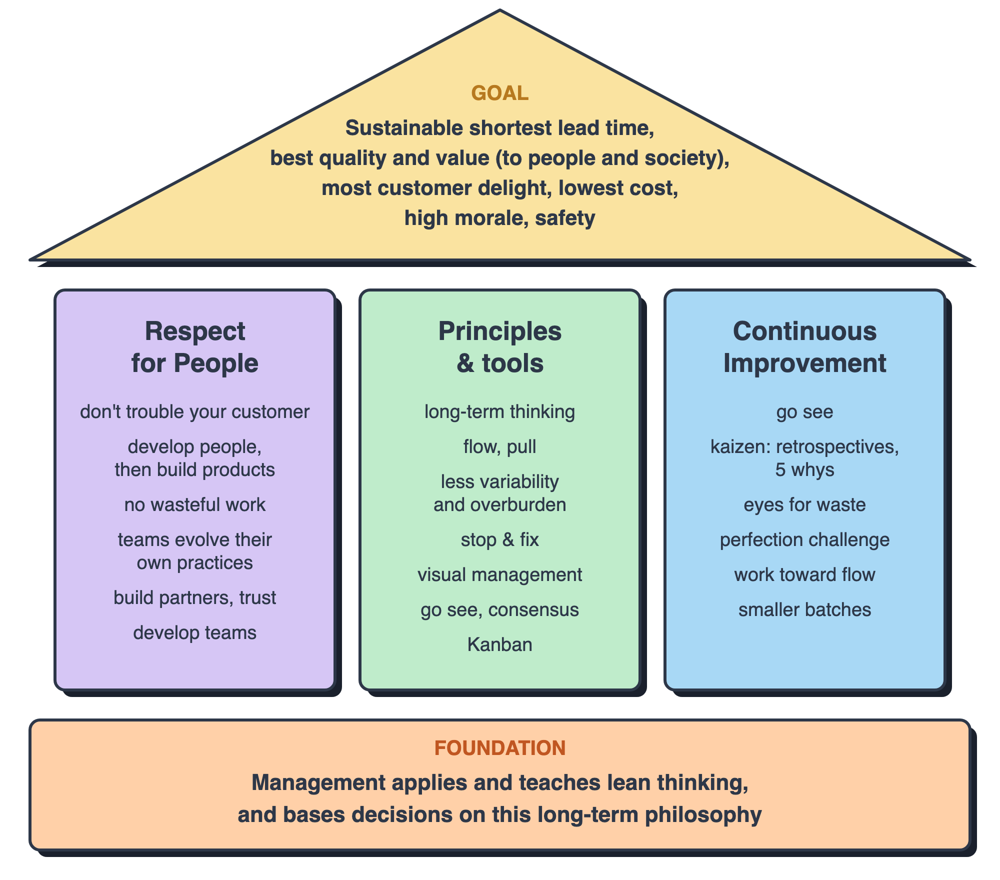{ height=85% }

# Lean thinking house: tavoite {.t}

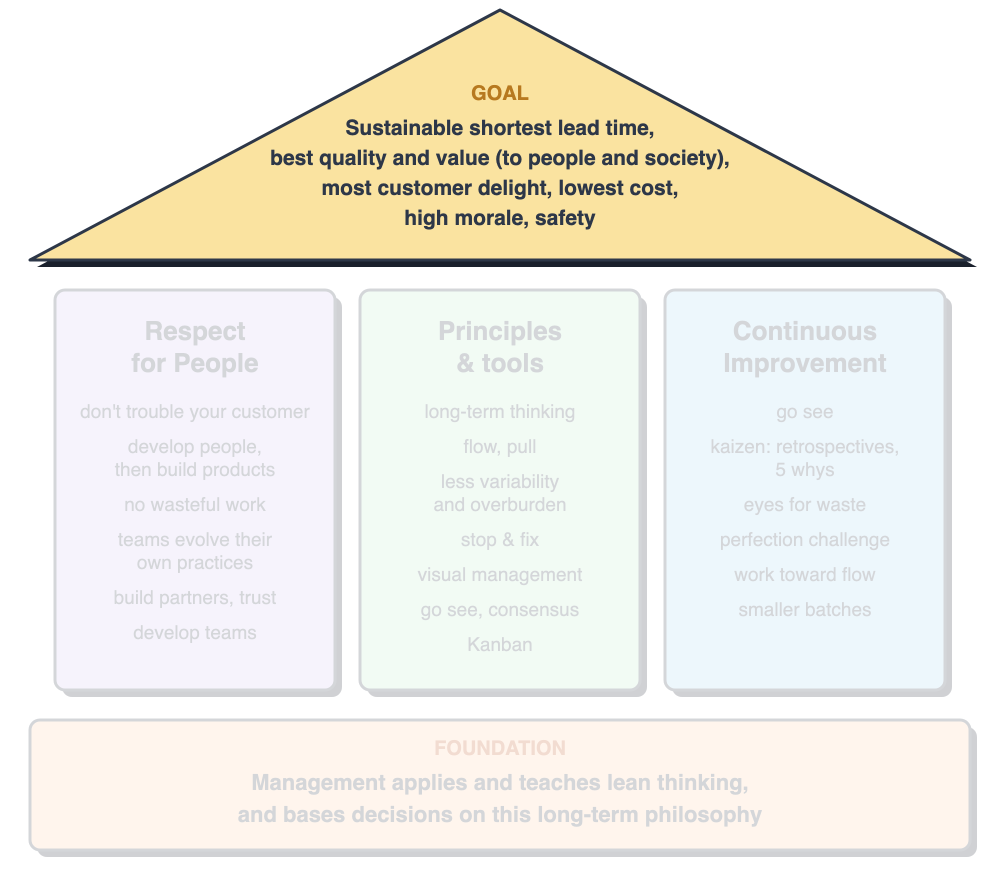{ height=55% }

- Tavoite (**goal**)
  - kestävä ja nopea tapa edetä "ideasta asiakkaalle myytyyn tuotteeseen" 
  - työntekijöitä ja yhteistyökumppaneita riistämättä
  - ylläpitäen korkea laatutaso ja asiakastyytyväisyys

# Lean thinking house: perusta {.t}

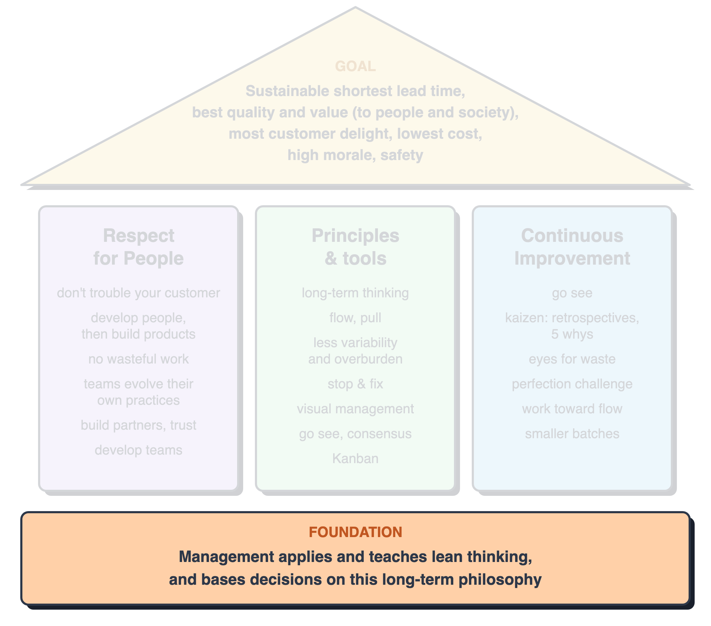{ height=55% }

- Perusta (**foundation**)
  - syvälle yrityksen kaikille tasoille juurtunut lean-toimintatapa
  - mitä johtajat soveltavat ja opettavat alaisille

# Lean thinking house: pilarit {.t}

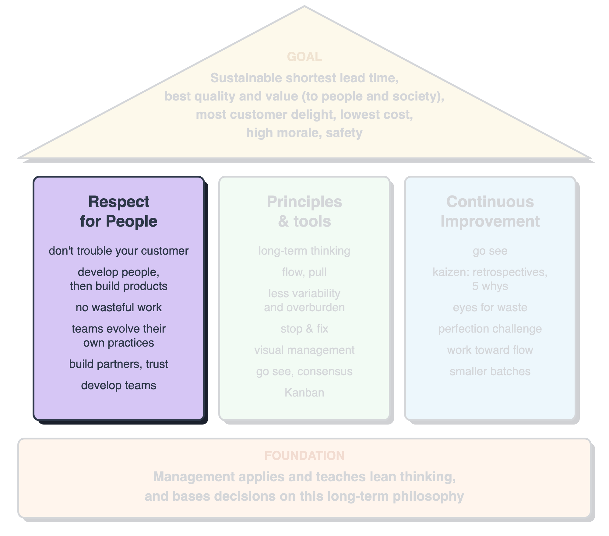{ height=55% }

- ihmisten kunnioittaminen (**respect for people**)

# Lean thinking house: pilarit {.t}

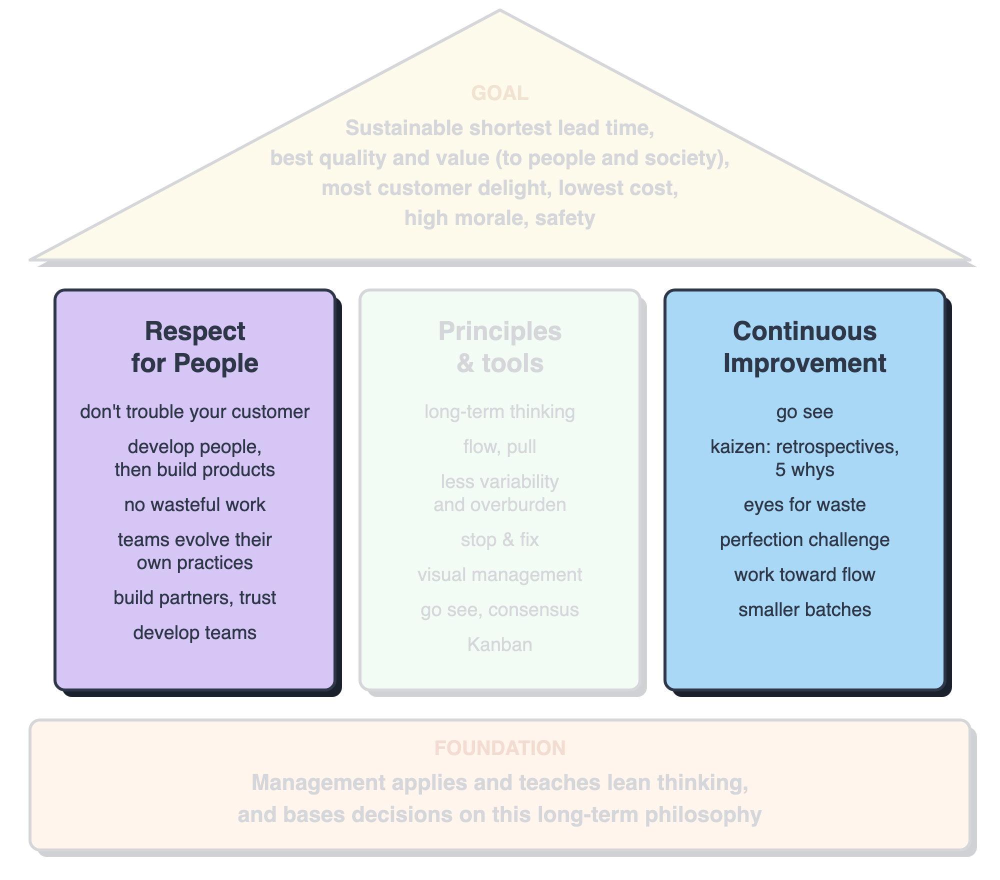{ height=55% }

- ihmisten kunnioittaminen (**respect for people**)

- jatkuva parantaminen (**continuous improvement**)

# Lean thinking house: periaatteet ja työkalut {.t}

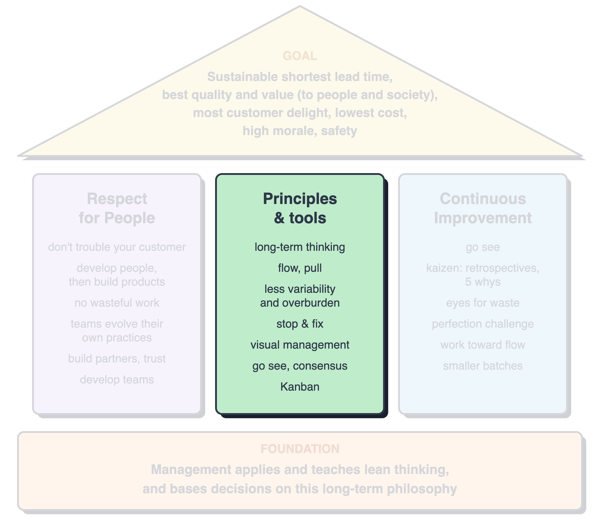{ height=55% }

- Pilareita tukee joukko periaatteita (_14 principles_)
- Lisäksi olemassa joukko leania tukevia työkaluja
  - näistä kuuluisin lienee _Kanban_

# Lean thinking house: pilarit {.t}

{ height=75% }

- Tarkastellaan tarkemmin jatkuvaa parantamista ja ihmisten kunnioittamista

# Jatkuva parantaminen (continuous improvement)

. . .

- Toyotan toimintatavan ydin on olla **tyytymätön vallitsevaan tilanteeseen**; on kysyttävä jatkuvasti 
  - _"Miksi teemme tätä?"_
  - Katsuaki Watanabe, Toyotan pääjohtaja 2005–2009

. . .

- Oleellista
  - **jatkuvan oppimisen** ilmapiiri ja
  - ympäristö joka ei pelkästään hyväksy vaan **rohkaisee muutokseen**

# Ihmisten kunnioittaminen (respect for people)

- Jatkuvan oppimisen ja parantamisen ilmapiiri on mahdollinen vain, jos toiminta perustuu _ihmisten kunnioittamiseen_. 
  - työntekijöitä kuunnellaan, mentoroidaan ja vastuutetaan 
  - työympäristö mielekäs ja turvallinen
  - työtehtävät mielekkäitä, annetaan mahdollisuus urakehitykselle

. . .

- Periaate kattaa myös alihankkijat ja loppuasiakkaat
  - alihankkijoiden kanssa rakennetaan aitoja partneruuksia, joista molemmat hyötyvät, ja niille opetetaan lean-ajattelua

. . .

- Ajatus on lähellä luennolta 2 tuttua _psykologista turvallisuutta_
  - ongelmista ja virheistä uskalletaan puhua

# Jatkuva parantaminen – arvo ja hukka

. . .

- TPS:n kehittäjä Taiichi Ohno kuvaa _jatkuvan parantamisen periaatetta_ seuraavasti:
  - Tarkastelemme **aikajanaa** siitä hetkestä, kun **asiakas tekee tilauksen, siihen kun saamme siitä rahat**
  - Lyhennämme aikajanaa **poistamalla hukkaa, joka ei tuota arvoa**

. . .

- _Arvo_ (value): asiat ja työvaiheet, joista asiakas on valmis maksamaan
- _Hukka_ (waste): kaikki tuotantoon liittyvä, mikä ei tuota asiakkaalle arvoa

. . .

- Hukkaa on kolmea tyyppiä: **muda**, **mura** ja **muri**, tutustutaan ensin mudaan

# Lean-hukka ohjelmistotuotannon näkökulmasta 

- **Over-production** ylituotanto: tehdään enemmän kuin asiakas on tilannut

. . .

- Ohjelmistotuotannossa:
  - ylimääräiset toiminnallisuudet: jopa 64 % käytetään harvoin tai ei koskaan

. . .

- **In-process inventory** välivarastointi: osittain tehty työ ja sen säilöminen

. . .

- Ohjelmistotuotannossa:
  - tarkka vaatimusmäärittely ominaisuuksille, joita ei vielä toteuteta
  - valmis koodi, jota ei ole vielä testattu tai otettu käyttöön
  - koodi, joka toteuttaa asiakkaan ehkä tulevaisuudessa haluamia toiminnallisuuksia
  - tekoälyaikana: koodausagenttien tuottamat PR:t, joita tiimi ei ehdi katselmoida

# Lean-hukka ohjelmistotuotannon näkökulmasta 

- **Extra processing** liikatyö
  - prosessin pakottamat turhat työvaiheet 
  - "pyörän keksiminen uudelleen"
  - liian hyvä laatu (?)

. . .

- **Transportation** tarpeeton materiaalin siirtely

. . .

- Ohjelmistotuotannossa ns. handoff, eli jos ohjelmisto
  - määritellään ja toteutetaan erillisten tiimien toimesta
  - toteutetaan ja viedään tuotantoon erillisten tiimien toimesta 
  - ...

# Lean-hukka ohjelmistotuotannon näkökulmasta 

- **Motion** työntekijöiden tarpeeton liikkuminen

. . .

- Ohjelmistotuotannossa _task switching_
  - työskentely yhtäaikaa monessa projektissa
  - liian monen storyn tekeminen yhtä aikaa

. . .

- **Waiting** turha odotus

. . .

- Ohjelmistotuotannossa
  - aika, joka joudutaan odottamaan että yrityksen johto hyväksyy vaatimusmäärittelyn
  - ... testaajat ehtivät testaamaan ohjelman uuden version
  - ... ylläpito vie sovelluksen uuden version tuotantoon
  - ... joku mergeää pull requestin

# Lean-hukka ohjelmistotuotannon näkökulmasta 

- **Defects** viat
  - Koodissa on väkisinkin vikoja jossain tuotannon vaiheessa 
  - Testaaminen ja vikojen havaitseminen vasta tuotannon loppuvaiheessa erittäin epäoptimaalista

# Mura- ja muri-tyyppinen hukka

- Seitsemän _muda_-tyyppisen hukan lisäksi olemassa kaksi muuta hukkatyyppiä: _mura_ ja _muri_

. . .

- **Mura**: epäsäännöllisyyttä tai epäyhdenmukaisuutta työtavoissa tai työstettävässä tuotteessa 
  - Esim. toteutettavien user storyjen suuresti vaihteleva koko  

. . .

- **Muri**:  ylikuormitus tai mahdottomat vaatimukset
  - koneiden käyttäminen 100% kapasiteetilla ilman säännöllistä huoltoa 
  - henkilöstön ylityöllistäminen
  
. . .

- Seurauksena saattaa olla _muda_-tyyppinen hukka, esimerkiksi välivarastoinnin tarve tai viat

# Jatkuva parantaminen: kaizen

. . .

- **Kaizen** eli jatkuva parantaminen: _optimoidaan toimintaa eliminoimalla asiakkaalle arvoa tuottamatonta hukkaa_

. . .

- Kaikkia työntekijöitä koskeva toimintafilosofia:
  - As a mindset, it suggests "My work is to do my work **and to improve my work**" 
  - "continuously improve for its own sake"

. . .

- Kaizen on myös konkreettinen tapa toimia
  - valitaan toimintatapa/prosessi ja tehdään siitä uusi **toiminnan standardi**
  - noudatetaan uutta toimintatapaa, kunnes se tunnetaan täysin
  - mietitään parannuksia, ja luodaan uusi toiminnan standardi
  - toistetaan ikuisesti...

. . . 

- Kaizenin sykliseen parannusprosessiin liittyvät usein tasaisin väliajoin pidettävät "kaizen eventit"

# TAUKO 10 min

# Lean-työkalu: value stream mapping

. . .

- Tekniikka/työkalu hukan kartoittamiseen
  - kuvaa tuotteen kulkua eri työvaiheiden läpi  
  - visualisoi arvoa tuottavat työvaiheet suhteessa elinkaareen
 
. . .

{ width=100% }

# Value stream management

- Kuvan esimerkissä
  - _läpimenoaika_ (cycle time) työn aloittamisesta tuotantoon noin 8,5 työpäivää
  - _lead time_ backlogiin lisäämisestä tuotantoon yli 5 viikkoa
  - _virtauksen tehokkuus_ (flow efficiency) eli arvoa tuottavan työn osuus noin 4 %

. . .

- Jos koodaus nopeutuisi esim. tekoälyn avulla puoleen, läpimenoaika lyhenisi vain noin 4 %
- Jos katselmointi ja testaus tehtäisiin heti, läpimenoaika putoaisi noin kahteen päivään
  - hitaus johtuu harvoin itse työstä, lähes aina odottamisesta

. . .

- Value stream mappingin ajatus laajennettu jatkuvaksi seurannaksi: _value stream management_
  - virtausta mitataan flow-mittareilla, arvot suoraan taskboardilta tai issue trackerista

# Lean-työkalu: perimmäisen syyn analyysi

- Jos tuotantoprosessissa on hukkaa, se tulee eliminoida 

. . .

- Kaizenissa tarkoitus tehdä _perimmäisen syyn analyysi_ (root cause analysis) ja korjata hukan taustalla olevat ongelmat

# Perimmäisen syyn analyysi {.t}

{ width=100% }

# Perimmäisen syyn analyysi: five whys {.t}

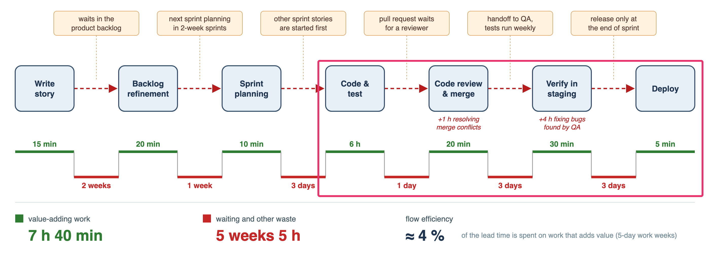{ width=100% }

- Koodin valmistumisesta menee 7 työpäivää sen tuotantoon saamiseen

. . .

- **Miksi?**

# Perimmäisen syyn analyysi: five whys

- Koodin valmistumisesta menee 7 työpäivää sen tuotantoon saamiseen. **Miksi?**

. . .

- QA-osaston on vielä varmistettava, että koodi toimii staging-ympäristössä. **Miksi?**

. . .

- Ohjelmoijilla ei ole aikaa testata koodia itse staging-ympäristössä. **Miksi?**

. . .

- Ohjelmoijilla on kiire sprintin tavoitteena olevien user storyjen tekemisessä. **Miksi?**

. . .

- Edellisten sprinttien aikana tehtyjen storyjen bugikorjaukset vievät  yllättävän paljon aikaa. **Miksi?**

. . .

- Laadunhallintaa ei ehditä koskaan tekemään kunnolla siinä sprintissä missä storyt toteutetaan. **Miksi?**

. . .

- Sprintteihin otetaan aina liian monta user storya. **Miksi?**

# Five whys: syy prosessista, ei ihmisistä

- Kysytään vielä yksi _miksi_: miksi sprintteihin otetaan liikaa storyja?
  - johtuuko se tiimistä vai ulkopuolisista paineista?

. . .

- Perimmäinen syy etsitään prosessista, ei yksittäisistä ihmisistä
  - jos vastaus on "joku teki virheen", kysytään: miksi prosessi salli sen?

. . .

- Sama ajatus ohjelmistoalalla: syyllistämätön jälkianalyysi (_blameless postmortem_)

# Leanin periaatteita

# Leanin periaatteita: pull-systeemi

. . .

- Leanissa on siis tarkoitus optimoida aikaa, mikä kestää tuotteen tilaamisesta sen asiakkaalle toimittamiseen
  - Arvo pyritään saamaan _virtaamaan_ (flow) asiakkaalle ilman turhia viiveitä ja työvaiheita

. . .

- Leanin mekanismi virtauksen optimointiin on _pull-systeemi_ 
  - tehdään tuotteita, tai tuotteiden tarvitsemia komponentteja ainoastaan tilauksen saapuessa
  - tapa toteuttaa JIT (just in time) -tuotanto  

. . .

- Vastakohta on _push-systeemi_, missä tuotteita ja komponentteja tehdään etukäteen varastoon
  - pizzeria: pull-systeemi
  - Unicafe: push-systeemi

. . .

- Pull-systeemi toteutetaan usein _kanbanin_ avulla
  - visuaalinen ohjaus, jonka avulla työntekijöiden on helppo tietää, miten seuraavaksi tulee toimia

# Kanban ohjelmistokehityksessä {.t}

- Story/task kulkee eri työvaiheiden kautta

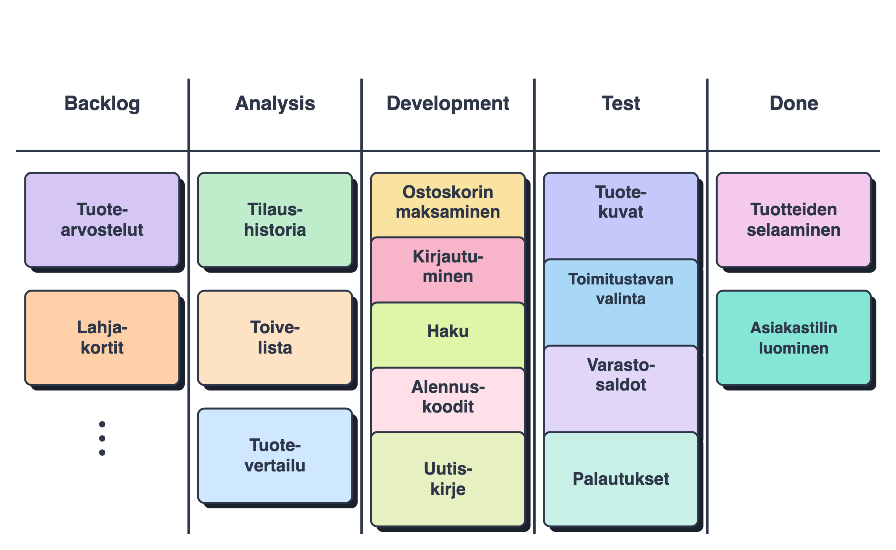{ width=260 }

# Kanban ohjelmistokehityksessä {.t}

- Story/task kulkee eri työvaiheiden kautta

{ width=260 }

- Työn läpivirtausta saadaan nopeutettua rajoittamalla tietyissä työvaiheissa kesken olevan työn määrää _WIP-rajoitteilla_

. . .

- Uutta työtä vedetään (pull) backlogilta vasta, kun siinä on tilaa

# Kanban: WIP-rajojen pienentäminen {.t}

- Pienennetään WIP-rajoja: vähemmän keskeneräistä työtä

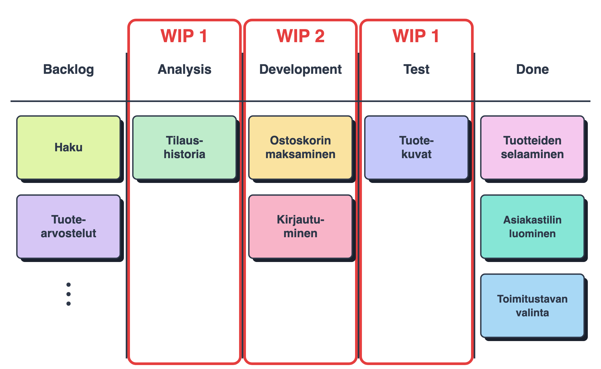{ width=260 }

. . .

- Kun kesken on vähemmän, yksittäinen story valmistuu nopeammin
- Aloitetun työn valmiiksi saaminen menee uuden aloittamisen edelle, periaatteena _stop starting, start finishing_

# Kanban: WIP-rajojen pienentäminen {.t}

- Äärimmillään yksi työ kerrallaan (_one piece flow_)

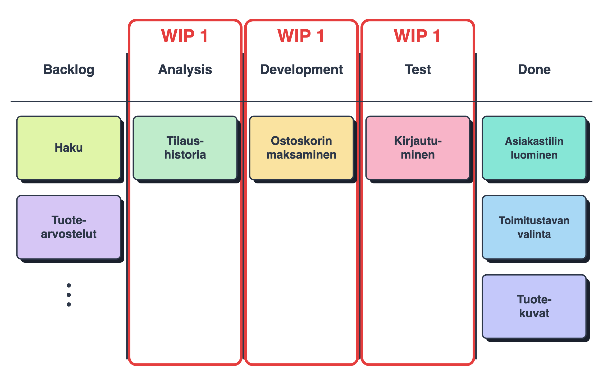{ width=260 }

. . .

- Liian tiukka raja voi jättää osan tiimistä odottamaan, mutta pullonkaulat näkyvät heti

# Leanin periaatteita: level the work

. . .

- Jotta arvo virtaisi tasaisesti, työvaiheiden kestoon ei saisi liittyä liikaa vaihtelua: _level the work_
  - pyrkimys suunnilleen tasakokoisiin user storyihin

. . .

- Miksi vaihtelu haittaa? Esimerkki: joka aamu valmistuu yksi story testattavaksi, testaaja testaa keskimäärin yhden storyn päivässä
  - jokaisen storyn testaus vie päivän: jonoa ei synny
  - koko vaihtelee (neljä storya ½ päivää, joka viides 3 päivää): keskiarvo yhä päivä, mutta jono syntyy

. . .

- Läpimenonopeus (throughput) sama, mutta story odottaa testiin keskimäärin päivän pidempään
  - asiakas saa ominaisuudet myöhemmin, palaute hidastuu, ennustettavuus heikkenee
  - lean ei optimoi läpimenonopeutta vaan _läpimenoaikaa_ (lead time) eli aikaa tilauksesta toimitukseen

# Level the work: miksi vaihtelu haittaa?

{ height=88% }

# Leanin periaatteita

- Yksi varianssin aiheuttaja ovat viat. Periaatteena:
  - Stop and fix
  - Build quality in

. . .

- _Stop and fix_: kuka tahansa velvollinen pysäyttämään tuotantolinjan vian havaitessaan
  - linjan pysäyttäjää kiitetään eikä syyllistetä, muuten ongelmista aletaan vaieta
  - vian perimmäinen syy tulee selvittää mahdollisimman nopeasti ja pyrkiä eliminoimaan vian mahdollisuus tulevaisuudessa 
  - laadun tulee olla sisäänrakennettua _build quality in_

. . .

- Jatkuva integraatio ja automaattinen testaus _stop and fix_ - ja _build quality in_ -periaatteiden ilmentymänä

# Leanin periaatteita

- _Decide as late as possible_: pull-systeemeissä tuotantopäätökset tehdään vasta tarvittaessa
  - _commit at the last responsible moment_: päätöksiä viivytetään, mutta ei liian kauan
  - myöhään tehdyn päätöksen tueksi on käytettävissä maksimaalinen määrä tietoa

. . .

- Kun päätös on tehty, toimitaan nopeasti: _deliver as fast as possible_
  - mitä nopeammin arvo virtaa, sitä pidempään päätöksiä voi viivyttää

# Arvon virtaaminen ketterässä ohjelmistotuotannossa

. . .

- Vaatimuksia hallitaan product backlogilla, joka on parhaassa tapauksessa DEEP
  - _detailed appropriately_, emergent, estimated, prioritized
  - tarkkoja vaatimuksia ei määritellä spekulatiivisesti vaan _at the last responsible moment_

. . .

- Kun product owner valitsee storyn seuraavaan sprinttiin: määritellään hyväksymiskriteerit ja suunnitellaan story
  - _deliver as fast as possible_ tehdään valmiiksi sprintin aikana

. . .

- *Scrum on pull-systeemi*:
  - jokaiseen sprinttiin otetaan asiakkaan edustajan viime hetkellä viimeistelemät tilaukset
  - arvo eli valmiit toiminnallisuudet virtaa asiakkaalle sprinttien määrittelemässä rytmissä

# Arvon virtaaminen ohjelmistotuotannossa *kiihtyy*

. . .

- Scrum vie uusia ominaisuuksia tuotantoon sprinteittäin ja rajoittaa kesken olevaa työtä ottamalla sprinttiin vain velositeetin verran storyja

. . .

- 2010-luvulta alkaen sykliä on tihennetty: _jatkuva toimittaminen_ (CD) voi viedä jopa jokaisen commitin tuotantoon
  - tällöin aikarajoitettu sprintti ei ole välttämättä mielekäs

. . .

- Paikoin siirrytty puhtaampaan pull-systeemiin: storyja toteutetaan yksi (tai muutama) kerrallaan
  - kun kapasiteettia vapautuu, product owner valitsee tärkeimmän storyn, joka määritellään, suunnitellaan ja toteutetaan heti alusta loppuun
  - esim. osassa 2 mainittu Scrumban

# Lean thinking house: perusta {.t}

{ height=68% }

- Tarkastellaan johtamista, jolla on keskeinen rooli leanin perustassa

# Johtaminen leanissa 

- Johtamiskulttuurissa keskiössä ovat lean-ajattelun opettajina, mentoreina ja työn valmentajina toimivat johtajat/managerit
  - _grow leaders_: johtajat kasvatetaan Toyotan arvoihin
  - _my manager can do my job better than me_: johtajat firman
sisällä eri työtehtävien kautta vastuuseen nousseita

. . .

- Tärkeä johtamisen periaate on _go see_ (genchi genbutsu)
  - asiat tulee "nähdä omin silmin" eikä pelkästään istua työpöydän ääressä raportteja lukemassa

. . .

- Johtajien oletetaan johtavan etulinjassa (gemba) eli siellä missä työ tosiasiallisesti tehdään

. . .

- Scrum masterin rooli on osin leanin ideaalien mukainen

# Lean-tuotekehityksen periaatteita

. . .

- Tuotekehityksessä leanin fokukseen nousee _oppimisen kiihdyttäminen_ (amplify learning)
  - _out-learn the competitors_: opitaan kilpailijoita nopeammin
  - keskitytään arvokkaaseen tietoon ja epävarmoihin asioihin

. . .

- Epävarmat ja teknisesti riskialttiit ideat toteutetaan nopeasti, sillä viivyttely maksaa:
  - _cost of delay_

. . .

- Toyotalla tuotekehitystä johtaa _chief engineer_ (shusa)
  - sekä tekninen että liiketoiminnallinen vastuu
  - etulinjassa toimiva johtaja, tuntee tarkasti käytännön työn, mutta on erittäin lähellä asiakasta

# Lean-tuotekehitys: set based concurrent development {.t}

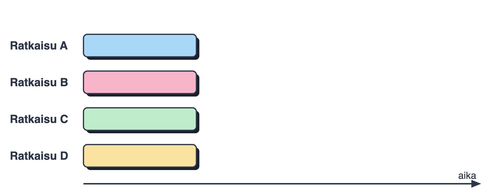{ width=85% }

- Oppimista nopeutetaan kehittämällä yhtä aikaa useita vaihtoehtoisia ratkaisuja eri tiimeissä
  - esim. uusi moottorin jäähdytysjärjestelmä

# Lean-tuotekehitys: set based concurrent development {.t}

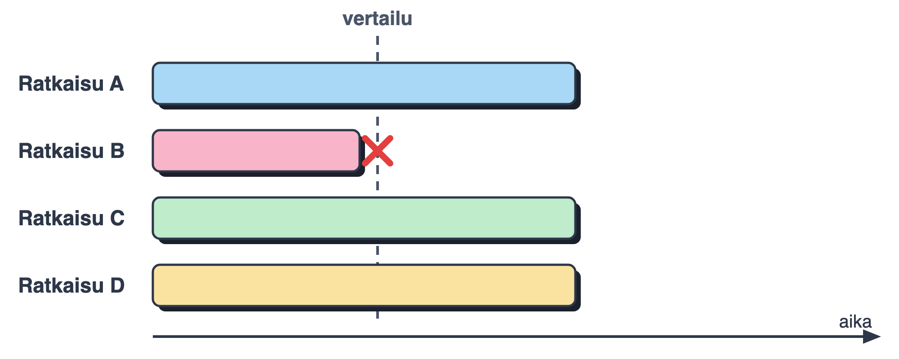{ width=85% }

- Oppimista nopeutetaan kehittämällä yhtä aikaa useita vaihtoehtoisia ratkaisuja eri tiimeissä
  - esim. uusi moottorin jäähdytysjärjestelmä
- Ratkaisuja vertaillaan tasaisin väliajoin, ja osa karsitaan

# Lean-tuotekehitys: set based concurrent development {.t}

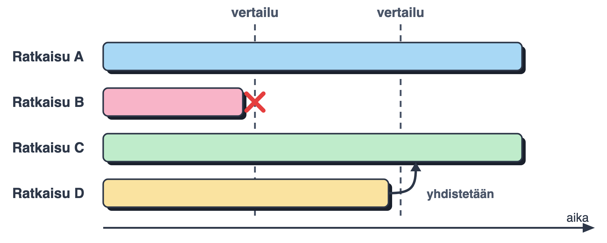{ width=85% }

- Oppimista nopeutetaan kehittämällä yhtä aikaa useita vaihtoehtoisia ratkaisuja eri tiimeissä
  - esim. uusi moottorin jäähdytysjärjestelmä
- Ratkaisuja vertaillaan tasaisin väliajoin, ja osa karsitaan
- Eri ratkaisujen hyviä puolia voidaan myös yhdistää

# Lean-tuotekehitys: set based concurrent development {.t}

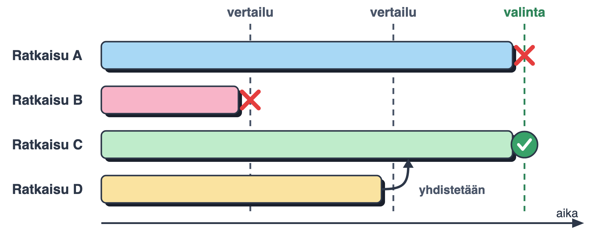{ width=85% }

- Oppimista nopeutetaan kehittämällä yhtä aikaa useita vaihtoehtoisia ratkaisuja eri tiimeissä
  - esim. uusi moottorin jäähdytysjärjestelmä
- Ratkaisuja vertaillaan tasaisin väliajoin, ja osa karsitaan
- Eri ratkaisujen hyviä puolia voidaan myös yhdistää
- Lopulta parhaaksi osoittautuva valitaan lopputuotteeseen

# Lean-tuotekehitys: set based concurrent development

- Poikkeaa radikaalisti iteratiivisesta kehityksestä
  - ohjelmistoissa perinteisesti harvinainen, koska vaihtoehtojen rakentaminen on ollut kallista
  - tekoälyagentti voi toteuttaa useita vaihtoehtoja rinnakkain, pullonkaulaksi tulee arviointi

# Leanin soveltaminen

. . . 

- 90-luvulta alkaen lean on herättänyt maailmalla suurta kiinnostusta ja sitä on sovellettu laajalti

. . .

- Scrumissa paljon vaikutteita leanista
  - ketterien menetelmien myöhempi kehitys on vienyt arvovirran optimoinnin (esim. storyjen läpimenoaikojen minimoinnin) Scrumia pidemmälle
  - nykyään puhutaan paljon _leanista ohjelmistokehityksestä_

. . . 

- Agilessa ja leanissa sama perusperiaate: _toimintojen jatkuva kehittäminen_
  - ketteryyden ytimenä oleva inspect-and-adapt-sykli on käytännössä sama idea kuin leanin kaizen
  - rajanveto leanin ja ketterän välillä ei olekaan ollenkaan selvä

# Leanin soveltamisen vaikeus

- Lean on Toyotan tarpeisiin kehitetty ja vuosikymmenten aikana jalostunut ajattelumalli
  - epäselvää, miten Toyotan käytänteet siirretään muille aloille

. . .

- Usein lean tulkitaan mekanistisesti työkalujen, esim. kanbanin ja value stream mappingin, kautta
  - periaatteet eli _jatkuva parantaminen ja ihmisten kunnioittaminen_ unohtuvat
  - parannukset jäävät hetkellisiksi, jos ne eivät vaikuta koko organisaation ajatteluun ja toimintatapoihin

. . .

- Lean ei ole työkalupakki vaan jatkuva toimintatapa
  - Larman & Vodde: _"In Toyota and in lean thinking, the idea is to repeat cycles of improvement experiments forever."_
